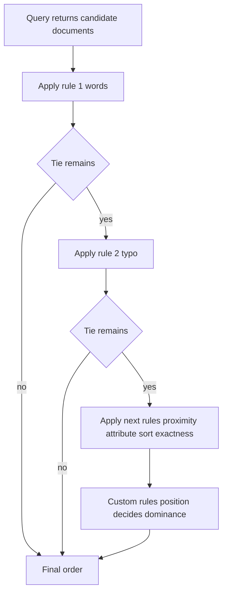

# Ranking Rules as a Lexicographic Sort: How Meilisearch Decides Order

## English

When a query returns results, Meilisearch does not compute a single blended relevance score like a classic TF-IDF or BM25 system. Instead it applies an ordered list of ranking rules, each of which is a comparison function, and sorts candidates lexicographically: the first rule decides wherever it can, ties fall through to the second rule, and so on. The default order is words, typo, proximity, attribute, sort, and exactness. Think of it like sorting a spreadsheet by column A, then column B only for rows where A is equal, then column C only where B is also equal.

'Words' counts how many of the query terms a document actually contains, preferring documents that match more of them. 'Typo' compares the number of typos needed to match, so a document matching the query exactly beats one that needed a corrected letter. 'Proximity' looks at how close the matched terms sit to each other in the document, rewarding phrases where the words are adjacent over ones scattered across paragraphs. 'Attribute' prefers matches in more important fields, using the order you declared in searchableAttributes. 'Sort' is the slot where your custom sort values apply. 'Exactness' rewards documents whose matched words appear exactly as typed.

This lexicographic structure is why adding a custom ranking rule is powerful but also slightly dangerous. If you insert a rule near the front, it dominates everything after it; putting a numeric popularity score first means a wildly popular but barely relevant document can outrank an exact title match. Most teams append custom rules after the built-in relevance rules, or place them just after typo, so relevance still gates the ordering. The rankingRules array is fully editable per index, and removing a default rule (say, proximity) genuinely changes behaviour rather than just nudging weights.

The rules operate on data computed during indexing, not at query time. Posting lists store, for each term, which documents contain it and in which positions and attributes; proximity and attribute ranking read those position lists directly. This is why changing rankingRules is an instant settings update with no reindex, while changing searchableAttributes or synonyms triggers a reindex task, because the underlying positional data must be rebuilt.

A useful mental model: relevance in Meilisearch is not a score you tune with weights, it is a sort key hierarchy you reorder. If results feel wrong, ask which rule is currently breaking the tie in the wrong direction. Debug by temporarily simplifying rankingRules to a single rule and observing how the order changes, then add rules back one at a time. That diagnostic loop is far more effective than guessing at hidden scoring weights, because there are none.

## 中文

當查詢返回結果時，Meilisearch 並不像經典的 TF-IDF 或 BM25 系統那樣計算單一的混合相關性分數。它改為套用一個有序的排名規則清單，每條規則都是一個比較函數，並以字典序方式排序候選文件：第一條規則能在何處分出高下就由它決定，平手則交給第二條規則，如此類推。預設次序是 words、typo、proximity、attribute、sort、exactness。可以想像成試算表先按 A 欄排序，只在 A 欄相等的列才按 B 欄排序，再只在 B 欄亦相等時按 C 欄排序。

「Words」計算文件實際包含多少個查詢詞，較多匹配者優先。「Typo」比較匹配所需的錯字數目，所以完全符合查詢的文件會勝過需要更正一個字母的文件。「Proximity」看匹配詞在文件中的距離，詞語相鄰的短語會勝過散落在不同段落的詞。「Attribute」偏好出現在較重要欄位的匹配，依據你在 searchableAttributes 中宣告的次序。「Sort」是你自訂排序值發揮作用的槽位。「Exactness」則獎勵匹配詞與輸入完全一致的文件。

這種字典序結構正是為何加入自訂排名規則既強大又稍具風險。若你把規則插在前方，它會支配之後的一切；把數值化的熱門度分數放在最前，就可能令一篇極受歡迎但相關性極低的文件壓過標題完全吻合的文件。大多數團隊會把自訂規則附加在內建相關性規則之後，或緊接在 typo 之後，令相關性仍然主導排序。rankingRules 陣列可以按索引完全編輯，而移除一條預設規則（例如 proximity）是真的改變行為，而不只是微調權重。

這些規則作用於索引時已計算好的資料，而非查詢時才計算。倒排列表會為每個詞記錄哪些文件包含它，以及在哪些位置與欄位出現；proximity 與 attribute 排名直接讀取這些位置列表。這正是為何更改 rankingRules 是即時的設定更新、毋須重建索引，而更改 searchableAttributes 或同義詞則會觸發重建索引任務，因為底層的位置資料必須重建。

一個實用的心智模型：Meilisearch 的相關性不是你用權重去調校的分數，而是一個你可以重新排序的排序鍵層級。若結果感覺不對，就問一問目前是哪條規則在錯誤的方向上打破平手。診斷方法是暫時把 rankingRules 簡化為單一規則，觀察次序如何改變，然後逐條加回。這個診斷循環遠比猜測隱藏的評分權重有效，因為根本沒有那些權重。

## Key Takeaway

Meilisearch ranks results by lexicographically applying an ordered list of rules rather than blending into one score, so reordering rankingRules is the real relevance lever.

## Related Concepts
- Lexicographic ordering
- Inverted index posting lists

## Diagram

