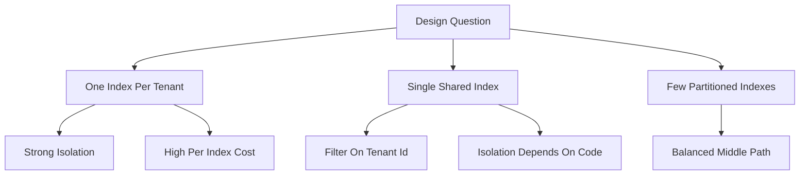

# Multi-Tenancy and Index Design: One Index, Many Indexes, or Filtered Views

## English

A common design question is how to serve many customers, projects, or categories from one Meilisearch instance. Meilisearch has no built-in row-level security: an API key either grants access to an index or it does not. So the choice of index layout is really a choice about isolation, and each layout trades off differently between safety, query performance, and operational cost.

The simplest layout is one index per tenant, for example an index named after each workspace or customer. Isolation is excellent: a scoped API key can be restricted to a specific index, so a leaked key cannot read another tenant's data. Deleting a tenant is a single index deletion. The cost is that every index carries its own settings, its own ranking rules, and its own indexing overhead; with thousands of tenants you get thousands of small indexes, and the per-index fixed costs (settings, task bookkeeping, memory-mapped file overhead) start to dominate. Cross-tenant global search also becomes awkward, since it would require fanning out to many indexes.

A single shared index with a tenant identifier field is the opposite extreme. All documents live together, and every query must include a filter such as tenant_id = 42. This is efficient for global search and for indexing throughput, and it keeps settings in one place. The danger is that isolation now depends entirely on application code always adding the filter. Meilisearch's tenant-token feature exists precisely to mitigate this: the server can generate a signed token that embeds a mandatory filter, so the client cannot widen its own scope. Even so, a bug that omits the filter leaks data, and the blast radius of a mistake is every tenant at once.

A middle path is a small number of indexes partitioned by a coarse dimension, such as region or product category, with tenant filtering inside each. This bounds the number of indexes while keeping some physical separation, and it lets you tune settings per partition (different searchable fields for different product lines, for instance). Many production deployments end up here because pure per-tenant and pure shared both have sharp edges at scale.

Beyond tenancy, the same reasoning applies to index granularity in general. Separate indexes when documents have genuinely different schemas, different ranking needs, or different access-control boundaries. Share an index when documents are homogeneous and differ only by attribute values you would filter on anyway. The test is: does a query ever need to span these groups together? If yes, sharing is natural; if never, separation buys isolation for free. Document this decision early, because migrating index layout later means reindexing and rewriting every query path.

## 中文

一個常見的設計問題是：如何用同一個 Meilisearch 例項服務眾多客戶、專案或分類。Meilisearch 並沒有內建列級安全機制：一支 API 金鑰要麼可以存取某個索引，要麼不可以。所以索引佈局的選擇，其實就是隔離方式的選擇，而每種佈局在安全性、查詢效能與營運成本之間的取捨都不同。

最簡單的佈局是每個租戶一個索引，例如以每個工作區或客戶命名一個索引。隔離效果極佳：受範圍限制的 API 金鑰可以只授權特定索引，所以即使金鑰外洩也讀不到其他租戶的資料。刪除一個租戶只需刪除一個索引。代價是每個索引都各自帶有設定、各自的排名規則與索引開銷；當租戶數以千計，你就會有數千個細小索引，而每個索引的固定成本（設定、任務記錄、記憶體對映檔案開銷）開始主導。跨租戶的全域搜尋亦變得笨拙，因為那需要向眾多索引分頭查詢。

單一共享索引加上租戶識別欄位則是另一個極端。所有檔案放在一起，每個查詢都必須包含例如 tenant_id = 42 的過濾條件。這對全域搜尋與索引吞吐量都有效率，而且設定集中在同一處。危險在於隔離如今完全依賴應用程式碼每次都加上過濾條件。Meilisearch 的 tenant token 功能正是為此而設：伺服器可以產生一個內嵌強制過濾條件的簽署權杖，令客戶端無法自行擴大範圍。即使如此，一個漏加過濾條件的錯誤就會洩漏資料，而錯誤的影響範圍會是一次過所有租戶。

中間路線是用少數幾個索引，按粗略維度（例如地區或產品類別）分割槽，再在每個索引內做租戶過濾。這限制了索引數目，同時保留若干實體分隔，亦讓你按分割槽調校設定（例如不同產品線用不同的可搜尋欄位）。許多生產部署最終都落在這裡，因為純粹的每租戶方案與純粹的共享方案在大規模時都有明顯的稜角。

除了多租戶之外，同樣的推理也適用於一般的索引粒度。當檔案有真正不同的結構、不同的排名需要，或不同的存取控制邊界時，就分開索引。當檔案同質、只是在你本來就會過濾的屬性值上不同時，就共用索引。測試問題是：查詢是否曾經需要同時橫跨這些群組？若是，共用是自然的；若從不需要，分隔就免費換來隔離。及早記錄這個決定，因為日後遷移索引佈局意味著要重建索引並改寫每一條查詢路徑。

## Key Takeaway

Index layout is an isolation decision: per-tenant indexes give hard security boundaries, shared indexes with tenant tokens give efficiency, and the right answer depends on whether queries ever need to span groups.

## Related Concepts
- Tenant tokens
- Multi-tenant data isolation

## Diagram

