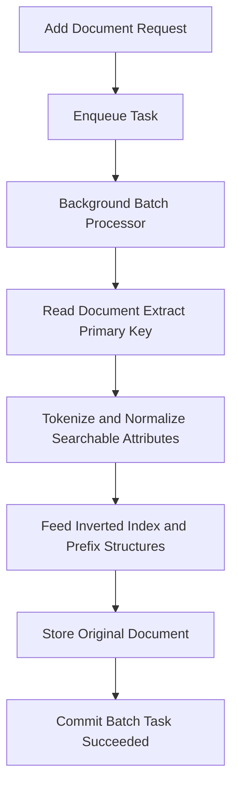

# What Happens When a Document Is Added: The Indexing Pipeline

## English

It helps to think of Meilisearch not as a database that happens to search, but as a factory that turns documents into searchable structures. When you add or update a document, the write does not directly touch the search structures. Instead, it is enqueued as a task. A background process picks up tasks in batches, and for each batch it runs a pipeline: it reads the document, extracts the primary key, and then walks every attribute marked as searchable. For each attribute it tokenizes the text, normalises it (lowercasing, and depending on the configured language, applying tokenization rules), and then feeds the resulting terms into the inverted index and any prefix structures. The original document is also stored so it can be returned in results. Only when the whole batch is processed and committed does the task report success. This is why a write is asynchronous: you get back a task identifier immediately, and you poll or wait until the task status becomes succeeded or failed.

The key insight is that indexing is a batch-oriented, CPU-and-I/O-heavy job that is deliberately decoupled from the HTTP request. If you add a thousand documents one at a time and wait for each, you pay the per-batch overhead a thousand times. If you add them in a single request, Meilisearch processes them together, which is dramatically faster. The same pipeline applies to updates: an update replaces the whole document, so re-indexing a document means re-tokenizing all of its searchable attributes, not just the changed field. That is a crucial performance consideration when you design your sync strategy.

Another subtlety: index settings themselves are also changes that go through the task queue. Changing searchable attributes, adding stop words, or configuring synonyms triggers a re-index of existing documents, because those settings change how text is tokenized and what ends up in the inverted index. So a settings change is not a cheap metadata tweak; it can be as expensive as re-adding all your documents. This is why you should finalise your searchable attributes and language settings before loading a large corpus, and why a settings change on a huge index can take a noticeable amount of time to become visible.

There is also a notion of index swapping, which is useful for zero-downtime reindexing. You can build a new index with a fresh schema, load all documents into it, and then atomically swap it with the old index. Because the swap is a single task, clients see either the old index or the new one, never a half-built state. This pattern is common when you need to change the primary key or dramatically restructure documents, since those operations cannot be done in place.

Finally, remember that indexing is not free of failure modes. A document whose primary key cannot be resolved — missing, null, or of the wrong type — fails the task with an `invalid_document_primary_key` error, and the task's error message tells you which document was the problem. A duplicate primary key is not an error at all: the later document simply replaces the earlier one. Malformed documents, unsupported field types, and invalid settings all surface as task errors rather than HTTP errors, because the HTTP layer only accepted the request. Reading task errors is therefore part of the normal operating loop, not an exceptional debugging step. Understanding this pipeline turns the task queue from a mysterious delay into a predictable, inspectable process.

## 中文

最好把 Meilisearch 想像成一座工廠，它把文件轉換成可搜尋的結構，而不是一個剛好附帶搜尋功能的資料庫。當你新增或更新一份文件時，這次寫入並不會直接改動搜尋結構，而是先被排入佇列成為一個任務（task）。背景程序會分批取出任務，對每一批執行一條管線：讀取文件、取出主鍵，然後逐一走訪每個標記為可搜尋（searchable）的屬性。對每個屬性，它會把文字切分成詞元（token）、做正規化（例如轉小寫，並依設定的語言套用切詞規則），再把產生的詞元送進倒排索引（inverted index）以及前綴結構。原始文件也會被保存下來，以便在結果中回傳。只有當整批處理完成並提交之後，任務才會回報成功。這就是為什麼寫入是非同步的：你會立刻拿到一個任務識別碼，然後輪詢或等待，直到任務狀態變成 succeeded 或 failed。

關鍵洞見是：索引是一項以批次為單位、耗費 CPU 與 I/O 的工作，而且刻意與 HTTP 請求解耦。如果你一次只加一份文件、每加一份就等一次，你就會把每批的固定開銷付上一千次。如果你在單一請求中一次加入，Meilisearch 就會一起處理，速度快得多。同樣的管線也適用於更新：更新會替換整份文件，所以重新索引一份文件意味著要重新切分它所有可搜尋屬性的詞元，而不只是改動的那個欄位。當你設計同步策略時，這是一個至關重要的效能考量。

另一個微妙之處：索引設定本身也是透過任務佇列處理的變更。更改可搜尋屬性、加入停用詞（stop words）或設定同義詞，都會觸發既有文件的重新索引，因為這些設定會改變文字如何被切分，以及倒排索引裡最終放進什麼。所以設定變更不是便宜的詮釋資料微調，它可能和重新加入你所有文件一樣昂貴。這就是為什麼你應該在載入大型語料庫之前，先把可搜尋屬性與語言設定定案；也解釋了為何在龐大索引上改設定，要等一段明顯的時間才會反映出來。

還有一個概念叫索引交換（index swap），對零停機的重新索引很有用。你可以用全新的結構建立一個新索引、把所有文件載入其中，然後把它與舊索引原子性地交換。因為交換是單一任務，用戶端看到的不是舊索引就是新索引，絕不會看到建到一半的狀態。當你需要更改主鍵或大幅重構文件時，這種模式很常見，因為那些操作無法就地完成。

最後，請記住索引並非沒有失敗模式。主鍵無法解析的文件——缺少、為 null，或者型別不正確——會令任務以 `invalid_document_primary_key` 錯誤失敗，而任務的錯誤訊息會告訴你是哪份文件出問題。主鍵重複本身並非錯誤：後來的文件只會取代先前那份。格式錯誤的文件、不支援的欄位型別、無效的設定，都會以任務錯誤而非 HTTP 錯誤的形式浮現，因為 HTTP 層只是接受了請求。因此，讀取任務錯誤是日常營運迴圈的一部分，而不是例外的除錯步驟。理解這條管線，就能把任務佇列從一個神祕的延遲，變成一個可預測、可檢視的過程。

## Key Takeaway

Writes are queued tasks that run through a batch indexing pipeline, so batching your documents and finalising settings early are the two biggest levers on indexing performance.

## Related Concepts
- Inverted index
- Asynchronous task queue

## Diagram

