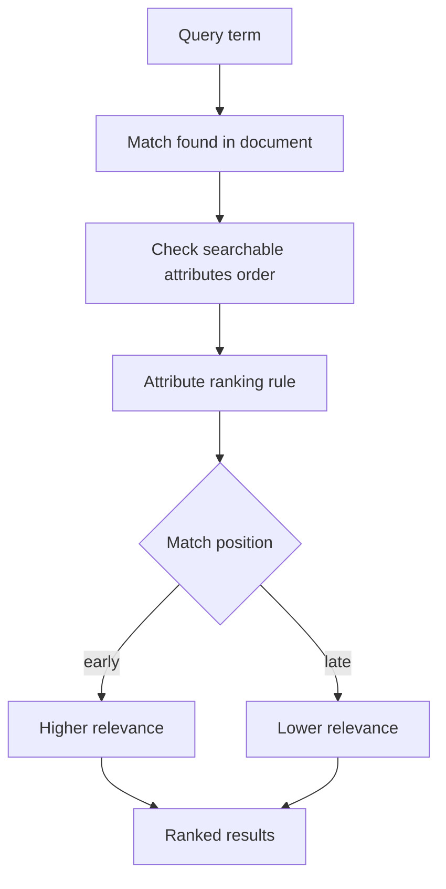

# Searchable Attributes Order Is a Relevance Signal

## English

Most people treat the list of searchable attributes as a simple allowlist: these fields are searchable, those are not. But in Meilisearch the order of that list matters. The position of an attribute in the searchable attributes array is used as a relevance signal during ranking. If a query term matches a document's title (listed first) and another document's body text (listed last), the title match is considered more relevant, all else being equal. This is a built-in, zero-configuration way to express 'title matches matter more than body matches' without writing custom scoring code.

This is different from the ranking rules, which are the explicit, ordered list of criteria such as words, typo, proximity, attribute, and exactness. The attribute ranking rule is the one that consumes the searchable attribute order. Think of it this way: the ranking rules decide which criteria to compare and in what priority, and the attribute rule compares where in the searchable attribute list the match occurred. So the searchable attributes order is effectively the input to one of the ranking rules, not a separate system. If you reorder your searchable attributes, you change relevance ordering for queries where matches land in different fields.

A concrete example: an e-commerce catalogue with attributes ordered as name, brand, description. A search for 'wireless' would rank a product whose name contains 'wireless' above one where only the description mentions it, even if the description document has more occurrences. That is usually exactly what you want, because the product name is the most reliable signal of what the item is. But if you put description first, you would get the opposite behaviour, and you might wonder why results look wrong. The fix is not to add custom ranking rules but simply to reorder the searchable attributes.

There is a performance dimension too. Every attribute in the searchable list is tokenized and indexed. Adding a large field like a full article body to the searchable list increases index size and indexing time, and it also makes matches in that field count for relevance. If you only need to display a field but not search it, leave it out of the searchable list. Conversely, if a field is important for matching but you do not want it to dominate ranking, place it lower in the list. This gives you a fine-grained relevance dial without any custom code.

One caveat: the attribute rule only breaks ties when earlier ranking rules (words, typo, proximity) are equal. If one document matches more query words, or has fewer typos, those rules decide first. So attribute order is a tie-breaker, not an override. Understanding that hierarchy prevents the common mistake of expecting attribute order to fix a relevance problem that is actually caused by typo tolerance or word matching. Diagnose which ranking rule is actually separating your results before you start reordering attributes.

## 中文

大多數人把可搜尋屬性的清單當成單純的白名單：這些欄位可搜尋、那些不行。但在 Meilisearch 裡，這份清單的順序是有作用的。屬性的位置在可搜尋屬性陣列中，會作為排名時的一個相關性訊號。如果某個查詢詞命中一份文件的標題（排在第一位），而另一份文件只在內文（排在最後）命中，那麼在其他條件相同時，標題命中會被視為更相關。這是一種內建、零設定的方式，讓你表達「標題命中比內文命中更重要」，而不必寫自訂的評分程式碼。

這與排名規則（ranking rules）不同。排名規則是明確、有順序的準則清單，例如 words、typo、proximity、attribute、exactness。其中 attribute 這條規則正是消費可搜尋屬性順序的那一條。可以這樣想：排名規則決定要比較哪些準則、以及優先順序；而 attribute 規則比較的是命中發生在可搜尋屬性清單中的哪個位置。所以可搜尋屬性的順序，實際上是某條排名規則的輸入，而不是另一套獨立系統。如果你重新排列可搜尋屬性，對於命中落在不同欄位的查詢，相關性排序就會改變。

舉個具體例子：一個電子商務目錄，屬性順序為 name、brand、description。搜尋「wireless」時，名稱含有 wireless 的產品，會排在只有描述提到 wireless 的產品之上，即使後者的描述出現次數更多。這通常正是你要的，因為產品名稱是判斷商品是什麼最可靠的訊號。但如果你把 description 放在第一位，行為就會相反，而你可能會納悶為什麼結果看起來不對。解法不是加自訂排名規則，而只是重新排列可搜尋屬性。

這裡也有效能面向。可搜尋清單中的每個屬性都會被切詞並建立索引。把一個很大的欄位（例如整篇文章的內文）加進可搜尋清單，會增加索引大小與索引時間，也會讓該欄位的命中計入相關性。如果你只需要顯示某個欄位而不需要搜尋它，就不要放進可搜尋清單。反過來說，如果某個欄位對命中很重要、但你不想讓它主導排名，就把它放在清單較後的位置。這給了你一個細緻的相關性旋鈕，而且不需要任何自訂程式碼。

一個提醒：attribute 規則只在較早的排名規則（words、typo、proximity）打平時才發揮作用。如果某份文件命中更多查詢詞，或錯字更少，那些規則會先決定。所以屬性順序是打破平手的依據，而不是覆寫。理解這個階層，可以避免一個常見錯誤：期望用屬性順序去修一個其實是錯字容忍或詞語比對造成的相關性問題。在你開始重排屬性之前，先診斷究竟是哪條排名規則在區分你的結果。

## Key Takeaway

The order of your searchable attributes feeds the attribute ranking rule, so it is a built-in relevance dial, but it only acts as a tie-breaker after words, typo, and proximity.

## Related Concepts
- Ranking rules
- Relevance tuning

## Diagram

