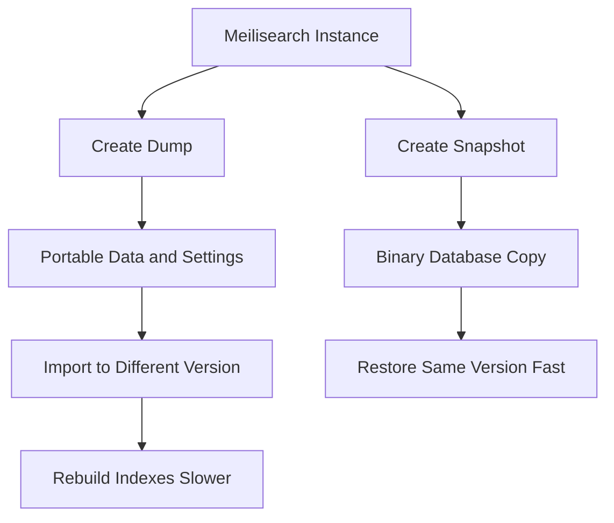

# The Dump and Snapshot Distinction for Backup and Migration

## English

Meilisearch offers two different ways to capture the state of an instance, and they solve different problems. A dump is a portable, version-independent export of your data and settings: documents, index settings, and the task history needed to reconstruct the instance. A snapshot is a binary, point-in-time copy of the database files on disk. The names sound similar, but the difference matters a lot when you plan backups, migrations, or upgrades.

A dump is designed to be loaded into a different Meilisearch version. You create a dump, then on the target instance you import it, and Meilisearch rebuilds the indexes from the documents and settings. Because it re-indexes from scratch, the dump format is more resilient to internal storage changes between versions. This makes dumps the right tool for migrations and for long-term archival backups where you want to be able to restore into a future version. The trade-off is that importing a dump is slower than restoring a snapshot, because the entire indexing pipeline runs again. For a large corpus this can take a while, so plan the migration window accordingly.

A snapshot, by contrast, is a fast, low-level copy of the LMDB database files. Restoring it is quick because there is no re-indexing; the files are simply put back in place. This makes snapshots ideal for frequent operational backups, for example before a risky settings change or an upgrade within the same major version. The catch is that a snapshot is tied to the storage format of the version that produced it. Restoring a snapshot into an incompatible version may not work, so snapshots are best treated as same-version recovery artifacts, not as portable migration packages.

A practical rule of thumb: use snapshots for routine, frequent backups and quick rollback within a version, and use dumps for migrations between versions and for backups you intend to keep long-term or move between environments. Many teams do both: nightly snapshots for fast recovery, and periodic dumps for portability and archival. The cost of a snapshot is low, so there is little reason not to take one before any significant operation.

There is also a security and operational angle. A dump is created through the API as a task and downloaded via the dump endpoints. A snapshot, by contrast, is an experimental, CLI-triggered operation (`snapshot`), not a task — you copy the resulting files off the host yourself. Either way the files contain your full dataset, so you should ensure they are stored somewhere durable and access-controlled. Note also that neither mechanism is available on Meilisearch Cloud. Understanding that these are two distinct mechanisms, not two names for the same thing, prevents the unpleasant surprise of discovering your backup cannot be restored into the version you actually need.

## 中文

Meilisearch 提供兩種不同的方式來擷取執行個體的狀態，而它們解決的是不同問題。dump 是一種可攜、與版本無關的匯出：包含文件、索引設定，以及重建執行個體所需的任務歷史。snapshot 則是磁碟上資料庫檔案的二進位、時間點副本。兩者名稱聽起來相似，但當你規劃備份、遷移或升級時，這個差異非常重要。

dump 的設計目的是可以載入到不同版本的 Meilisearch。你建立一個 dump，然後在目標執行個體上匯入它，Meilisearch 會從文件與設定重建索引。因為它是從頭重新索引，dump 格式對於版本之間內部儲存結構的變化更有韌性。這使 dump 成為遷移，以及需要能還原到未來版本的長期封存備份的正確工具。代價是匯入 dump 比還原 snapshot 慢，因為整條索引管線要再跑一次。對大型語料庫而言，這可能耗費不少時間，所以要相應規劃遷移的時間窗口。

相對地，snapshot 是 LMDB 資料庫檔案快速、低階的副本。還原它很快，因為不需要重新索引，檔案只是被放回原位。這使 snapshot 非常適合頻繁的營運備份，例如在進行有風險的設定變更之前，或在同一主要版本內升級之前。問題在於，snapshot 與產生它的那個版本的儲存格式綁定。把 snapshot 還原到不相容的版本可能行不通，所以 snapshot 最好視為同版本的復原產物，而不是可攜的遷移封裝。

一個實用的經驗法則：用 snapshot 做例行、頻繁的備份，以及同一版本內的快速回滾；用 dump 做跨版本遷移，以及你打算長期保存或在環境之間搬移的備份。許多團隊兩者都做：每晚 snapshot 以求快速復原，定期 dump 以求可攜與封存。snapshot 的成本很低，所以在任何重大操作之前，幾乎沒有理由不先做一個。

這裡還有安全與營運的面向。dump 是透過 API 以任務形式建立，再經由 dump 端點下載；snapshot 則相反，是一個仍屬實驗性質、由 CLI 觸發的操作（`snapshot`），並不是任務——你要自己把產生的檔案從主機複製走。兩者無論哪一種，檔案都包含你的完整資料集，所以你應該確保它們被存放在持久且受存取控制的地方。另外也要留意，Meilisearch Cloud 並不提供這兩種機制。理解這是兩套不同的機制、而不是同一件事的兩個名字，可以避免一個不愉快的意外：發現你的備份無法還原到你真正需要的那個版本。

## Key Takeaway

Use snapshots for fast same-version backups and dumps for portable, cross-version migrations, because only dumps re-index from scratch and survive version changes.

## Related Concepts
- LMDB storage
- Version upgrades

## Diagram

