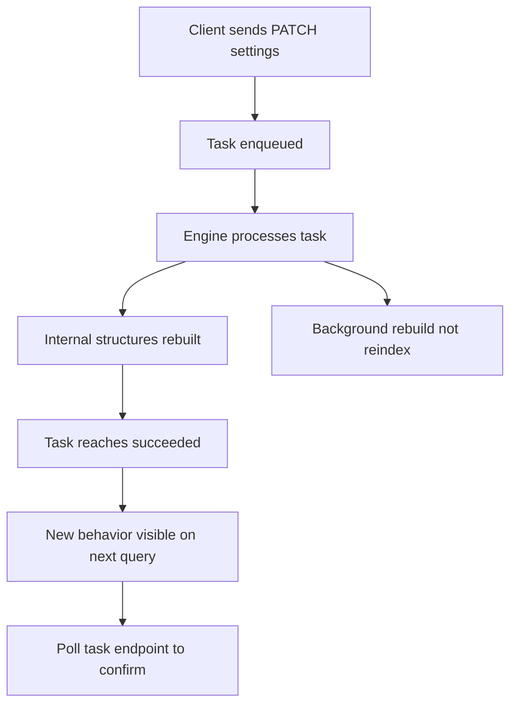

# Index Settings That Change Results Without Reindexing

## English

Meilisearch separates a document's stored data from the settings that control how it is searched. Settings such as searchableAttributes, rankingRules, stopWords, synonyms, typoTolerance thresholds, and filterableAttributes live alongside an index, and many of them take effect almost immediately because the engine rebuilds the relevant internal structures in the background rather than requiring you to re-upload your documents. This is a big deal operationally: you can experiment with a new ranking rule order, or add a synonym for a product name, and observe the effect on the next query without re-ingesting gigabytes of JSON.

The mechanism is that Meilisearch keeps a task queue. When you call the settings endpoint (for example PATCH /indexes/movies/settings with a JSON body), the request enqueues an asynchronous task. The engine processes it, updates the internal index structures, and the change becomes visible once that task reaches the 'succeeded' state. Because the queue is ordered, a burst of setting changes followed by a search will reflect all completed tasks; you can poll the task endpoint (GET /tasks/:uid) to know when to expect the new behaviour. This is why a settings change is not instantaneous like an in-memory dictionary swap but is still far faster than a full reindex for most datasets.

Not every setting is equally cheap. Changing searchableAttributes can require Meilisearch to recompute which fields are indexed and in what priority order, which touches the underlying word-level structures; on a large index this can take noticeable time. Changing stopWords or synonyms is comparatively light because those are lookup tables consulted at query time. Changing filterableAttributes may require building or discarding auxiliary data structures used for filtering, so it can also be heavy. Knowing which knobs are cheap versus expensive helps you decide whether to tweak settings live in production or to stage the change and roll it out deliberately.

A practical workflow is to treat settings as versioned configuration. Keep a JSON file per index in source control, apply it via the settings endpoint in your deployment pipeline, and record the task UID so your tooling can wait for completion before declaring the deploy healthy. If a setting change goes wrong, you can revert the file and re-apply. Because settings are not documents, some workflows treat them as a separate concern, so it is still worth keeping your settings files in source control for diffability and reproducibility — but note that a Meilisearch dump does capture both the documents and the index settings.

Finally, remember that settings are scoped per index. Two indexes can share documents but have completely different searchableAttributes, rankingRules, and typoTolerance. That makes it cheap to A/B test relevance configurations: create a second index, copy documents, apply an alternative settings file, and compare result quality on real queries before promoting the winner. The lesson is that relevance tuning is a configuration exercise, and Meilisearch gives you a fast, reversible loop for it.

## 中文

Meilisearch 將文件儲存的資料，與控制「如何被搜尋」的設定分開處理。searchableAttributes、rankingRules、stopWords、synonyms、typoTolerance 的門檻，以及 filterableAttributes 等設定，都與索引並存；當中許多設定幾乎即時生效，因為引擎會在背景重建相關的內部結構，而不需要你重新上傳文件。這在營運上意義重大：你可以實驗新的 ranking rule 次序，或為某個產品名稱加一個同義詞，然後在下一次查詢就看到效果，毋須重新載入幾 GB 的 JSON。

背後的機制是 Meilisearch 維護一個任務佇列（task queue）。當你呼叫設定端點（例如以 JSON 主體 PATCH /indexes/movies/settings），這個請求會將一個非同步任務排入佇列。引擎處理它、更新內部索引結構，當該任務到達「succeeded」狀態後，改動就可見。由於佇列有次序，一連串設定改動之後再搜尋，會反映所有已完成的任務；你可以輪詢任務端點（GET /tasks/:uid）來得知何時預期新行為。這就是為何設定改動不像記憶體字典替換那樣即時，但對大多數資料集而言仍遠快於完整重建索引。

並非每個設定都同樣便宜。改動 searchableAttributes 可能要求 Meilisearch 重新計算哪些欄位被索引、以及優先次序，這會觸及底層的字詞結構；在大型索引上可能耗時明顯。改動 stopWords 或 synonyms 相對輕量，因為它們是查詢時才查閱的對照表。改動 filterableAttributes 則可能需要建立或捨棄用於過濾的輔助結構，因此也可能很重。知道哪些旋鈕便宜、哪些昂貴，有助你決定在生產環境即時微調，還是先暫存改動再謹慎推出。

實務上的做法，是把設定當作有版本管理的配置。每個索引在原始碼控制中保留一份 JSON 檔案，在部署流程中透過設定端點套用，並記錄任務 UID，讓工具可以等待完成後才宣告部署健康。若某次設定改動出錯，你可以還原檔案再套用一次。由於設定不是文件，某些流程會把它們當成另一件事來處理，所以把設定檔保留在原始碼控制中仍然值得——好處在於可以 diff、可以重現——但要知道，Meilisearch 的 dump 其實同時包含文件與索引設定。

最後要記住，設定是按索引（per index）劃分的。兩個索引可以共用文件，卻有完全不同的 searchableAttributes、rankingRules 與 typoTolerance。這令 A/B 測試相關性配置變得便宜：建立第二個索引、複製文件、套用另一份設定檔，在真實查詢上比較結果質素，然後才把勝出者推上正式。教訓是：相關性調校本質上是一項配置工程，而 Meilisearch 給你一個快速、可逆的迴圈去做。

## Key Takeaway

Meilisearch settings are per-index, applied asynchronously via the task queue, and cheap enough to iterate on without re-uploading documents, so treat them as versioned configuration you can A/B test.

## Related Concepts
- Asynchronous task queue
- Index settings API

## Diagram

