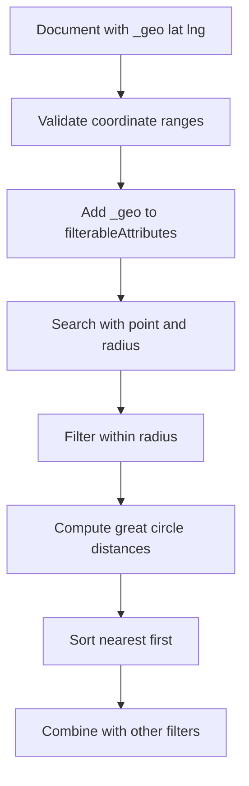

# Geo Search and Distance Ranking

## English

Meilisearch supports geographic search through a special document field convention: a field named _geo whose value is an object with lat and lng numbers (latitude and longitude in decimal degrees). Once a document has a valid _geo field, you can filter and sort by distance from a reference point, which is essential for 'restaurants near me' or 'stores within 10 km' style features. The coordinates must be real numbers within valid ranges (latitude between -90 and 90, longitude between -180 and 180); malformed values cause the whole document to be rejected with an invalid-geo error rather than having the geo field silently ignored, so validate before indexing.

The key API is the geo search parameters on the search endpoint: you pass a point (latitude and longitude of the user) and optionally a radius in metres, plus a sort expression like _geoPoint(lat, lng) with an ascending or descending direction. The engine then computes great-circle distances and can both filter (only results within the radius) and rank (nearest first) in one query. This is more efficient than fetching everything and sorting client-side, and it composes with other filters and ranking rules so you can say 'vegetarian restaurants within 5 km, cheapest first'.

A subtle but important point is that geo filtering requires the _geo field to be declared in filterableAttributes, while geo sorting is opted into separately by listing _geo in sortableAttributes — they are two distinct attribute-level opt-ins, not one shared mechanism. If you forget either one, geo queries will not behave as expected. Also, distance is computed on a spherical model of the Earth rather than a flat plane, which matters at larger radii; for a few kilometres the difference is negligible, but for cross-country queries a naive Euclidean calculation on raw latitude and longitude would be badly wrong.

Performance-wise, geo queries are fast because the engine can use spatial indexing structures rather than scanning every document. Still, radius queries with very large radii (hundreds of kilometres) touch more candidates and cost more. A common pattern is to store the user's location and let the frontend send it with each search request, keeping the search index free of user-specific state. For privacy-sensitive applications, you can round coordinates before sending them so that precise user location never leaves the client in identifiable form.

A practical gotcha: documents without a _geo field simply cannot match a geo filter, which is usually what you want, but it means you should not rely on geo filtering for completeness. If some records lack coordinates, they silently drop out of radius queries. Audit your data for missing or zero-value coordinates (0,0 is a valid point in the Gulf of Guinea, not a null marker) before shipping a location feature, and decide explicitly whether missing-location records should be excluded or surfaced separately.

## 中文

Meilisearch 透過一個特殊的文件欄位慣例來支援地理搜尋：名為 _geo 的欄位，其值是一個含 lat 與 lng 數字的物件（以十進制度數表示的緯度與經度）。當文件擁有有效的 _geo 欄位後，你便可以按與某參考點的距離來過濾與排序，這對「我附近嘅餐廳」或「10 公里內的門市」這類功能至關重要。座標必須是有效範圍內的真實數字（緯度介乎 -90 與 90，經度介乎 -180 與 180）；格式錯誤的值會令整份文件被拒收並回報 invalid-geo 錯誤，而不是讓 _geo 欄位被默默忽略，所以索引前要先驗證。

關鍵 API 是搜尋端點上的地理搜尋參數：你傳入一個點（使用者的緯度與經度），可選地再傳入以米為單位的半徑，以及像 _geoPoint(lat, lng) 這類帶升序或降序方向的排序表達式。引擎隨後計算大圓距離（great-circle distance），並可在同一個查詢中同時過濾（只保留半徑內的結果）與排序（最近的排前）。這比先取回全部再在客戶端排序更有效率，而且可與其他過濾條件及 ranking rules 組合，讓你表達「5 公里內的素食餐廳，最便宜優先」。

一個微妙但重要的重點：地理過濾要求 _geo 欄位在 filterableAttributes 中宣告，而地理排序則要在 sortableAttributes 中另外列出 _geo 才會啟用——這是兩個各自獨立的「按屬性逐項開啟」，並非同一個共用機制。若你漏了任何一個，地理查詢就不會如預期運作。此外，距離是基於地球的球面模型而非平面來計算，這在半徑較大時有影響；幾公里的差距微不足道，但跨國查詢若直接在原始經緯度上做歐幾里得計算，就會嚴重出錯。

效能方面，地理查詢很快，因為引擎可以使用空間索引結構，而不必掃描每份文件。不過，半徑極大（數百公里）的查詢會觸及更多候選項，成本更高。常見做法是儲存使用者位置，讓前端在每次搜尋請求時一併送出，使搜尋索引不含任何使用者專屬狀態。對於私隱敏感的應用，你可以在送出前先將座標四捨五入，令精確的使用者位置不會以可識別形式離開客戶端。

實務陷阱：沒有 _geo 欄位的文件根本無法符合地理過濾，這通常正是你想要的，但也意味著你不應依賴地理過濾來求完整性。若部分記錄缺少座標，它們會悄悄從半徑查詢中消失。推出位置功能前，先審核資料中缺失或零值的座標（0,0 是幾內亞灣一個有效點，不是空值標記），並明確決定缺少位置的記錄應被排除，還是另行呈現。

## Key Takeaway

Geo search in Meilisearch hinges on a _geo field declared as filterable, letting you filter by radius and sort by distance in one query, but records without valid coordinates silently drop out.

## Related Concepts
- filterableAttributes
- Great-circle distance

## Diagram

