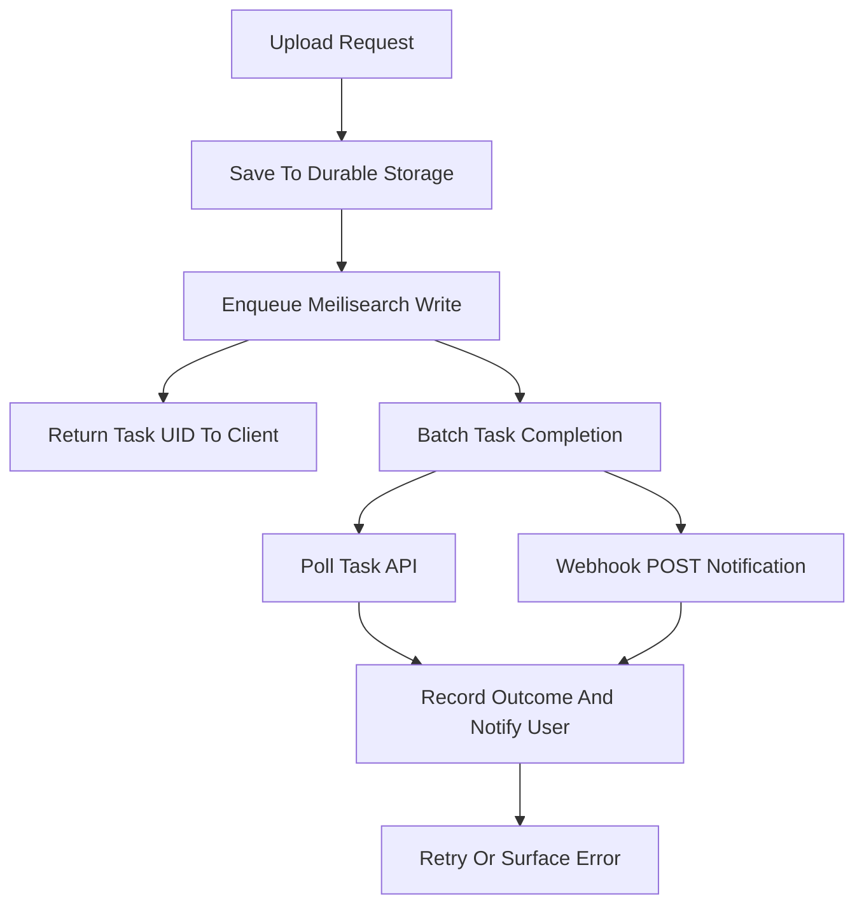

# Webhooks and Task Notifications for Building Reactive Pipelines

## English

Because indexing in Meilisearch is asynchronous, any system that depends on 'the document is searchable now' must know when a task finishes. The primary tool is the task API: every write (adding documents, updating settings, deleting) returns a task UID, and you can poll GET /tasks/:uid to read its status (enqueued, processing, succeeded, failed) and any error. This polling model is simple and works everywhere, but it means your pipeline must decide how often to poll and how to handle failures without hammering the server.

For event-driven architectures, Meilisearch also supports webhooks: you configure a URL, and the engine sends an HTTP POST notification each time a task completes. This lets a backend react without polling — for example, invalidating a cache, sending a 'your upload is ready' email, or triggering a downstream export. The payload describes the single completed task and its outcome, so your handler can branch on success or failure. Treat webhook handlers as idempotent: the same notification may be retried, and your handler should tolerate duplicates by keying on task UIDs.

A common production pattern is a two-stage pipeline. Stage one accepts a user's document upload, writes it to durable storage, and enqueues a Meilisearch write, returning the task UID to the client immediately. Stage two, driven by polling or a webhook, records the final outcome in your own database and notifies the user. This keeps the user-facing request fast (no waiting for indexing) while giving you an auditable record of what actually became searchable. If the task fails, you can retry or surface the error rather than silently losing the document.

Batching is the other half of the story. Sending one document per request is wasteful because each request becomes a task and the engine pays fixed overhead per task. Instead, accumulate documents for a short window (say, a few hundred milliseconds to a second) and send them in one batch. This dramatically improves throughput and reduces queue churn. The trade-off is latency: a document is searchable slightly later than if you sent it alone. For most applications this delay is invisible, but for 'post and immediately search' flows you may want to send critical writes alone and batch bulk imports.

Finally, monitor the task queue as a health signal. A growing backlog of enqueued tasks, or a cluster of failed tasks, usually indicates a problem upstream — malformed documents, a primary key mismatch, or an engine under-resourced for the write load. Alerting on task failure rate and queue depth catches these early. The mental model: your application's source of truth is its own database; Meilisearch is a derived, eventually consistent search view, and the task system is the contract that tells you when that view has caught up.

## 中文

由於 Meilisearch 的索引是非同步的，任何依賴「文件現在已可被搜尋」的系統，都必須知道任務何時完成。主要工具是任務 API：每次寫入（新增文件、更新設定、刪除）都會回傳一個任務 UID，你可以輪詢 GET /tasks/:uid 讀取其狀態（enqueued、processing、succeeded、failed）及任何錯誤。這種輪詢模型簡單且在何處都可行，但意味著你的流程要決定輪詢頻率，以及如何在不過度衝擊伺服器的情況下處理失敗。

對於事件驅動的架構，Meilisearch 亦支援 webhook：你配置一個 URL，每當一個任務完成時，引擎就會發送 HTTP POST 通知。這讓後端毋須輪詢即可反應——例如令快取失效、寄出「你嘅上傳已準備好」的電郵，或觸發下游匯出。負載描述的是該單一已完成任務及其結果，所以你的處理器可以按成功或失敗分支。請把 webhook 處理器視為冪等（idempotent）：同一個通知可能被重試，處理器應以任務 UID 作鍵來容忍重複。

常見的生產模式是兩階段流程。第一階段接受使用者的文件上傳，寫入持久儲存，並將一個 Meilisearch 寫入排入佇列，立即把任務 UID 回傳給客戶端。第二階段由輪詢或 webhook 驅動，把最終結果記錄在你自己的資料庫，並通知使用者。這令面向使用者的請求保持快速（毋須等待索引），同時給你一份關於什麼真正變得可搜尋的可稽核記錄。若任務失敗，你可以重試或呈現錯誤，而不是無聲地丟失文件。

批次處理是故事的另一半。每個請求只送一份文件很浪費，因為每個請求都會成為一個任務，而引擎要為每個任務付出固定開銷。相反，應在短時間窗口（例如幾百毫秒至一秒）內累積文件，再一次過送出。這會大幅提升吞吐量並減少佇列流轉。代價是延遲：文件會比單獨送出時稍遲才可搜尋。對大多數應用而言這延遲不可見，但對於「發佈後即時搜尋」的流程，你可能想讓關鍵寫入單獨送出，而大量匯入則批次處理。

最後，把任務佇列當作健康訊號來監控。enqueued 任務積壓增加，或一批失敗任務聚集，通常表示上游有問題——文件格式錯誤、主鍵不匹配，或引擎資源不足以應付寫入負載。對任務失敗率與佇列深度設警報可及早發現。心智模型是：你應用程式的事實來源是它自己的資料庫；Meilisearch 是一個衍生的、最終一致的搜尋視圖，而任務系統就是告訴你該視圖何時追上的契約。

## Key Takeaway

Use task UIDs plus polling or webhooks to know when asynchronous writes become searchable, batch writes for throughput, and monitor queue depth and failure rates as health signals.

## Related Concepts
- Asynchronous task queue
- Idempotency

## Diagram

