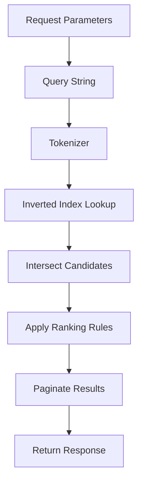

# Query-Time Mechanics: How a Search Request Travels Through the Engine

## English

When you send a search request to Meilisearch, the engine does not simply scan documents. The query string first goes through a tokenizer that splits it into words and normalizes them, then each term is looked up in the inverted index to collect candidate document IDs. That candidate set is then intersected across terms, so a multi-word query narrows results progressively. This is why adding more words usually shrinks the result set rather than growing it.

After candidate documents are found, Meilisearch applies the ranking rules in order, each acting as a tie-breaker for the previous one. The default order is words, typo, proximity, attribute, sort, and exactness. "Words" counts how many query terms matched, "proximity" rewards matches where terms appear close together in the document, and "attribute" prefers matches in higher-priority searchable attributes. Because the rules are applied lexicographically, a document that matches one more query word always outranks one that matches fewer, regardless of how good the typo or proximity scores are.

Pagination then slices the ranked list. By default Meilisearch returns the first 20 hits, and you can control the window with limit and offset. Internally it still has to rank enough candidates to fill that window, which is why very large offsets cost more than small ones. The response also includes estimatedTotalHits, which is an estimate rather than an exact count because computing exact totals across a huge corpus would be expensive on every keystroke.

A subtle but important detail: the query pipeline is stateless from the caller's perspective. You do not build a query object server-side; you send parameters like q, filter, sort, attributesToRetrieve, and facets, and the engine assembles the execution plan per request. This makes it easy to reason about behaviour, but it also means that performance tuning is mostly about shaping the index and the request, not about maintaining server-side state.

Understanding this flow helps you debug surprising results. If a document is missing, check whether all query terms are present or whether a filter excluded it. If ranking feels wrong, inspect which ranking rule is deciding the order. If pagination is slow at high offsets, consider whether you really need deep paging or whether a narrower filter would do.

## 中文

當你向 Meilisearch 發出搜尋請求，引擎並不是逐份文件掃描。查詢字串首先會經過分詞器（tokenizer），被拆成詞語並正規化，然後每個詞會在倒排索引（inverted index）中查找，收集候選文件 ID。這個候選集合隨後會按詞語逐一取交集，所以多詞查詢會逐步收窄結果。這正是為何加入更多詞通常會令結果變少而非變多。

找到候選文件後，Meilisearch 會依序套用排名規則（ranking rules），每條規則都是前一條的決勝條件。預設次序是 words、typo、proximity、attribute、sort、exactness。「Words」計算查詢中有多少詞匹配到；「proximity」獎勵詞語在文件中位置相近的匹配；「attribute」則偏好出現在較高優先搜尋屬性中的匹配。由於規則是按字典序（lexicographic）套用，多匹配一個查詢詞的文件永遠排在匹配較少的文件之前，無論其錯字或鄰近度分數多好。

之後分頁會切割已排序的清單。Meilisearch 預設回傳前 20 筆結果，你可以用 limit 和 offset 控制視窗。內部仍需排序足夠的候選以填滿該視窗，所以非常大的 offset 比小的 offset 成本更高。回應亦包含 estimatedTotalHits，這是估算值而非精確總數，因為在每次按鍵時對龐大語料庫計算精確總數會非常昂貴。

一個微妙但重要的細節：從呼叫者角度看，查詢流程是無狀態的。你不是在伺服器端建立查詢物件；你送出 q、filter、sort、attributesToRetrieve、facets 等參數，引擎會按每個請求組裝執行計劃。這令行為容易理解，但也意味著效能調校主要在於塑造索引與請求，而非維護伺服器端狀態。

理解這個流程有助你排查令人意外的結果。若某文件不見了，先檢查是否所有查詢詞都存在，或是否有過濾條件把它排除。若排名感覺不對，查看是哪條排名規則在決定次序。若深層分頁很慢，考慮你是否真的需要深分頁，還是用更窄的過濾條件更合適。

## Key Takeaway

A Meilisearch query is tokenized, intersected in the inverted index, ranked by lexicographic rules, then paginated, so most relevance surprises come from which rule is deciding the order.

## Related Concepts
- Inverted index intersection
- Ranking rules lexicographic order

## Diagram

