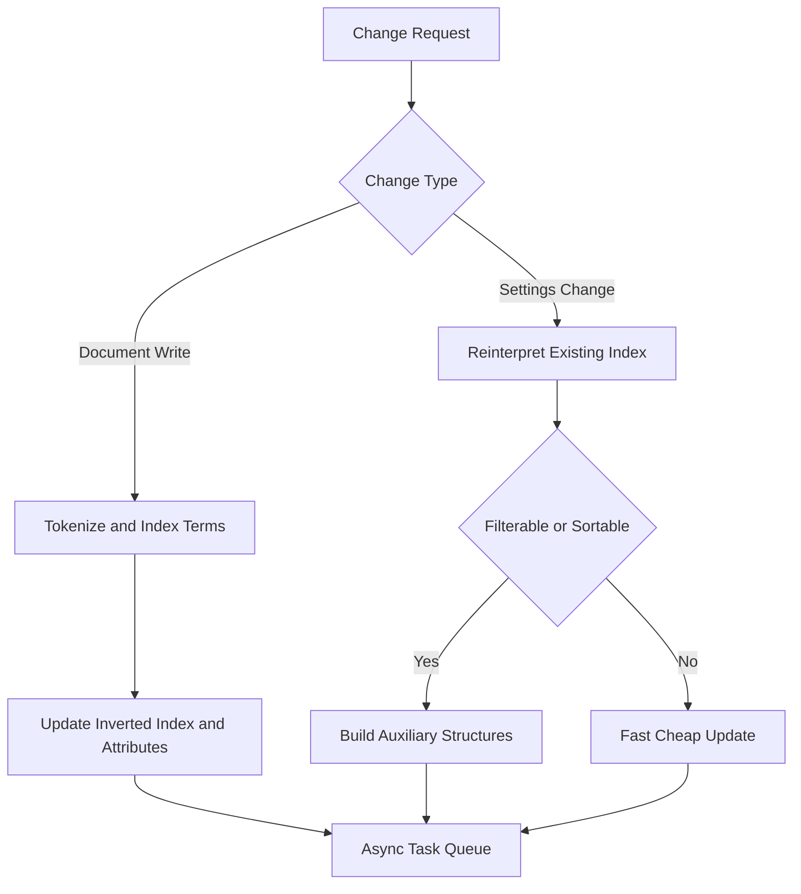

# Index Settings Versus Document Writes: What Is Cheap and What Is Expensive

## English

A common misconception is that any change to a Meilisearch index requires reindexing every document. In reality, Meilisearch separates document writes from settings changes, and the cost of each is very different. Adding or updating documents is the expensive path: each document must be tokenized, its terms inserted into the inverted index, and its attributes recorded for filtering and sorting. That work is proportional to the size of the documents you send, not the whole corpus, but it still touches many internal structures.

Settings changes are generally cheaper because they alter how the existing index is interpreted rather than rebuilding every posting list. Changing searchableAttributes, for example, changes which attributes are considered during matching and how attribute ranking works, but the underlying term-to-document mappings already exist. Changing filterableAttributes or sortableAttributes does require Meilisearch to build or adjust the auxiliary data structures that support filtering and sorting, so those changes can trigger background work and are best planned deliberately rather than toggled per request.

This distinction matters operationally. If you want to experiment with relevance, prefer adjusting settings like ranking rules, synonyms, or searchable attribute order, because they are fast to change and easy to revert. If you want to change what data is stored, that is a document write, and you should batch it. Meilisearch processes writes through an asynchronous task queue, so a single large batch is far more efficient than thousands of tiny requests, each of which pays task overhead and disk sync costs.

The task queue is the key mental model. Every write and every settings change becomes a task with a status such as enqueued, processing, succeeded, or failed. You can poll a task by its UID or wait for it to finish. Because tasks are processed in order, a settings change enqueued after a document batch will run after that batch completes. This ordering is what lets you safely script sequences like "add documents, then update settings, then search" without race conditions.

Practical guidance: treat document writes as the heavy, batched operations you schedule deliberately, and treat settings as lightweight knobs you tune during development. When you must change filterableAttributes or sortableAttributes, do it once with a full list rather than incrementally, because each change may rebuild supporting structures. And always inspect task results, since a failed settings change can silently leave your index behaving differently from what you intended.

## 中文

一個常見誤解是，任何對 Meilisearch 索引的改動都需要重新索引所有文件。實際上，Meilisearch 將文件寫入與設定變更分開，兩者成本差別很大。新增或更新文件是昂貴的路徑：每份文件都要分詞、其詞語插入倒排索引、其屬性記錄下來以供過濾與排序。這項工作與你送出的文件大小成正比，而非整個語料庫，但仍會觸及許多內部結構。

設定變更一般較便宜，因為它們改變的是現有索引的詮釋方式，而非重建每條倒排列表（posting list）。例如更改 searchableAttributes 會改變匹配時考慮哪些屬性以及屬性排名如何運作，但底層的詞語對文件映射已存在。更改 filterableAttributes 或 sortableAttributes 則需要 Meilisearch 建立或調整支援過濾與排序的輔助資料結構，所以這類變更可能觸發背景工作，最好刻意規劃而非逐個請求切換。

這個區別在營運上很重要。若你想實驗相關性，宜調整 ranking rules、synonyms 或搜尋屬性次序等設定，因為它們改動快、易還原。若你想改變儲存的資料，那就是文件寫入，應該批次處理。Meilisearch 透過非同步任務佇列（task queue）處理寫入，所以一個大批次遠比數千個微小請求有效率，因為每個小請求都要付上任務開銷與磁碟同步成本。

任務佇列是關鍵心智模型。每次寫入與每次設定變更都會成為一個任務，狀態包括 enqueued、processing、succeeded 或 failed。你可以用任務 UID 輪詢或等待它完成。由於任務按次序處理，排在文件批次之後的設定變更會在該批次完成後才執行。這個次序讓你能安全地編排「加入文件、更新設定、搜尋」之類的序列，而不會出現競態條件。

實務指引：把文件寫入視為你刻意排程的重型批次操作，把設定視為開發期間調校的輕量旋鈕。當你必須更改 filterableAttributes 或 sortableAttributes，一次過提交完整清單而非逐項遞增，因為每次變更都可能重建輔助結構。並且一定要檢查任務結果，因為失敗的設定變更可能無聲地令索引行為與你預期不同。

## Key Takeaway

Document writes are the expensive batched path while settings changes are cheap interpretation tweaks, and the ordered task queue is what lets you script both safely.

## Related Concepts
- Asynchronous task queue
- Filterable and sortable attribute structures

## Diagram

