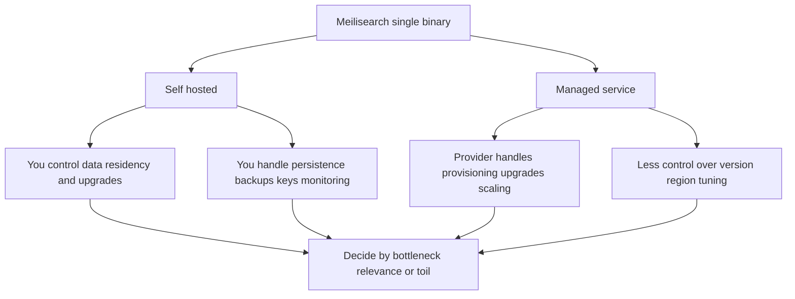

# Choosing Between Self-Hosted and Managed Meilisearch: Operational Trade-offs

## English

Meilisearch is distributed as a single binary that you can run almost anywhere: a laptop, a container, a virtual machine, or a managed cloud service. That single-binary design is a deliberate operational choice. There is no separate search cluster to coordinate, no ZooKeeper or etcd quorum, and no JVM to tune. You start the process, point it at a data directory, and it serves HTTP. This makes the self-hosted path unusually approachable for a search engine.

Self-hosting gives you full control over data residency, upgrade timing, and network topology, but it also transfers operational responsibility to you. You need to handle persistence (pointing the binary at a durable volume), backups (snapshots or dumps), access control (API keys and master key configuration), and monitoring. You also need to think about memory: Meilisearch memory-maps its LMDB database, so the operating system page cache does much of the heavy lifting, and you should size RAM with headroom for the working set rather than treating it like a traditional in-memory database.

Managed offerings remove much of that burden. They typically handle provisioning, upgrades, backups, and scaling, and they expose the same HTTP API, so your application code does not change. The trade-off is less control: you may not be able to choose the exact version, tune low-level parameters, or place data in a specific region depending on the provider. For teams without dedicated infrastructure staff, managed can be the pragmatic choice; for teams with strict compliance or latency requirements, self-hosting may be non-negotiable.

A useful way to decide is to separate concerns. Ask whether your bottleneck is search relevance or operational toil. If relevance work is consuming your team, a managed service frees time. If you have unusual data locality rules, heavy custom networking, or a need to co-locate search with application servers for latency, self-hosting wins. Many teams start managed for speed of adoption and later migrate to self-hosted once usage patterns are clear, or vice versa when operational load grows.

Whichever path you choose, keep the interface stable. Because both expose the same HTTP API and official SDKs, you can abstract the endpoint behind configuration. That way, moving between self-hosted and managed is a deployment change rather than a rewrite, and you retain the option to switch if costs, compliance, or performance demands shift.

## 中文

Meilisearch 以單一二進位檔形式發佈，幾乎可在任何地方運行：手提電腦、容器、虛擬機或受管雲端服務。這種單一二進位設計是刻意的營運選擇。沒有需要協調的獨立搜尋叢集，沒有 ZooKeeper 或 etcd 仲裁，也沒有 JVM 要調校。你啟動程序、指向資料目錄，它便提供 HTTP 服務。這令自架路徑對搜尋引擎而言異常平易近人。

自架讓你完全控制資料駐留、升級時機與網路拓撲，但也把營運責任轉移給你。你需要處理持久化（把二進位指向持久磁碟區）、備份（快照或傾印）、存取控制（API 金鑰與主金鑰設定）以及監控。你也需要考慮記憶體：Meilisearch 以記憶體映射（memory-map）方式使用其 LMDB 資料庫，所以作業系統頁面快取承擔大部分繁重工作，你應以工作集（working set）加餘裕來規劃 RAM，而非當它是傳統記憶體內資料庫。

受管方案免除大部分負擔。它們通常處理佈建、升級、備份與擴展，並提供相同的 HTTP API，所以應用程式碼無需改動。取捨是控制較少：視乎供應商，你可能無法選擇確切版本、調校低層參數或把資料放在特定區域。對沒有專職基礎設施人員的團隊，受管可能是務實選擇；對有嚴格合規或延遲要求的團隊，自架可能無可妥協。

一個有用的決策方式是分開關注點。問問你的瓶頸是搜尋相關性還是營運雜務。若相關性工作耗盡團隊精力，受管服務可釋放時間。若你有特殊資料本地化規則、繁重自訂網路，或需要把搜尋與應用伺服器共置以降低延遲，自架勝出。許多團隊先採受管以加快採用，待使用模式清晰後再遷移至自架；或當營運負荷增長時反向而行。

無論選擇哪條路，保持介面穩定。由於兩者都提供相同 HTTP API 與官方 SDK，你可以把端點抽象到設定之後。這樣，在自架與受管之間移動只是部署變更而非重寫，並保留在成本、合規或效能需求轉變時切換的選項。

## Key Takeaway

Meilisearch's single-binary design makes self-hosting approachable, but the real decision is whether your bottleneck is relevance work or operational toil, and a stable API keeps that choice reversible.

## Related Concepts
- Single-binary architecture
- Memory-mapped LMDB storage

## Diagram

