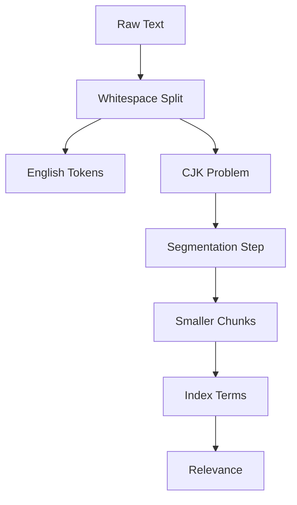

# Search in Other Languages: Tokenization Beyond English

## English

Meilisearch's tokenizer splits text into terms at whitespace and punctuation, which works well for English but runs into trouble with languages that do not put spaces between words. Chinese, Japanese, and Korean (often abbreviated CJK) are the classic case: a sentence like 東京でラーメンを食べた has no spaces, so a naive whitespace splitter treats the whole clause as one giant token and almost nothing will match. Meilisearch handles this with a segmentation step that breaks CJK text into smaller chunks before indexing. The good news is that this works out of the box: by default Meilisearch automatically detects the language of your documents and queries and picks the right pipeline for each, so a CJK index needs no special setup. Where you should intervene is when detection is not confident enough — short snippets are harder to identify than long text, and type-as-you-search queries are short by nature. In that case you can declare locales explicitly: `localizedAttributes` on the index tells Meilisearch which languages live in which fields, and a `locales` search parameter does the same for the query side.

The practical consequence is that relevance for CJK content depends heavily on getting segmentation right. If a compound word is split too aggressively, searching for the whole word may miss documents; if it is split too little, partial queries return nothing. Japanese in particular has no reliable spaces, so tokenizers must rely on dictionaries or statistical models. For Chinese, a common approach is to index overlapping character bigrams so that any two-character query can match. These are engineering trade-offs, not magic, and they mean your typo-tolerance behaviour will also differ because a one-character typo in a two-character word is a fifty-percent error.

Other languages have their own wrinkles. Thai and Lao also lack spaces, so they need their own segmentation. German compounds like Donaudampfschifffahrtsgesellschaft produce very long tokens that rarely appear whole in queries, which argues for either compound splitting or synonym entries. Arabic and Hebrew are written right-to-left and have rich morphology where prefixes and suffixes attach to roots, so stemming matters more than in English. Turkish has vowel harmony and agglutination, producing many surface forms from a single stem.

A practical checklist: rely on automatic language detection for most cases, but declare locales explicitly when you have short fields or short queries where detection may struggle; test with real queries from real users in each language rather than translating English test cases; add synonyms for the most common abbreviations and alternate spellings; and remember that stop-word lists and typo tolerance thresholds tuned for English may be wrong for a language with short words. If you index mixed-language content, consider whether one index with multiple locales or separate per-language indexes gives better control. One caveat worth knowing: Chinese and Japanese are hard to tell apart automatically when they share a field, so if you need both, keep them in separate fields or separate indexes and mark those fields as localized.

Finally, remember that searchable attributes order still applies across languages, and that ranking rules like words and typo count are language-agnostic in the engine but language-sensitive in effect. A query that is one character off in English is a minor typo; in Chinese it may be a completely different word. Measure precision and recall on a per-language sample set, and do not assume that a configuration that feels great in English will feel equally good in Japanese.

## 中文

Meilisearch 的分詞器（tokenizer）會按空白與標點把文字切成詞項（term），這對英文很有效，但遇到不以空格分隔詞語的語言就會出問題。中日韓（常簡稱 CJK）就是典型例子：像「東京でラーメンを食べた」整句沒有空格，若只用空白切分，整段子句會被當成一個巨大的詞項，幾乎什麼都搜不到。Meilisearch 透過切分步驟，在建立索引前把 CJK 文字拆成較小的片段。好消息是這件事開箱即用：預設情況下 Meilisearch 會自動偵測文件與查詢的語言，並為每者選擇合適的處理管線，所以 CJK 索引不需要特別設定。你要出手介入的是偵測不夠有把握的情況——短片段比長文本更難辨識，而 type-as-you-search 的查詢天生就短。在這種情況下可以明確宣告語系：索引上的 `localizedAttributes` 告訴 Meilisearch 哪些語言放在哪些欄位，而查詢端的 `locales` 搜尋參數則做同樣的事。

實務上的後果是：CJK 內容的相關性（relevance）高度依賴切分是否正確。若複合詞被切得太碎，搜尋整個詞可能漏掉文件；若切得太粗，部分查詢又會一無所獲。日文尤其沒有可靠的空格，分詞器必須依賴詞典或統計模型。中文常見做法是索引重疊的二字組合（bigram），讓任何兩字查詢都能命中。這些都是工程取捨，不是魔法，也意味著錯字容忍（typo tolerance）的行為會不同，因為在兩字詞裡錯一個字就是百分之五十的錯誤率。

其他語言也各有難題。泰文與寮文同樣沒有空格，需要自己的切分方式。德文的複合詞如 Donaudampfschifffahrtsgesellschaft 會產生極長的詞項，查詢中很少完整出現，這就傾向於做複合詞拆分或加入同義詞條目。阿拉伯文與希伯來文由右至左書寫，且構詞豐富，前綴與後綴會黏在字根上，因此詞形還原（stemming）比英文更重要。土耳其文有元音和諧與黏著構詞，同一個字根會產生許多表面形式。

實用檢查清單：大部分情況依賴自動語言偵測就好，但在欄位很短或查詢很短、偵測可能失準時，就明確宣告語言環境；用真實使用者的真實查詢來測試每種語言，而不是把英文測試案例翻譯過來；為最常見的縮寫與異體拼法加入同義詞；並記住為英文調校的停用詞（stop word）清單與錯字容忍門檻，對詞語較短的語言可能並不適用。若你索引的是混合語言內容，請思考單一索引搭配多語言環境，還是每個語言各自一個索引，哪個控制力更好。另外有一點值得注意：中文與日文放在同一個欄位時，自動判別非常困難；若兩者都需要，就把它們分開放在不同欄位或不同索引，並把那些欄位標記為 localized。

最後，別忘了可搜尋屬性（searchable attributes）的順序仍然適用於各種語言，而 words、typo 數量等排名規則在引擎層面與語言無關，實際效果卻與語言息息相關。英文差一個字母只是小錯字；中文差一個字可能就是完全不同的詞。請針對每種語言建立樣本集，量測精確率（precision）與召回率（recall），不要假設在英文感覺良好的設定，在日文也會一樣好。

## Key Takeaway

Tokenization is language-specific, so declare your locales, test with real per-language queries, and expect typo tolerance and relevance to behave differently outside English.

## Related Concepts
- Tokenization and CJK segmentation
- Searchable attributes order

## Diagram

