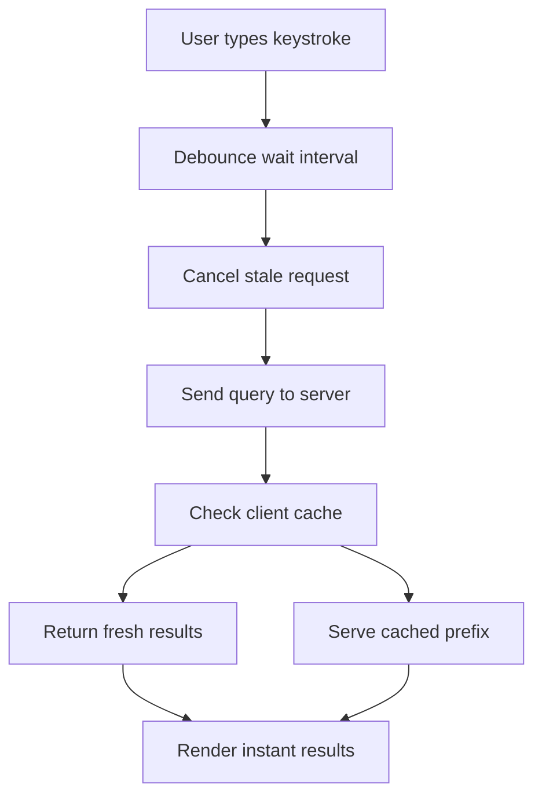

# Search Inside the Browser: Instant Meilisearch and Client-Side Relevance

## English

Most search architectures put the engine on a server and let the browser send HTTP requests. That is simple, but every keystroke becomes a network round trip, and on a slow mobile connection the 'instant' feeling evaporates. One pattern to understand is shifting part of the search experience into the client. The idea is not to replace the server engine but to make the front end smart about when and how it asks, and in some cases to hold a curated subset of data locally for zero-latency suggestions.

A common building block is a dedicated front-end library that wraps the HTTP client with UI-friendly behaviour: debouncing keystrokes so you do not fire a request per character, cancelling in-flight requests when a newer query arrives, and managing loading and error states. Debouncing means waiting a short interval after the last keystroke before sending; cancellation means aborting a previous fetch whose results are now stale so they do not overwrite fresher results. These two details alone fix the most common bug in search-as-you-type UIs, where fast typing causes results to flicker or arrive out of order.

Another angle is caching. Identical or prefix-related queries repeat constantly in real usage: users type 'lap', then 'lapt', then 'lapto'. A small client-side cache keyed by the normalised query string can serve repeated prefixes instantly and reduce load on the server. Be careful to include filter, sort, and pagination parameters in the cache key, otherwise you will show results for the wrong facet selection. Also set a short time-to-live, because the underlying index changes as documents are added or updated.

For truly offline or ultra-low-latency cases, some teams ship a trimmed index to the browser and run a client-side search library over it. This works for small, mostly static catalogues such as a documentation site's page titles or a product list of a few thousand items. It does not scale to millions of documents, and it exposes your data to anyone who opens developer tools, so never use it for content that requires permission checks. Treat it as a complement to server search, not a replacement.

Finally, think about perceived performance. Skeleton loaders, keeping previous results visible while a new query loads, and highlighting matched terms all make the experience feel faster even when the network is unchanged. Measure with real devices on real networks, not just a fast office connection. The goal is not the lowest possible server latency but the shortest time until the user sees something useful and trustworthy.

## 中文

大多數搜尋架構把引擎放在伺服器上，讓瀏覽器發出 HTTP 請求。這很簡單，但每次按鍵都變成一次網路往返，在行動網路較慢時，「即時」的感覺就消失了。有一種值得理解的做法，是把部分搜尋體驗搬到用戶端。重點不是取代伺服器引擎，而是讓前端聰明地決定何時、如何發問；在某些情況下，甚至在本機保留一份精選的資料子集，以達到零延遲的建議。

常見的積木是一個專門的前端函式庫，替 HTTP 用戶端包上對使用者介面友善的行為：對按鍵做去抖（debounce），避免每打一個字就送一次請求；當更新的查詢到來時取消進行中的請求；以及管理載入與錯誤狀態。去抖是指等最後一次按鍵後的一小段時間再送出；取消是指中止先前那個結果已經過時的請求，以免它覆蓋較新的結果。光是這兩個細節，就能修好「邊打邊搜」介面最常見的毛病：快速打字時結果閃爍或順序錯亂。

另一個角度是快取。相同或前綴相關的查詢在真實使用中不斷重複：使用者先打 lap，再打 lapt，再打 lapto。一個以正規化查詢字串為鍵的小型用戶端快取，可以瞬間回應重複的前綴，並減輕伺服器負擔。請務必把過濾、排序與分頁參數也納入快取鍵，否則會顯示錯誤分面選擇的結果。同時設定較短的存活時間（TTL），因為底層索引會隨文件新增或更新而改變。

對於真正離線或極低延遲的情境，有些團隊會把精簡過的索引送到瀏覽器，並在其上執行用戶端搜尋函式庫。這適用於小型且大致靜態的目錄，例如文件網站的頁面標題，或幾千項的產品清單。它無法擴展到數百萬份文件，而且會把資料暴露給任何打開開發者工具的人，所以絕不要用於需要權限檢查的內容。請把它視為伺服器搜尋的補充，而非替代品。

最後，請考慮感知效能（perceived performance）。骨架載入畫面、在新查詢載入時保留先前的結果、以及標示命中的詞項，都能讓體驗感覺更快，即使網路完全沒變。請用真實裝置與真實網路量測，而不是只在快速的辦公室連線上測試。目標不是把伺服器延遲壓到最低，而是縮短使用者看到有用且可信內容的時間。

## Key Takeaway

Client-side debouncing, request cancellation, and query-keyed caching fix the classic search-as-you-type bugs, while local trimmed indexes suit only small, non-sensitive datasets.

## Related Concepts
- Debouncing and request cancellation
- Client-side caching keys

## Diagram

