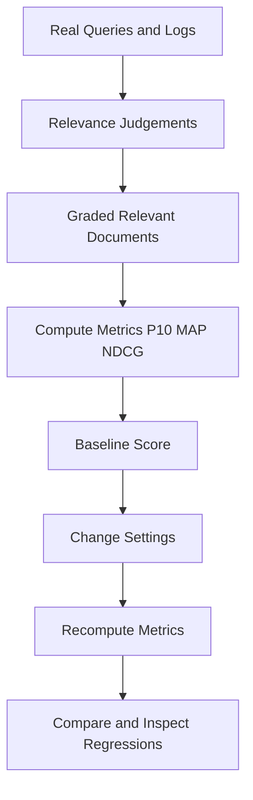

# Measuring Search Quality: Offline Evaluation and Relevance Judgement

## English

A search engine that feels good in a demo can still be quietly bad in production. The only way to know is to measure. The core tool is a relevance judgement set: a list of realistic queries, each paired with the documents a human considers relevant, ideally graded (for example, highly relevant, somewhat relevant, irrelevant). Building even fifty such queries from real logs or interviews gives you a baseline you can defend. Without it, every tuning change is a guess, and 'it seems better' is the only argument available.

From these judgements you compute metrics. Precision at k (often written P@10) asks: of the top ten results, what fraction are relevant? Recall asks: of all relevant documents, what fraction did we return? For ranked lists, mean average precision (MAP) and normalised discounted cumulative gain (NDCG) are standard because they reward putting relevant items near the top; NDCG also handles graded relevance, so a highly relevant document at position one scores better than a somewhat relevant one. Choose one or two metrics, understand what they reward, and track them over time.

A subtlety is that Meilisearch does not score documents with a single number. Instead it uses a bucket sort: the first ranking rule sorts all results into broad groups, and each subsequent rule acts only as a tiebreaker inside those groups. Once a rule has separated two documents, no later rule can change their relative order. That is why the order of the ranking rules list matters so much, and why a change to searchable attributes order, synonyms, stop words, or typo tolerance thresholds can shift results in ways that help some queries and hurt others. That is exactly why you evaluate on a set, not on a single query. Run the same query set before and after a settings change, compare aggregate metrics, and inspect the queries that regressed. Often you will find a trade-off you can live with, or a targeted synonym that fixes the regression without harming the rest.

Another dimension is the user's behaviour signal. Click-through rate, reformulation rate (how often users retype a query), and zero-result rate are cheap to log and highly informative. A high reformulation rate suggests the first results were not trusted; a high zero-result rate points to vocabulary mismatch that synonyms or better tokenization could fix. Combine these online signals with offline judgements: the judgements tell you whether the engine can rank well, the logs tell you whether real users agree.

Finally, keep the evaluation set alive. Add queries when you launch new content, retire ones that no longer reflect usage, and periodically re-check that your judgements still match what a human would say. Store the set in version control alongside your index settings so that a configuration change and its measured effect travel together. Search quality is not a one-time launch task; it is an ongoing habit of measuring, changing one thing, and measuring again.

## 中文

一個在示範中感覺良好的搜尋引擎，在正式環境中仍可能悄悄地很差。唯一知道的方法就是量測。核心工具是相關性判斷集（relevance judgement set）：一份真實的查詢清單，每個查詢搭配人工認定為相關的文件，最好分級（例如高度相關、部分相關、不相關）。即使只從真實日誌或訪談建立五十條這樣的查詢，也能給你一個站得住腳的基準。沒有它，每次調校都只是猜測，「好像比較好」是唯一能拿出的論據。

從這些判斷可以計算指標。前 k 名精確率（常寫成 P@10）問的是：前十筆結果中，相關的佔多少比例？召回率問的是：所有相關文件中，我們回傳了多少比例？對於有排序的清單，平均平均精確率（MAP）與正規化折損累積增益（NDCG）是標準做法，因為它們獎勵把相關項目放在前面；NDCG 還能處理分級相關性，所以排在第一位的高度相關文件，分數會高於部分相關的文件。挑一兩個指標，理解它們獎勵什麼，並長期追蹤。

一個微妙之處在於，Meilisearch 並不是替每份文件算一個分數。它用的是 bucket sort（分桶排序）：第一條排名規則把所有結果分成大致的組別，之後每一條規則只在那些組別之內扮演平手時的決勝手。一旦某條規則把兩份文件分開了，後面的規則就再也無法改變它們的相對次序。這正是排名規則列表的次序如此重要的原因，也是為何改變可搜尋屬性順序、同義詞、停用詞或錯字容忍門檻，都可能以某些查詢變好、某些查詢變壞的方式移動結果。這正是為何要在一個集合上評估，而非只看單一查詢。在設定變更前後跑同一組查詢，比較彙總指標，並檢視退步的查詢。你常會發現一個可以接受的取捨，或是一條針對性的同義詞，能在不傷害其他查詢的情況下修好退步。

另一個面向是使用者行為訊號。點擊率、改寫率（使用者重新輸入查詢的頻率）與零結果率，記錄成本低且資訊量高。改寫率高表示使用者不信任第一批結果；零結果率高則指向詞彙不匹配，可用同義詞或更好的分詞來修正。把這些線上訊號與離線判斷結合：判斷告訴你引擎能否排得好，日誌告訴你真實使用者是否同意。

最後，讓評估集保持鮮活。推出新內容時加入查詢，淘汰不再反映使用情況的查詢，並定期重新確認你的判斷仍符合人工的看法。把評估集與索引設定一起放進版本控制，讓設定變更與其量測到的效果同行。搜尋品質不是一次性的上線任務，而是持續量測、一次只改一件事、再量測的習慣。

## Key Takeaway

Build a graded relevance judgement set, track metrics like P@10 and NDCG across settings changes, and pair them with logged signals such as reformulation and zero-result rates.

## Related Concepts
- Relevance judgement sets
- NDCG and precision at k

## Diagram

