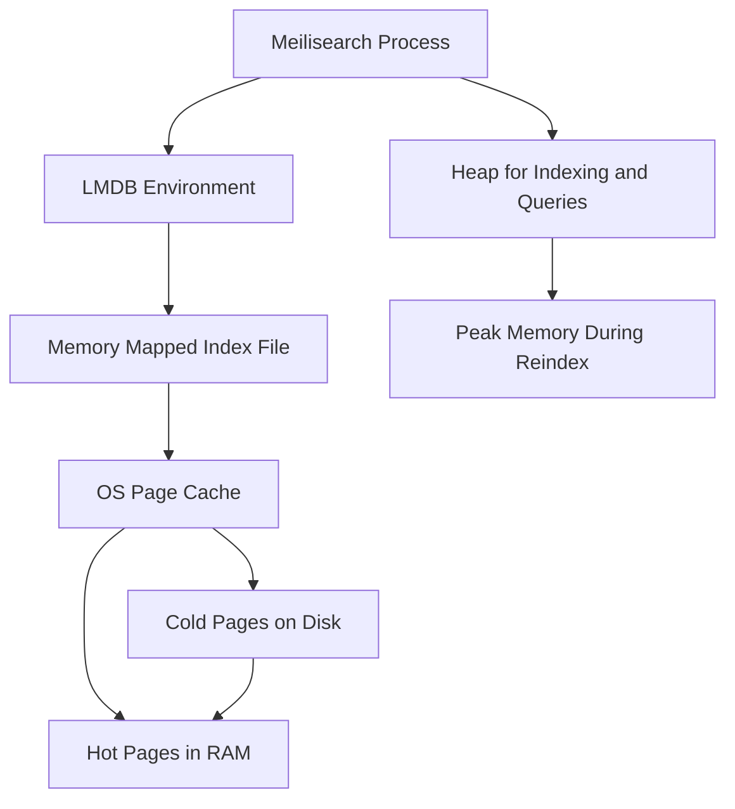

# Memory Budgeting: How Meilisearch Uses RAM and Why It Matters

## English

Meilisearch keeps its index in an LMDB environment, and LMDB is a memory-mapped database: instead of copying index pages into a private buffer, the engine maps the on-disk file into its address space and lets the operating system's page cache decide what is physically resident in RAM. On a 64-bit machine the virtual address space is enormous, so mapping a multi-gigabyte index is cheap and instant. What actually consumes memory is the set of pages the OS decides to keep cached, plus a smaller amount of heap used for transient structures during indexing and query processing. This is why a Meilisearch process can look like it uses very little RSS (resident set size) right after startup and then climb as queries touch more of the index.

The practical consequence is that Meilisearch prefers to have enough free RAM to hold the hot parts of your index, but it will not crash if the index is larger than RAM: the OS simply evicts cold pages and reads them from disk on demand, which is slower but correct. Indexing, by contrast, is the memory-hungry phase. Building or rebuilding an index requires temporary structures and sorting work, and the peak memory during a large reindex can be several times the steady-state footprint. If you run out of memory during indexing, the process may be killed by the OS out-of-memory killer, and the task will fail rather than silently corrupt data, because LMDB's transactional writes are crash-safe.

A useful mental model is a library reading room. The shelves (disk) hold every book, the reading tables (RAM) hold whatever is currently open, and the librarian (the OS page cache) decides which books to keep on the table based on what people keep asking for. You do not need tables for every book, but if the popular books keep getting carried back to the shelves, service slows down. Tuning is therefore less about a magic number and more about measuring: watch how much of the index is actually queried, and size the machine so the working set fits comfortably.

Concrete levers include limiting the number of searchable attributes (fewer attributes means fewer postings to scan and less cache pressure), avoiding unnecessarily large documents with giant text fields, and splitting very large corpora across multiple indexes or instances so each one has a smaller working set. When you run Meilisearch in a container, remember that the container's memory limit is enforced by the kernel, and the page cache counts against it in many configurations, so a container that looks under-provisioned may simply be evicting cache constantly. Monitoring disk read throughput alongside query latency is often the clearest signal that you are short on memory rather than short on CPU.

Finally, note that because the data lives in LMDB and writes are transactional, restarting the process does not require a warm-up rebuild: the OS cache may be cold after a restart, but the index is intact and correct from the first query. This is a different trade-off from engines that keep large in-memory structures and must reload them at boot. The design favors predictable durability and lets you reason about capacity in terms of working-set size rather than a fixed memory requirement.

## 中文

Meilisearch 把索引存放在 LMDB 環境之中，而 LMDB 是一個記憶體對映（memory-mapped）資料庫：它不會把索引頁複製到私有緩衝區，而是把磁碟上的檔案對映到自己的位址空間，再由作業系統的頁快取（page cache）決定哪些頁面實際上留在 RAM。在 64 位元機器上，虛擬位址空間極大，所以對映一個數 GB 的索引既便宜又即時。真正消耗記憶體的，是作業系統決定保留在快取中的那些頁面，再加上索引與查詢過程中短暫結構所用的一小部分堆積記憶體。這就是為何 Meilisearch 程式在啟動後 RSS（resident set size，常駐記憶體）看起來很小，之後隨著查詢觸及索引更多部分而逐步上升。

實務上的結論是：Meilisearch 希望有足夠的閒置 RAM 容納索引的熱區，但即使索引比 RAM 大也不會崩潰——作業系統只會淘汰冷頁面，需要時再從磁碟讀回，速度較慢但結果正確。相反，索引（indexing）才是吃記憶體的階段。建立或重建索引需要暫存結構與排序工作，大型重建期間的峰值記憶體可以是穩定狀態的好幾倍。若在索引期間耗盡記憶體，程式可能被作業系統的 out-of-memory killer 殺掉，該任務會失敗而不是悄悄損壞資料，因為 LMDB 的交易式寫入具備當機安全性。

一個好用的比喻是圖書館閱覽室。書架（磁碟）放著所有書，閱覽桌（RAM）放著目前開啟的書，而館員（作業系統頁快取）根據大家不斷索取什麼來決定哪些書留在桌上。你不需要為每本書都準備桌子，但如果熱門的書不斷被搬回書架，服務就會變慢。因此調校不是找一個神奇數字，而是量測：觀察索引中實際被查詢的比例，並把機器規模設定到工作集（working set）能舒適地放得下。

具體手段包括：限制可搜尋屬性的數量（屬性越少，要掃描的倒排資料越少，快取壓力也越小）、避免檔案含有不必要的大型文字欄位、以及把超大型語料拆成多個索引或執行個體，讓每個索引的工作集更小。在容器中執行 Meilisearch 時要記住，容器的記憶體上限由核心強制執行，而在許多設定下頁快取也計入其中，所以看似資源不足的容器，可能只是不斷在淘汰快取。同時監察磁碟讀取吞吐量與查詢延遲，通常最能清楚顯示你是缺記憶體而非缺 CPU。

最後要注意，由於資料存在 LMDB 且寫入具交易性，重啟程式不需要暖機重建：重啟後作業系統快取可能是冷的，但索引完好且第一條查詢就正確。這與那些把大型結構放在記憶體、開機時必須重新載入的引擎是不同的取捨。此設計偏好可預測的永續性，讓你用工作集大小而非固定記憶體需求來思考容量規劃。

## Key Takeaway

Meilisearch's memory footprint is mostly the OS page cache over an LMDB file, so plan capacity around the working set and treat indexing as the peak-memory phase.

## Related Concepts
- LMDB memory mapping
- Working set sizing

## Diagram

