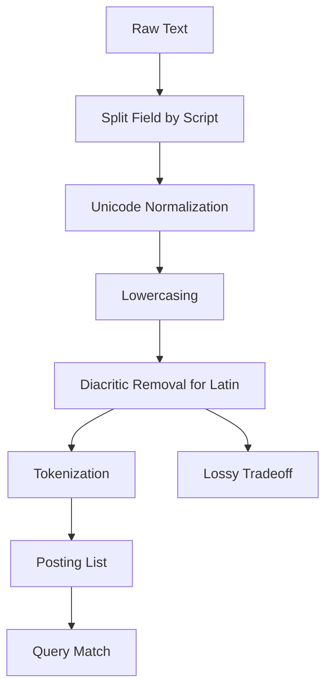

# Character Normalization, Diacritic Stripping, and Why Accents and Case Vanish

## English

Before Meilisearch ever builds a posting list, it normalizes text so that queries match documents despite cosmetic differences. The work is done by Charabia, the Rust tokenizer library that splits each field by writing system and then runs a language-specific normalization pipeline on each part. For Latin script that pipeline performs compatibility decomposition, lowercases the text, and removes non-spacing marks, so an accented letter such as é is folded to its base form e. It also applies a couple of spoofing normalizations, such as treating Ð and Đ as equivalent, plus dotless-ı handling. Without this step, two visually identical strings could produce different tokens and fail to match. Lowercasing is what makes a search for a name in lowercase find it regardless of how it was written.

What Charabia does not do is transliterate. There is no step that rewrites Greek or Cyrillic letters into Latin characters, and no blanket ASCII folding of every script. Greek text is decomposed and lowercased with final-sigma normalization, but it stays Greek; Chinese and Japanese get their own script-specific pipelines with dictionary-based segmentation. The treatment of diacritics is deliberately scoped to Latin text, where it buys real benefit: a user typing plain ASCII on a keyboard without accents should still find documents written with accents, and vice versa. That is a trade-off, not linguistic purity — it improves recall across input methods and keyboard layouts at the cost of collapsing distinctions that some languages consider meaningful.

That trade-off has real consequences for languages where diacritics carry meaning. In French, cote, coté, côte, and côté are different words, and a search that folds them together will return results a native speaker might consider wrong. Similar issues arise in languages that use tone marks, or where the Latin-specific pipeline is not the one running on the text. Because this normalization is applied during both indexing and querying, the effect is symmetric and consistent, but it is still a lossy transformation. If exactness matters for a field, the usual remedy is to keep a separate, more literal representation or to use filtering on a structured attribute rather than relying on full-text matching.

Normalization also interacts with tokenization. The tokenizer splits text into words according to language-specific rules, and the normalized form is what gets stored in the inverted index. This means the tokens you see in the index are not necessarily the raw substrings of your document. When debugging relevance, it helps to remember that the engine is matching normalized tokens, not original characters, so a query that looks like it should match may fail because normalization produced a different token, or may match unexpectedly because two distinct originals collapsed to the same token.

For most applications the defaults are exactly right: users get forgiving, accent-insensitive, case-insensitive search without any configuration. When you need precision, you can adjust searchable attributes, add synonyms to steer specific cases, or handle the sensitive field through filtering. The key insight is that normalization is a pipeline stage that runs before ranking, so it shapes what candidates exist at all. Ranking rules can only reorder the documents that survived normalization and tokenization; they cannot recover a match that was never produced.

## 中文

在 Meilisearch 建立任何倒排清單之前，它會先正規化文字，讓查詢能跨越外觀差異而命中文件。這部分工作由 Charabia 負責——一個以 Rust 寫成的分詞函式庫，它會先依書寫系統把每個欄位切開，再對每一段套用對應語言的正規化管線。對拉丁字母而言，這條管線會做相容分解、轉為小寫，並移除不佔位標記，因此像 é 這種帶重音的字母會被折疊回基本形式 e。它亦會做一些防偽字正規化，例如視 Ð 與 Đ 等同，以及處理無點的 ı。若沒有這一步，兩個視覺上相同的字串可能產生不同詞元而無法匹配。而轉小寫，就是為何用小寫搜尋名字，不論原文怎麼寫都能找到。

Charabia 不會做的事是轉寫（transliterate）。當中並沒有任何一步會把希臘文或西里爾字母改寫成拉丁字符，也沒有對每一種書寫系統做無差別的 ASCII 化。希臘文會被分解並轉小寫，並做尾形 sigma 的正規化，但依然是希臘文；中文與日文則各有自己的腳本專屬管線，採用詞典式分詞。對重音符號的處理是刻意限定在拉丁文字之內，而那裡的好處最實在：使用沒有重音鍵盤的用戶輸入純 ASCII 查詢，仍應能找到帶重音的文件，反之亦然。這是一個取捨，而非語言純度：它提升跨輸入法與鍵盤配置的召回率，代價是抹平了某些語言認為有意義的區別。

這個取捨對以變音符號區分意義的語言有實際後果。在法文中，cote、coté、côte、côté 是不同詞，把它們折疊在一起的搜尋會回傳母語者認為錯誤的結果。使用聲調符號、或根本不跑拉丁管線的語言也有類似問題。由於這個正規化在索引與查詢時都會套用，效果是對稱且一致的，但它仍是有損轉換。若某欄位需要精確性，常見做法是保留一份較字面的表示，或改用結構化屬性上的過濾，而非依賴全文匹配。

正規化也與分詞（tokenization）互動。分詞器依語言規則把文字切成詞，而存入倒排索引的是正規化後的形式。這意味著索引中的詞元不一定是文件裡的原始子字串。除錯相關性時要記得：引擎匹配的是正規化後的詞元，不是原始字元，所以看似應該匹配的查詢可能因正規化產生不同詞元而失敗，也可能因兩個不同的原文折疊成同一詞元而意外匹配。

對大多數應用而言，預設值恰到好處：使用者得到寬容、不區分重音與大小寫的搜尋，無需任何設定。需要精確時，你可以調整可搜尋屬性、加入同義詞引導特定情況，或透過過濾處理敏感欄位。關鍵洞見是：正規化是排序之前執行的管線階段，因此它決定了究竟有哪些候選存在。排序規則只能重排那些通過正規化與分詞的文件；它無法挽回從未產生的匹配。

## Key Takeaway
Meilisearch normalizes text before indexing — lowercasing and stripping diacritics for Latin script — which buys forgiving accent- and case-insensitive search without transliterating other scripts into ASCII.

## Related Concepts
- Unicode normalization forms
- Charabia: script-aware tokenization and normalization

## Diagram

