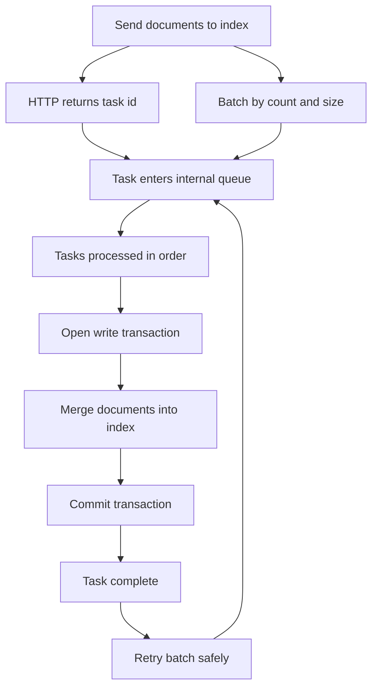

# Batch Import Strategies: Throughput, Task Queue Behavior, and Safe Bulk Loading

## English

Loading a large corpus into Meilisearch is not a single operation but a sequence of asynchronous tasks. When you send documents to an index, the HTTP request returns quickly with a task identifier, and the actual indexing happens later on the engine's internal queue. Understanding this queue is the key to fast, safe bulk imports. Tasks are processed largely in order, and each indexing task carries fixed overhead: opening a write transaction, merging new documents into the existing index, and committing. Sending ten thousand tiny requests therefore wastes most of the work on overhead, while sending a few large batches amortizes it.

Batching is the single biggest throughput lever. A reasonable approach is to group documents into batches sized by both count and byte size, because a batch of a thousand tiny records and a batch of a thousand long articles are very different workloads. Very large batches are not automatically better: they increase peak memory during indexing, take longer to commit, and delay other tasks behind them in the queue. A practical pattern is to pick a moderate batch size, measure indexing time per batch, and adjust. If you are doing an initial full load, a common tactic is to disable or reduce expensive settings such as faceting and to add documents before fine-tuning relevance, then apply settings changes afterward.

Idempotency matters for resumability. Each document is identified by a primary key, and re-adding a document with the same key updates it rather than creating a duplicate. This means a failed import can often be retried by simply resending the batch, because the engine will overwrite rather than duplicate. Design your primary key to be stable and derived from your source of truth, not from an auto-increment counter that changes between runs, so that retries and incremental syncs behave predictably. If a batch fails, you can inspect the task's error and resubmit only the affected documents.

Concurrency is a subtle trap. Because indexing tasks mutate the same index, running many parallel writers does not necessarily increase throughput and can even serialize behind a single write lock while adding contention. A better pattern is a small number of producers that each send reasonably sized batches and wait for task completion before sending the next, giving you backpressure. If you must parallelize, separate writers by index so they do not fight over the same write path, and monitor the queue depth to see whether you are actually keeping the engine busy or just piling up tasks.

Finally, plan the import around the fact that search remains available during indexing, but relevance settings applied mid-import can change what gets indexed. Apply schema-level settings such as searchable attributes and filterable attributes before or after the bulk load, not scattered throughout, so you can reason about the result. For very large migrations, consider loading into a fresh index, verifying counts and a few sample queries, then swapping traffic to it, rather than mutating a live index in place. This gives you a clean rollback and avoids partial states that are hard to diagnose.

## 中文

把大型語料載入 Meilisearch 並不是單一操作，而是一連串非同步任務。當你把檔案送到索引時，HTTP 請求會很快回傳一個任務識別碼，真正的索引稍後才在引擎內部的佇列上發生。理解這個佇列，是快速且安全地大量匯入的關鍵。任務大致依序處理，而每個索引任務都有固定開銷：開啟寫入交易、把新檔案合併進既有索引、提交。因此送出上萬個極小請求，大部分工作都浪費在開銷上；送出少數大型批次則能把開銷攤平。

批次化是提升吞吐量最大的手段。合理的做法是同時依數量與位元組大小來決定批次規模，因為一千筆極小記錄與一千篇長文章的負載截然不同。批次並非越大越好：過大的批次會提高索引期間的峰值記憶體、提交時間更長，並讓佇列中後面的任務被延誤。實務模式是選一個適中的批次大小，量測每批的索引時間再調整。若是初次全量載入，常見策略是先停用或降低昂貴設定（例如分面），先加入檔案再微調相關性，之後才套用設定變更。

冪等性（idempotency）對可續傳性很重要。每份檔案由主鍵識別，用相同主鍵重新加入檔案是更新而非建立重複。這意味著失敗的匯入往往只要重送該批次即可，因為引擎會覆寫而非重複。把主鍵設計成穩定、由真實來源推導而來，而不是每次執行都改變的自增計數器，這樣重試與增量同步才會可預測。若某批次失敗，你可以檢視該任務的錯誤，只重送受影響的檔案。

併發是個微妙的陷阱。由於索引任務會改動同一個索引，大量平行寫入者不一定提升吞吐量，甚至可能在單一寫入鎖後面序列化，徒增競爭。更好的模式是少數生產者，各自送出大小合理的批次，並等任務完成後再送下一批，形成背壓（backpressure）。若必須平行化，就讓不同寫入者操作不同索引，避免爭奪同一條寫入路徑，並監察佇列深度，判斷你是真的讓引擎忙碌，還是隻是把任務堆積起來。

最後，規劃匯入時要記得：索引期間搜尋仍可用，但匯入中途套用的相關性設定會改變被索引的內容。把可搜尋屬性、可過濾屬性等結構層級設定集中於大量載入之前或之後套用，不要零散穿插，這樣結果才可推理。對於超大型遷移，可考慮載入到全新索引、核對檔案數與幾條樣本查詢，再把流量切換過去，而不是就地改動線上索引。這給你乾淨的回滾，也避免難以診斷的半完成狀態。

## Key Takeaway

Bulk imports into Meilisearch are asynchronous tasks, so throughput comes from moderate batches, idempotent primary keys, controlled concurrency, and applying settings in deliberate phases.

## Related Concepts
- Asynchronous task queues
- Idempotent upserts

## Diagram

