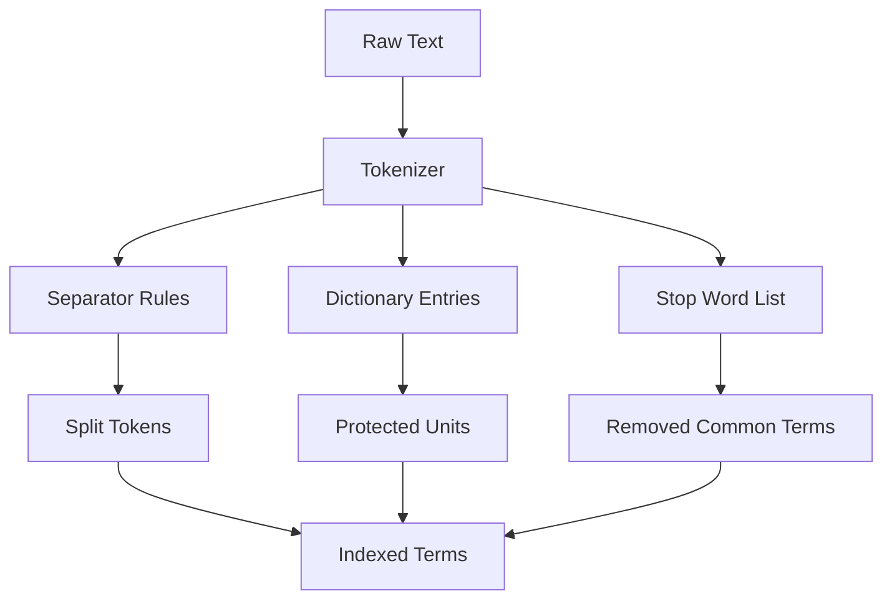

# Stop Words, Separators, and the Dictionary Settings You Rarely Touch

## English

Meilisearch ships with a built-in stop-word list for the languages it knows, plus a configurable separator list. Stop words are extremely common terms like "the", "a", "of" that carry almost no discriminating power. Removing them from the index shrinks the term dictionary and speeds up matching, but it also changes behaviour in ways that surprise people: a query that consists only of stop words can return nothing useful, and phrase-like queries lose their connective tissue. You can replace the default list entirely with the `stopWords` setting, which takes an array of strings — it is a full replacement, not an append, so if you want the defaults plus your own, you must supply everything. Changing stop words triggers a reindex of affected documents, which is why this is a setting you tune early rather than casually.

Separators are the characters Meilisearch treats as word boundaries when it splits text into tokens. The default set covers whitespace and common punctuation, but domains like product codes, version strings, or identifiers such as "ABC-123/XY" may need extra separators (or the opposite: you may want to keep a hyphen inside a token). The `separatorTokens` and `nonSeparatorTokens` settings exist precisely for this — the first adds characters that split words, the second protects characters that would otherwise split them. Getting this wrong is a classic source of "why does searching for my SKU fail" bugs.

A third lever is the `dictionary` setting: an array of words that should be treated as single units even if they contain characters that would normally be split. Think of brand names with internal punctuation, or compound terms in languages that use hyphens productively. The dictionary tells the tokenizer "do not break this apart".

All three settings are index-level, not query-level. They live in the index settings object and are applied at indexing time, so changing them means documents are re-tokenized. The practical rule: decide your stop words, separators, and dictionary entries before you load a large corpus, because retrofitting them on millions of documents is an expensive reindex rather than a quick tweak. Test with a small representative sample first, then lock the settings in.

## 中文

Meilisearch 對它所支援的語言內建了停用詞（stop words）清單，另外還有可設定的分隔符（separator）清單。停用詞就是像「the」、「a」、「of」這種極度常見、幾乎沒有辨識力的詞。把它們從索引中移除可以縮小詞典（term dictionary）並加快比對速度，但同時也會以令人意外的方式改變行為：一個只由停用詞組成的查詢可能回傳不了有用的結果，而近似片語的查詢也會失去連接詞。你可以用 `stopWords` 設定整個替換預設清單，它接受一個字串陣列——注意這是「完全取代」而非「附加」，所以如果你想保留預設值再加上自己的詞，就必須把全部詞都列出來。變更停用詞會觸發受影響文件的重新索引，所以這是應該早點調好、而不是隨手改的設定。

分隔符是 Meilisearch 在把文字切成 token 時視為詞邊界的字元。預設集合涵蓋空白與常見標點，但像產品編號、版本字串，或「ABC-123/XY」這類識別碼，可能需要額外的分隔符（或者相反：你可能希望連字號留在 token 裡面）。`separatorTokens` 與 `nonSeparatorTokens` 這兩個設定正是為此存在——前者加入會切開詞的字元，後者保護原本會被切開的字元。這裡弄錯就是「為什麼搜我的 SKU 搜不到」這類 bug 的經典來源。

第三個槓桿是 `dictionary` 設定：一個詞的陣列，這些詞即使含有平常會被切開的字元，也應被視為單一單位。想想內部帶標點的品牌名，或在某些語言中大量使用連字號的複合詞。字典告訴分詞器「不要拆開這個」。

這三個設定都是索引層級、而非查詢層級。它們存在於索引設定的物件裡，並在索引時套用，所以變更它們就意味著文件要重新分詞。實務原則是：在載入大量語料之前就先決定好停用詞、分隔符與字典詞條，因為在數百萬份文件上事後補救是昂貴的重新索引，而不是隨手調整。先用小型且有代表性的樣本測試，然後把設定定下來。

## Key Takeaway

Stop words, separators, and dictionary entries are index-time settings that reshape tokenization, so decide them before loading a large corpus.

## Related Concepts
- Tokenization
- Index settings

## Diagram

