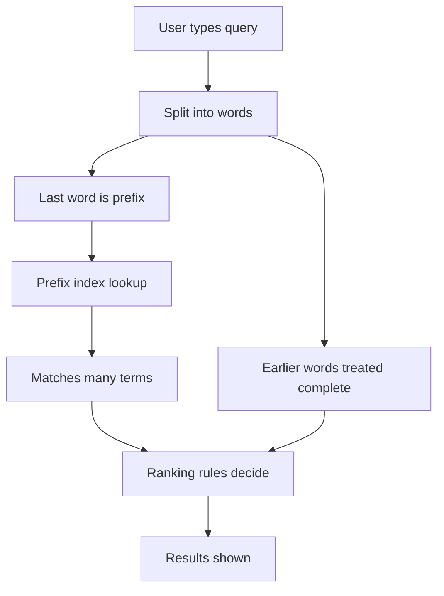

# Prefix Search, Word-Prefix Matching, and How Meilisearch Finds Results Before You Finish Typing

## English

The magic of search-as-you-type rests on prefix matching: when you have typed "meil", the engine must find documents containing "meilisearch" without knowing the full word yet. Meilisearch handles this with a prefix index — a structure that lets it look up any word beginning with a given string quickly, rather than scanning every term. The `prefixSearch` setting controls this behaviour with values like `indexingTime` and `disabled`. In `indexingTime` mode the prefix data is built when documents are indexed, which makes queries faster at the cost of a larger index and slower writes; `disabled` turns prefix matching off entirely, which is useful for batch or analytics workloads where queries are always complete words.

There is a subtlety worth knowing: prefix matching applies to the last word of the query by default, because that is the word still being typed. Earlier words are treated as complete. That is why typing "red sh" can match "red shoes" but also "red shirt", and why the ranking rules then decide which is more relevant. The `matchingStrategy` setting (values like `last`, `all`, `frequency`) lets you tune how strictly Meilisearch requires all query terms to match — `last` is the default and is forgiving about the final term, while `all` requires every term to be present.

Prefix search interacts with typo tolerance in a way that can feel like a bug but is by design: a very short prefix like "me" may match an enormous number of terms, and the engine has to cut off results to stay fast. This is one reason very short queries sometimes look noisy. The practical fix is usually to require a minimum query length on the client side, or to lean on ranking rules to push good matches to the top rather than trying to eliminate all bad ones.

One more detail: prefix matching is not the same as fuzzy matching. Prefix means "starts with"; typo tolerance means "close enough". They combine, so "meils" can match "meilisearch" both because it is a prefix and because the edit distance is small. Understanding which mechanism produced a match helps you debug relevance: if results appear with no typo at all, it is prefix; if they appear with a wrong letter, it is typo tolerance.

## 中文

即時搜尋（search-as-you-type）的魔力建立在字首比對（prefix matching）之上：當你只打了「meil」，引擎必須在還不知道完整單詞的情況下，找出含有「meilisearch」的文件。Meilisearch 用字首索引（prefix index）來處理——這是一種結構，讓它能快速查找以某字串開頭的任何詞，而不必掃描每一個詞。`prefixSearch` 設定用 `indexingTime` 與 `disabled` 等值來控制這個行為。在 `indexingTime` 模式下，字首資料會在文件被索引時建立，這讓查詢更快，代價是索引更大、寫入更慢；`disabled` 則完全關閉字首比對，適合查詢永遠是完整詞的批次或分析型工作負載。

有個值得知道的細節：字首比對預設只套用在查詢的最後一個詞，因為那才是你正在打的詞。前面的詞會被視為完整。這就是為什麼打「red sh」可以比對到「red shoes」，也可以比對到「red shirt」，然後再由排名規則決定哪個更相關。`matchingStrategy` 設定（值如 `last`、`all`、`frequency`）讓你調整 Meilisearch 要求所有查詢詞都必須比對的嚴格程度——`last` 是預設值，對最後一個詞較寬容；`all` 則要求每個詞都必須存在。

字首搜尋與錯字容忍的互動，有時會讓人覺得像 bug，但其實是設計使然：像「me」這種極短的字首可能比對到數量龐大的詞，引擎必須截斷結果才能維持速度。這是短查詢有時看起來很雜亂的原因之一。實務上的解法通常是在客戶端設定最小查詢長度，或倚賴排名規則把好的比對推到前面，而不是試圖消除所有壞的比對。

還有一點：字首比對不等於模糊比對。字首意思是「以……開頭」；錯字容忍意思是「夠接近」。兩者會疊加，所以「meils」既能比對到「meilisearch」是因為它是字首，也因為編輯距離很小。理解是哪個機制產生了比對，有助於你除錯相關性：如果結果完全沒有錯字卻出現，那是字首；如果出現時字母有誤，那是錯字容忍。

## Key Takeaway

Prefix matching is a separate mechanism from typo tolerance, and knowing which one produced a hit is the key to debugging relevance.

## Related Concepts
- Prefix index
- Matching strategy

## Diagram

