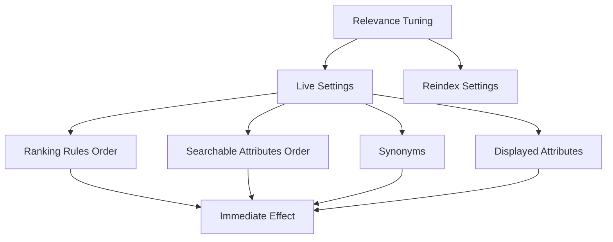

# Relevance Tuning Without Reindexing: The Settings You Can Change on a Live Index

## English

A useful mental model for Meilisearch is to sort settings into two buckets: those that require reindexing and those that take effect immediately. The immediate ones are the levers you can pull on a live production index when relevance is off, without waiting hours for a rebuild. The most important is the ranking rules array. Meilisearch applies ranking rules lexicographically — the first rule dominates, ties are broken by the second, and so on. Reordering the array changes which dimension wins: putting `words` before `typo` prioritizes matching more query terms over tolerating fewer typos; putting `proximity` higher rewards terms appearing close together. You can also add a custom ranking rule like `sort` or `attribute` to inject business logic, for example boosting documents with a higher popularity score.

The `searchableAttributes` order is another immediate lever. Meilisearch treats earlier attributes as more important, so listing `title` before `description` means a match in the title outranks a match in the description. This is a common fix when search results feel "buried": reorder the array and re-test, no reindex needed. Similarly, `displayedAttributes` and `filterableAttributes` can be adjusted live, though changing `filterableAttributes` does incur some indexing work because filter data structures must be built.

Synonyms are also applied at query time, so you can add them on a live index to fix specific misses — for example mapping "laptop" to "notebook" for a hardware store. This is a surgical tool: instead of retraining anything, you patch the vocabulary. The same goes for stop words in many cases, though the docs are explicit that some settings trigger reindexing, so check before you assume.

The discipline here is to treat relevance tuning as an iterative loop: change one setting, run a fixed set of test queries, compare results, revert if worse. Because most of these settings are cheap to apply and cheap to revert, you can afford to experiment on production with a small blast radius. Keep a changelog of setting changes alongside your test queries so you know what "good" looked like before you started fiddling.

## 中文

對 Meilisearch 來說，一個有用的心智模型是把設定分成兩類：需要重新索引的，以及立即生效的。立即生效的那些，就是當線上正式索引的相關性不對時，你可以馬上拉的槓桿，不必等好幾個小時重建。最重要的是排名規則（ranking rules）陣列。Meilisearch 以字典序（lexicographic）套用排名規則——第一條規則主導，平手時由第二條決定，依此類推。重排陣列會改變哪個維度勝出：把 `words` 放在 `typo` 前面，就是優先要求比對到更多查詢詞，而非容忍更少錯字；把 `proximity` 放高一點，則獎勵彼此靠近的詞。你也可以加入像 `sort` 或 `attribute` 的自訂排名規則來注入商業邏輯，例如提高人氣分數較高的文件。

`searchableAttributes` 的順序是另一個立即生效的槓桿。Meilisearch 把較前面的屬性視為較重要，所以把 `title` 列在 `description` 前面，就表示標題中的比對會排在描述中的比對之前。當搜尋結果讓人覺得「被埋住」時，這是很常見的修法：重排陣列、重新測試，不需要重新索引。同樣地，`displayedAttributes` 與 `filterableAttributes` 可以即時調整，不過變更 `filterableAttributes` 會產生一些索引工作，因為必須建立過濾用的資料結構。

同義詞也是在查詢時套用，所以你可以在線上索引加入同義詞來修正特定的漏搜——例如為五金行把「laptop」對應到「notebook」。這是外科手術式的工具：不必重新訓練任何東西，只要補上詞彙。停用詞在許多情況下也是如此，不過官方文件明確指出有些設定會觸發重新索引，所以假設之前先確認。

這裡的紀律是把相關性調校當成一個迭代循環：改一個設定、跑一組固定的測試查詢、比較結果、變差就還原。因為這些設定大多套用便宜、還原也便宜，你可以在影響範圍很小的前提下，在正式環境上實驗。把設定變更與測試查詢一起記在變更日誌裡，這樣你就知道在你開始動手之前，「好」長什麼樣子。

## Key Takeaway

Ranking rules, searchable attribute order, and synonyms are live levers that let you tune relevance on a production index without a full reindex.

## Related Concepts
- Ranking rules
- Relevance tuning

## Diagram

