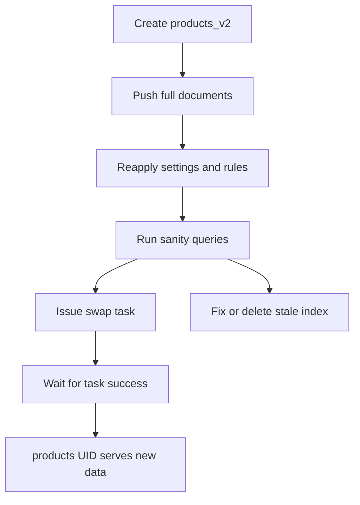

# Index UID Naming, Swaps, and Blue-Green Reindexing

## English

Every Meilisearch index has a unique identifier called its UID, and that UID is a string you choose yourself when you create the index. The UID becomes part of every API path, so a search against an index called products hits a route like /indexes/products/search. Because the UID is just a label pointing at a set of underlying data, you can create a second index with a different UID and fill it with a completely rebuilt dataset while the first one keeps serving live traffic. This is the raw material for a blue-green deployment pattern: build the new version in the background, verify it, then flip traffic over. Meilisearch provides a dedicated index swap operation that atomically exchanges the contents of two existing indexes. More precisely, POST /swap-indexes takes the UIDs of two indexes and swaps the documents, primary key, settings and task history between them; the UIDs themselves are not exchanged. After the swap, the index called products holds the data that products_v2 used to hold, and the switch is instant from the client's perspective because no documents are copied during the swap itself. If you also want the UIDs themselves to change, you can pass rename: true, which renames the first index to the second one instead of swapping the contents. The swap is submitted as a task like any other write, so it is queued and processed asynchronously; your application should wait for that task to succeed before assuming the new data is live. A practical workflow looks like this: create products_v2, push the full document set, apply all the same settings (searchable attributes, ranking rules, filters, synonyms), run some sanity queries, and only then issue the swap between products and products_v2. If something is wrong, you can swap back or simply delete the stale index. One subtlety is that settings and documents travel with the index, so if you forget to reapply a setting on the new index, the swap will silently change relevance behaviour. Treat the settings as part of the deployment artifact, not as an afterthought. This pattern is far safer than deleting and recreating an index in place, because an in-place rebuild leaves a window where searches return nothing or partial results.

## 中文

每個 Meilisearch 索引都有一個獨一無二的識別碼，稱為 UID，而這個 UID 是你在建立索引時自己選定的字串。UID 會成為每個 API 路徑的一部分，所以對名為 products 的索引搜尋，實際上會打到類似 /indexes/products/search 的路由。由於 UID 只是一個指向底層資料集的標籤，你可以建立另一個使用不同 UID 的索引，在舊索引繼續服務線上流量的同時，把整個資料集重建並灌進新索引。這正是藍綠部署（blue-green deployment）模式的原料：在背景建好新版本、驗證無誤，然後把流量切換過去。Meilisearch 提供了一個專門的索引交換（index swap）操作，能原子性地交換兩個既有索引的內容。準確啲講，POST /swap-indexes 會接收兩個索引的 UID，交換它們之間的文件、主鍵（primary key）、設定與任務記錄（task history）；UID 本身並不會被交換。交換之後，名為 products 的索引會持有原本屬於 products_v2 的資料，從用戶端角度看，切換是瞬間完成的，因為交換本身並不會複製任何文件。如果你想連 UID 一併改變，可以傳入 rename: true，作用是把第一個索引改名成第二個索引的名稱，而不是交換內容。交換跟其他寫入一樣是以任務（task）形式提交，因此會排隊並非同步處理；你的應用程式應該等該任務成功後，才假設新資料已經上線。一個實務流程大致如下：建立 products_v2、推送完整文件集、套用所有相同的設定（可搜尋屬性、排序規則、過濾、同義詞）、跑幾個基本查詢做驗證，最後才在 products 與 products_v2 之間發出交換。若發現有問題，可以再交換回去，或直接刪掉過期的索引。有一個容易忽略的細節：設定與文件是跟著索引走的，所以如果你忘了在新索引上重新套用某個設定，交換後相關性行為就會悄悄改變。請把設定視為部署產物的一部分，而不是事後補救。這個模式遠比就地刪除再重建索引安全，因為就地重建會留下一段搜尋回傳空白或部分結果的空窗期。

## Key Takeaway

Build a fresh index under a new UID, verify it, then atomically swap the index contents (documents, primary key, settings and task history) so production never sees an empty or half-built index.

## Related Concepts
- Task queue and asynchronous writes
- Index settings as deployment artifacts

## Diagram

