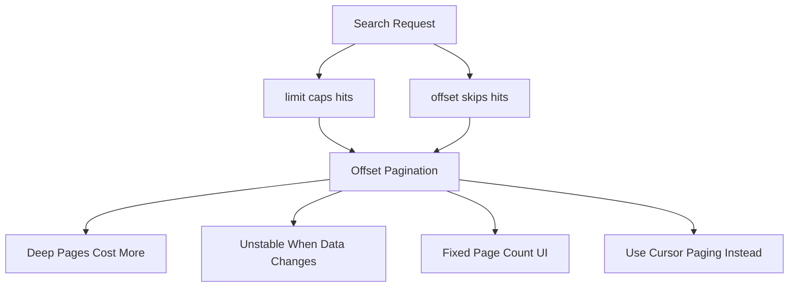

# Pagination Strategies: Offset, Limit, and the Cost of Deep Pages

## English

Meilisearch search requests accept two parameters that control which slice of results you get back: limit, which caps how many hits are returned, and offset, which skips that many hits from the top of the ranked list. Together they implement classic offset pagination, the same model you may know from SQL's LIMIT and OFFSET. A request with limit 20 and offset 40 returns hits 41 through 60 in ranked order. This is simple and works well for the first handful of pages, but it has two costs worth understanding. First, the engine still has to rank and consider everything above the offset to know what to skip, so deep pages do more work than shallow ones. Second, offset pagination is inherently unstable when the underlying data changes between requests: if a new highly relevant document is inserted while a user is on page two, every subsequent page shifts by one, and the user may see a duplicate or miss an item entirely. This is not a Meilisearch bug; it is a property of offset-based paging in any system. For interfaces that show a fixed page count, offset and limit are the right tool, and you can request a total count of matching documents so the UI can render page numbers. For infinite-scroll feeds, a better approach is cursor-style paging: remember the last item the user saw and build the next request around it, either by filtering out already-seen identifiers or by using a stable sort key such as a timestamp and asking only for items beyond it. Meilisearch also exposes a separate facet-search endpoint for fetching facet counts, so you do not need to inflate your main search response just to render filter checkboxes. Finally, note that very large offsets are usually a sign that the user should be narrowing the query with filters rather than paging deeper, and good search UIs encourage exactly that.

## 中文

Meilisearch 的搜尋請求接受兩個參數來控制你要取回哪一段結果：limit 限制回傳多少筆命中，offset 則從排序清單頂端略過那麼多筆。兩者合起來實現了經典的偏移分頁（offset pagination），也就是你在 SQL 的 LIMIT 與 OFFSET 中可能見過的同一套模型。一筆 limit 為 20、offset 為 40 的請求，會依排序回傳第 41 到第 60 筆命中。這很簡單，對前幾頁也運作良好，但有兩個值得理解的代價。第一，引擎仍必須排序並考慮 offset 之上的所有內容，才知道要略過什麼，所以越深的頁面做得比淺頁多。第二，當底層資料在兩次請求之間變動時，偏移分頁本質上就不穩定：如果使用者正在第二頁時插入了一筆高度相關的新文件，之後每一頁都會位移一格，使用者可能看到重複項目或完全漏掉某一項。這不是 Meilisearch 的 bug，而是任何系統中偏移分頁的固有性質。對於顯示固定頁數的介面，offset 與 limit 就是正確工具，而且你可以要求回傳符合文件總數，讓 UI 能繪製頁碼。對於無限捲動的動態牆，更好的做法是游標式分頁（cursor-style paging）：記住使用者看到的最後一項，並圍繞它建構下一次請求，做法可以是過濾掉已看過的識別碼，或使用穩定的排序鍵（例如時間戳）並只要求該鍵之後的項目。Meilisearch 另外還提供獨立的 facet-search 端點來取得分面計數，所以你不需要為了繪製篩選核取方塊而把主要搜尋回應撐大。最後請注意，非常大的 offset 通常是個訊號，代表使用者應該用篩選把查詢收窄，而不是繼續往深處翻頁，而好的搜尋 UI 正是鼓勵這種行為。

## Key Takeaway

Use limit and offset for page-number UIs, but switch to cursor-style paging for infinite scroll because offset paging shifts when data changes underneath.

## Related Concepts
- Facet search endpoint
- Stable sort keys for cursor pagination

## Diagram

