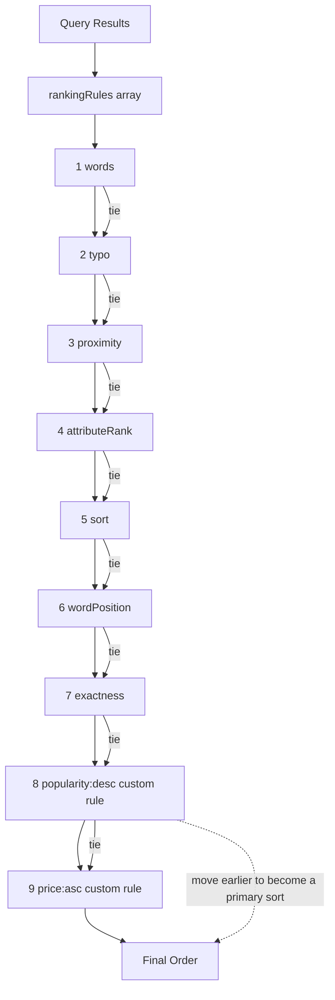

# Custom Ranking Rules: Turning Business Signals into Order

## English

Meilisearch's built-in ranking rules are applied in a strict lexicographic order, and the current default list contains seven rules: words, typo, proximity, attributeRank, sort, wordPosition, and exactness. The older `attribute` rule is a legacy alias that behaves like attributeRank and wordPosition used together; you cannot configure `attribute` alongside attributeRank or wordPosition, because Meilisearch returns an error, and using the two newer rules separately gives you finer control over the order. Each rule compares candidates and only falls through to the next rule when the current one ties.

A custom ranking rule is a standalone entry in the `rankingRules` array, written as `attribute_name:asc` or `attribute_name:desc` on a single attribute. It is not a slot inside the `sort` rule and it is not an expression: there is no formula syntax, and you cannot combine several fields into one rule. To sort by two fields you add two rules. For example, you might add a `popularity:desc` rule so that among two equally matching results the one with more views wins, or a `price:asc` rule so cheaper items surface first.

Whether a custom ranking rule acts as a tie-breaker or as a primary sort depends entirely on where you place it in the `rankingRules` array. Placed after the built-in rules, it only applies when the earlier rules (word match, typo count, proximity, attribute position) produce a tie, so a weak business signal can never drag a poorly matching document above a strongly matching one. Placed earlier in the array, it becomes a primary sort and reorders documents regardless of relevance, which is why the documentation recommends placing custom rules after the built-in ones and warns that a custom rule set at a high position may degrade the search experience. A common mistake is assuming that a high popularity score will promote an item that only partially matches the query; with the rule in the usual trailing position, it will not, because the words rule already separated them.

Custom ranking rules are also declared in the settings, which means you can change them on a live index without reindexing documents. That makes them a cheap lever for experiments: try a popularity rule for a week, measure click-through, then adjust. Be careful with missing fields: the Meilisearch documentation states that if some documents do not contain the attribute used in a custom ranking rule, the application of the rule is undefined and the results might not be sorted as expected. The behaviour for those documents is therefore explicitly undefined, so make sure the attribute is present in every document and test with real data that includes gaps. Finally, keep the rule set small and its ordering deliberate, since every extra rule changes the final order in ways that are hard to reason about and even harder to explain to users when they ask why a result appeared where it did.

## 中文

Meilisearch 的內建排序規則會以嚴格字典序套用，目前預設清單共有七條：words、typo、proximity、attributeRank、sort、wordPosition 與 exactness。舊有的 `attribute` 規則是歷史別名，行為等同同時使用 attributeRank 與 wordPosition；你不能把 `attribute` 與 attributeRank 或 wordPosition 一起設定，因為 Meilisearch 會回傳錯誤，而分開使用那兩條新規則可以更細緻地控制次序。每條規則會比較候選項目，只有在當前規則平手時才會落到下一條規則。

自訂排序規則（custom ranking rule）是 `rankingRules` 陣列中的一個獨立項目，寫法是單一屬性加上 `attribute_name:asc` 或 `attribute_name:desc`。它不是 sort 規則裡面的一個插槽，也不是運算式：沒有公式語法，也不能把多個欄位組合成同一條規則。若要按兩個欄位排序，就加兩條規則。例如，你可以加一條 `popularity:desc` 規則，於是兩筆同樣匹配的結果中，瀏覽數較多的那筆勝出；又或者加一條 `price:asc` 規則，讓較便宜的商品先出現。

自訂排序規則究竟表現為決勝規則（tie-breaker）還是以主要排序的身份生效，完全取決於它在 `rankingRules` 陣列中的位置。放在內建規則之後，它只會在較早的規則（詞語匹配、錯字數、鄰近度、屬性位置）打成平手時才生效，因此薄弱的商業訊號永遠無法把匹配很差的文件拉高到匹配很強的文件之上。若放得較前，它就會成為主要排序，無論相關性也會重新排列文件；正因如此，官方文件建議把自訂規則放在內建規則之後，並警告把自訂規則設在高位置可能會令搜尋體驗變差。常見的誤解是以為高人氣分數會提拔只部分匹配查詢的項目；如果該規則在慣常的較後位置，就不會，因為 words 規則早已把它們分開了。

自訂排序規則也宣告在設定中，這代表你可以在線上索引上更改它們，而不必重新索引文件。這使它們成為做實驗的便宜槓桿：試一週人氣規則、量測點擊率，然後再調整。要小心缺漏的欄位：Meilisearch 官方文件指出，如果部分文件缺少自訂排序規則所用的屬性，該規則的套用行為屬於未定義（undefined），搜尋結果可能不會按你預期的方式排序。因此這些文件的行為是明確未定義的，請確保每份文件都有該屬性，並用包含空缺的真實資料來測試。最後，盡量令規則數目保持精簡、排序次序保持明確，因為每多加一條規則都會改變最終次序，難以推理，更難在使用者問「為什麼這個結果排在這裡」時解釋清楚。

## Key Takeaway

Custom ranking rules are standalone entries in the rankingRules array written as attribute:asc or attribute:desc; they act as tie-breakers only because of where you place them in that list.

## Related Concepts
- Lexicographic ranking rule evaluation
- Live settings changes without reindexing

## Diagram

