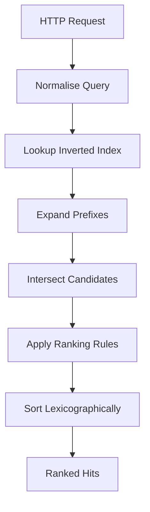

# The Search Pipeline End to End: From HTTP Request to Ranked Hits

## English

It helps to picture a Meilisearch query as a relay race with a handful of baton passes, each one cheap and predictable. The runner starts when your HTTP request lands: the search route carries a query string, optional filter expressions, sort rules, pagination parameters, and switches like attributesToRetrieve or attributesToHighlight. Before any matching happens, the engine normalises the query text — lowercasing, stripping diacritics, splitting on separators — so that the terms it looks up are the same canonical forms that were written into the inverted index at indexing time. That symmetry is the quiet reason search feels instant: both sides of the conversation speak the same normalised language.

Next comes candidate generation. For each query term the engine walks the inverted index to collect the documents that contain that term. Prefix expansion also plays a part, which is why results appear before you finish typing — but note that it applies only to the beginning of the *last* word in the query, while earlier words are matched exactly. Whether the candidate lists are then intersected also depends on the matching strategy: the default `last` strategy drops query words one at a time from the end until it finds matches, so it can return documents matching only a suffix of the query. It is the opt-in `all` strategy that requires every query word to match, which is where a true intersection of the candidate lists happens. Notice the ordering of work: Meilisearch narrows first and scores second, never the other way around, because scoring every document in the index would be wasteful. This is the same instinct as a librarian pulling the right shelf before reading every spine.

Ranking then applies the index's ranking rules in strict lexicographic order, which means the first rule is a total tiebreaker before the second rule is consulted at all. Typical rules cover words, typo count, proximity of matched terms, attribute position, exactness, and any custom rules you have defined. Because the rules are applied as successive sorts rather than a weighted blend, the behaviour is easy to reason about: adding a custom rule at the end only reorders documents that were already tied on everything above it.

The final stage is shaping the response. The engine slices the ranked list according to offset and limit, then projects each hit down to the attributes you asked for, optionally computing highlights and cropping snippets around matched terms. It also tallies facet distribution counts over the full candidate set, not just the returned page, which is why facet counts stay stable as you page through results. The estimated total number of hits is reported separately from the exact count because exact counting on very large candidate sets is the expensive part.

Understanding this pipeline pays off in debugging. If results are missing entirely, the problem is almost always upstream in candidate generation — a filter that excludes everything, a searchable attribute that was never marked searchable, or a document that failed to index. If results are present but oddly ordered, the problem is in the ranking stage. If results are correct but slow, look at pagination depth and the size of the attributes being returned. Each symptom points at a different station on the relay route.

## 中文

要理解 Meilisearch 的查詢，可以想像成一場接力賽，中間有幾次交棒，每一棒都便宜而且可預測。第一棒由你的 HTTP 請求落地開始：搜尋路由會帶上查詢字串、可選的過濾表達式、排序規則、分頁參數，以及 attributesToRetrieve 或 attributesToHighlight 之類的開關。在真正比對之前，引擎會先正規化查詢文字——轉小寫、去除變音符號、按分隔符切詞——令它查詢時用的詞語，與建立索引時寫入反向索引的標準形式完全一致。這種對稱正是搜尋感覺即時的隱藏原因：對話兩邊講的是同一套正規化語言。

接著是候選文件生成。對每個查詢詞，引擎會走訪反向索引，收集包含該詞的文件。前綴擴展也佔一份角色，這就是為何你未打完字就已經有結果——但要注意，前綴擴展只應用在查詢中「最後一個詞」的開頭，較前面的詞是精確比對的。至於候選清單是否真的取交集，則取決於比對策略（matching strategy）：預設的 `last` 策略會由查詢末端逐個刪去字詞，直至找到結果為止，因此它可以回傳只符合查詢後綴的文件；真正要求每個查詢詞都必須命中的是可選用的 `all` 策略，真正的交集也是在那一種情況下發生。留意工作次序：Meilisearch 先收窄範圍、後評分，絕不會反過來，因為為索引內每份文件評分是極度浪費的。這就像圖書館員先拉出正確的書架，而不是讀遍每本書的書脊。

然後進入排名階段，按索引的排名規則以嚴格的字典序套用，意思是第一條規則是徹底的決勝條件，之後才會考慮第二條規則。典型規則包括詞語、錯字數目、詞語鄰近度、屬性位置、精確度，以及你自訂的規則。因為規則是逐層排序而非加權混合，行為很容易推理：在最後加一條自訂規則，只會重新排列那些在上面所有規則都已打平的文件。

最後一階段是塑造回應。引擎按 offset 與 limit 切出排名清單，再把每筆命中投影成你要求的屬性，並可選擇計算高亮與在匹配詞附近裁剪摘要。它亦會對整個候選集合（而非只是當前頁）統計分面分佈計數，這就是為何你翻頁時分面數字保持穩定。估計命中總數會與精確計數分開回報，因為在極大候選集合上做精確計數正是最昂貴的部分。

理解這條管道對除錯很有幫助。如果完全沒有結果，問題幾乎總是在上游的候選生成——某個過濾條件排除了所有東西、某個屬性從未被標記為可搜尋，或者某份文件索引失敗。如果結果存在但次序古怪，問題就在排名階段。如果結果正確但慢，就要看分頁深度與回傳屬性的大小。每個症狀都指向接力路線上的不同站點。

## Key Takeaway

Meilisearch runs a fixed pipeline — normalise, generate candidates, rank lexicographically, then shape the response — and each failure symptom points to a specific stage.

## Related Concepts
- Inverted index
- Lexicographic ranking rules

## Diagram

