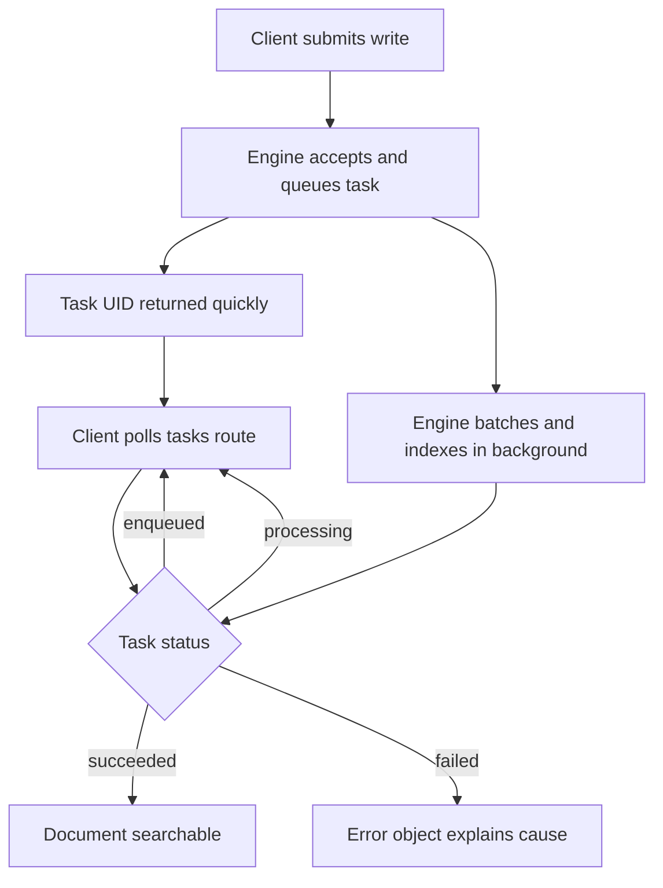

# Consistency Guarantees: Why a Write Is Not Visible Immediately

## English

One of the first surprises when integrating Meilisearch is that adding a document does not mean searching for it will find it a millisecond later. Writes are asynchronous: a document addition, a settings change, or a deletion is accepted, queued as a task, and given an identifier. The HTTP call returns quickly with a task UID rather than with the indexed result. This is a deliberate design choice, not a limitation to work around, and understanding it changes how you structure application code.

The task queue exists because indexing is the expensive part of a search engine. Building inverted index entries, updating prefix structures, recomputing facet databases, and rewriting ranking data all take CPU and disk. If every write blocked until indexing finished, a bulk import of a hundred thousand documents would serialise into an unusably slow request, and concurrent writers would fight over the same resources. By queueing, the engine can batch compatible tasks, apply them in order, and keep read traffic flowing against a consistent snapshot of the index while writes are processed in the background.

In practice you interact with this through task polling. After submitting a write you receive a task UID; you then query the tasks route for that UID and inspect its status, which moves from enqueued to processing to succeeded or failed. A failed task carries an error object explaining why — a malformed document, a primary key mismatch, a filter that references an attribute not configured as filterable. Because tasks are recorded durably, you can inspect history rather than guess what happened. Many client SDKs offer a convenience method that waits for a task to finish, which is fine for scripts and tests but dangerous in a request handler, where it turns a fast write into a long blocking call.

The user-facing consequence is read-after-write inconsistency. A user edits their profile, you submit the document, you redirect them to a search page, and their change is not there yet. The standard fixes are to wait on the task before responding when the user must see their own change, to optimistically update the client-side copy of the data, or to design the interface so the confirmation comes from the write path rather than from search. For search-as-you-type experiences this rarely matters, because the delay is typically short and the user is not expecting their own brand-new content to appear instantly.

There is also a subtler point about ordering. Tasks are processed in the order they are enqueued, so a settings change submitted before a document addition will be applied first. This gives you a predictable way to sequence schema-like changes against data changes. The practical rule of thumb: treat Meilisearch as an eventually consistent read model fed by an ordered task queue, keep your source of truth in your primary database, and never make correctness of a write depend on the search index having caught up.

## 中文

整合 Meilisearch 時最先遇到的意外之一，是新增文件並不代表下一刻搜尋就找得到它。寫入是非同步的：新增文件、更改設定、刪除文件都會被接受、排入佇列成為一個任務，並獲發一個識別碼。HTTP 呼叫很快回傳一個任務 UID，而不是索引完成的結果。這是刻意的設計選擇，不是要繞過的缺陷，理解它會改變你組織應用程式碼的方式。

任務佇列之所以存在，是因為建立索引才是搜尋引擎最昂貴的部分。建立反向索引條目、更新前綴結構、重算分面資料庫、重寫排名資料，全部都要消耗 CPU 與磁碟。如果每次寫入都要阻塞到索引完成，匯入十萬份文件就會串行化成一個慢得不能用的請求，而並行寫入者亦會爭奪同一批資源。透過排隊，引擎可以把相容的任務合批、按次序套用，並在背景處理寫入的同時，讓讀取流量繼續對著索引的一致快照運行。

實務上，你是透過輪詢任務來與此互動。提交寫入後你會收到任務 UID；然後你查詢該 UID 的任務路由並檢視其狀態，狀態會由 enqueued 變成 processing，再到 succeeded 或 failed。失敗的任務會帶著一個錯誤物件解釋原因——文件格式錯誤、主鍵不匹配、過濾條件引用了未配置為可過濾的屬性。因為任務有持久記錄，你可以查看歷史而不是猜測發生了什麼。很多客戶端 SDK 提供一個等待任務完成的便利方法，這對腳本與測試沒問題，但在請求處理器中就很危險，會把快速寫入變成漫長的阻塞呼叫。

對使用者最直接的後果是讀後寫不一致。使用者編輯個人檔案，你提交文件，然後把他們重定向到搜尋頁，但他們的改動還未出現。標準解法包括：當使用者必須看到自己的改動時，先等待任務完成才回應；在客戶端樂觀地更新資料副本；或者設計介面，令確認訊息來自寫入路徑而非搜尋。對即時輸入即搜尋的體驗而言，這通常無關痛癢，因為延遲一般很短，而使用者並不期望自己剛新增的內容即時出現。

還有一個更微妙的次序問題。任務按入佇列的次序處理，所以先提交的設定變更會先於後提交的文件新增被套用。這給你一個可預測的方法，去編排類似結構變更與資料變更的次序。實用的經驗法則：把 Meilisearch 視為一個由有序任務佇列餵養的最終一致讀取模型，把真實來源留在你的主資料庫，永遠不要讓寫入的正確性依賴搜尋索引已經追上。

## Key Takeaway

Meilisearch writes are queued tasks, not synchronous operations, so design for read-after-write inconsistency by polling task status or updating the client optimistically.

## Related Concepts
- Asynchronous task queue
- Eventual consistency

## Diagram

