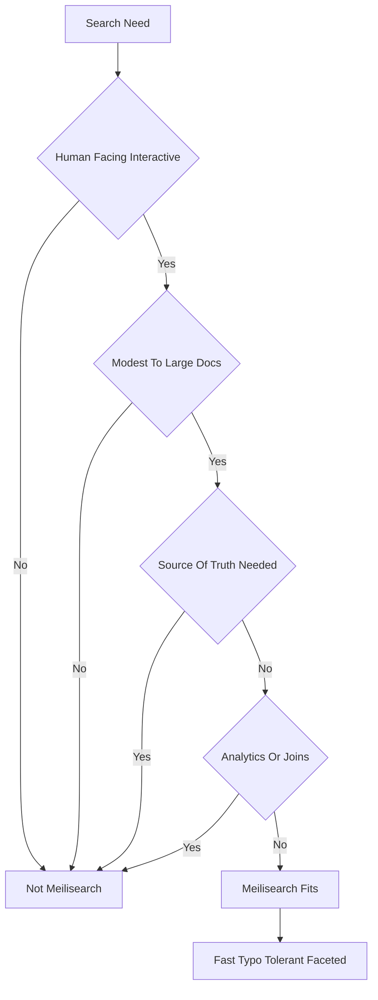

# Choosing the Right Tool: When Meilisearch Fits and When It Does Not

## English

Meilisearch occupies a specific niche, and knowing its edges prevents both disappointment and over-engineering. It is a full-text search engine built for human-facing, interactive search over modest-to-large document collections — product catalogues, documentation sites, internal knowledge bases, community forums. Its strengths are fast prefix matching, built-in typo tolerance, faceted filtering, and a developer experience that lets you go from zero to a working search box in an afternoon. Its design centre is relevance that feels good to a person typing into a box, not exhaustive retrieval over billions of documents.

Where it is a poor fit is equally instructive. It is not an analytics engine: you would not use it to compute aggregations over millions of records the way you would use a columnar warehouse. It is not a transactional store: it should never be your source of truth, and you should expect to be able to rebuild the whole index from your primary database at any time. It is not designed for the scale of a web-wide crawler index; its memory model assumes the working set fits comfortably in RAM, and sharding exists only in the Enterprise Edition under a BUSL licence, so it adds both operational complexity and a commercial decision. If you need complex boolean logic across dozens of fields, or SQL-style joins at query time, a traditional relational database with a full-text extension may serve you better.

Comparisons with other search engines are usually framed around trade-offs rather than winners. Engines built on Apache Lucene offer enormous flexibility in analysers, scoring customisation, and distributed scale, at the cost of more configuration and more operational surface. Managed search services remove the operational burden but tie you to a vendor and a pricing model. Vector-first databases excel at semantic similarity but may lack the crisp typo-tolerant keyword matching users expect from a search box. Meilisearch's bet is that most product search problems are keyword problems with a semantic garnish, not the reverse, and that a small, fast, opinionated engine beats a large, configurable one for that job.

A useful decision heuristic is to ask three questions. First, how many documents, and does the searchable working set fit in memory? If you are in the millions with heavy text, plan carefully. Second, how important is relevance tuning versus out-of-the-box quality? Meilisearch gives you good defaults and a limited but sharp set of knobs; if you need per-field analysers and custom scoring scripts, look elsewhere. Third, what is your operational appetite? Self-hosting is straightforward but you own backups, upgrades, and monitoring; a managed offering trades money for that burden.

Finally, consider the shape of your queries. If your users type short, misspelled, prefix-y queries and expect instant feedback with facet counts, Meilisearch is close to ideal. If your queries are long natural-language questions expecting paraphrased answers, you probably want a hybrid setup where a semantic layer handles recall and a keyword engine handles precision. Being honest about which of these you actually have — rather than which sounds more advanced — is the single most useful step before committing.

## 中文

Meilisearch 佔據一個特定的生態位，清楚它的邊界可以同時避免失望與過度工程。它是一個全文搜尋引擎，為面向人、互動式的搜尋而建，處理中等至大型的文件集合——產品目錄、文件網站、內部知識庫、社群論壇。它的強項是快速前綴匹配、內建錯字容忍、分面過濾，以及讓你在一個下午內由零做到可用搜尋框的開發者體驗。它的設計中心是「對著搜尋框打字的人覺得好用」的相關性，而不是在數十億份文件上做窮盡式檢索。

它不適合的地方同樣有啟發性。它不是分析引擎：你不會用它像欄式資料倉庫那樣對數百萬筆記錄做聚合運算。它不是交易式儲存：它永遠不應是你的真實來源，你應該預期隨時能從主資料庫重建整個索引。它並非為網頁級爬蟲索引的規模而設計；它的記憶體模型假設工作集能舒適地放進 RAM，而分片功能只存在於採用 BUSL 授權的 Enterprise Edition，所以它同時帶來維運複雜度同埋商業授權上的取捨。如果你需要跨幾十個欄位的複雜布林邏輯，或查詢時的 SQL 式連接，傳統關聯式資料庫加上全文擴充可能更適合你。

與其他搜尋引擎的比較，通常圍繞取捨而非誰勝誰負。建基於 Apache Lucene 的引擎在分析器、評分自訂與分散式規模上提供極大彈性，代價是更多配置與更大的維運面。託管搜尋服務消除了維運負擔，但把你綁在供應商與定價模式上。向量優先的資料庫擅長語意相似度，但可能缺乏使用者對搜尋框期望的乾脆錯字容忍關鍵詞匹配。Meilisearch 的賭注是：大多數產品搜尋問題本質是關鍵詞問題加上一點語意點綴，而非相反；對這份工作而言，一個小而快、有主見的引擎勝過一個大而可配置的引擎。

一個實用的判斷方法是問三個問題。第一，文件有多少，可搜尋的工作集是否放得進記憶體？如果你有數百萬份文字量大的文件，就要仔細規劃。第二，相關性調校相對開箱即用的品質有多重要？Meilisearch 給你良好預設與一組有限但銳利的旋鈕；如果你需要逐欄位分析器與自訂評分腳本，就要另覓他處。第三，你的維運胃口如何？自架很直接，但你要自己負責備份、升級與監控；託管方案就是用金錢換走這份負擔。

最後，考慮你查詢的形態。如果你的使用者輸入短、有錯字、帶前綴的查詢，並期望即時回饋與分面計數，Meilisearch 近乎理想。如果你的查詢是長篇自然語言問題、期望改寫式答案，你大概想要混合架構，由語意層負責召回、關鍵詞引擎負責精確度。誠實面對你實際擁有的是哪一種——而不是哪一種聽起來更高級——是投入之前最有用的一步。

## Key Takeaway

Meilisearch is a keyword-first engine for interactive product search, so choose it when typo-tolerant prefix matching over in-memory collections is the problem, not when you need analytics, transactions, or web-scale crawling.

## Related Concepts
- Search engine trade-offs
- Hybrid keyword and semantic search

## Diagram

