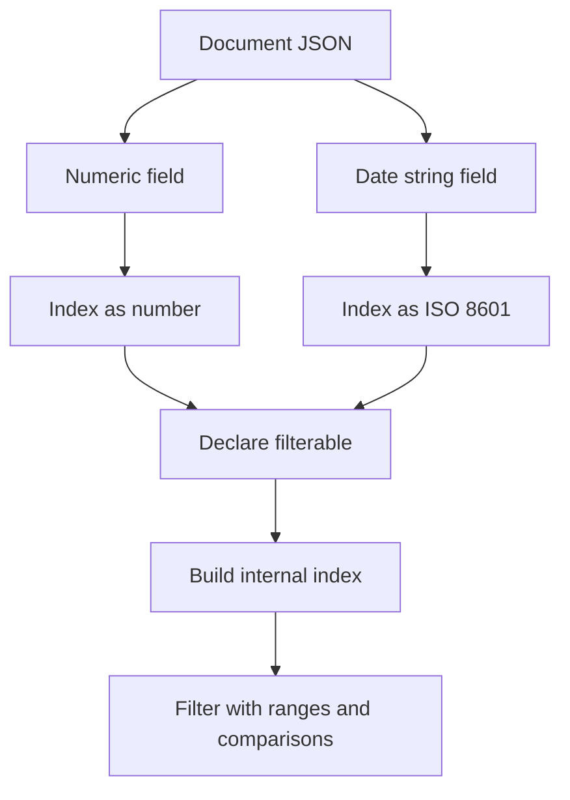

# How Meilisearch Handles Numbers, Dates, and Ranges in Filters

## English

Most people think of a search engine as handling text, but a huge share of real queries involve numbers and dates: price under 50, released after 2020, rating at least 4. Meilisearch stores documents as JSON, so a field like price is written as a JSON number (not a quoted string) and a field like release_date as an ISO-8601 string such as "2021-03-14". The type you choose at indexing time determines what comparisons you can do later. Numeric fields support numeric comparison operators in filters, while string fields only support equality and a limited set of string operators. If you store a price as the string "49.99" you lose the ability to ask for price < 50 in a natural way, so the first lesson is simply: index numbers as numbers and dates in a consistent, sortable string format.

Filters in Meilisearch are written as a small expression language. You combine conditions with AND, OR, and NOT — NOT is the negation operator in the filter grammar (there is no leading-minus filter operator; a leading `-` is query-search syntax, not filter syntax) — group them with parentheses, and compare field values to literals. A typical filter looks like `price < 50 AND (category = "books" OR category = "games")`. For this to work, the fields you reference must be declared filterable in the index settings. That declaration is not free: it tells the engine to build an internal structure so it can answer the condition quickly. Declaring every field filterable bloats the index and slows indexing, so you should declare only the fields you actually filter on.

Dates are the interesting case. Meilisearch does not have a dedicated date type in the way a relational database does. Instead, you store dates as strings in a format that sorts lexicographically in the same order as chronologically, which is exactly what ISO-8601 gives you: "2021-03-14" sorts before "2021-03-15" as plain text. You can then use range comparisons like `release_date > "2020-01-01"`. The catch is consistency: if some documents store "2021-3-4" and others store "2021-03-04", string comparison will not behave the way you expect. Pick one canonical format, ideally full ISO-8601 with zero-padded months and days, and convert at write time.

A practical pattern for e-commerce is to keep both a display value and a filter value. Store `price_display: "$49.99"` for showing to users and `price_cents: 4999` as an integer for filtering and sorting. Integers avoid floating-point comparison surprises entirely, and cents are exact. The same idea applies to dates: store `release_date: "2021-03-14"` for range filters and `release_year: 2021` as an integer if you frequently filter by year, because comparing an integer is simpler and less error-prone than slicing strings. This kind of denormalization feels redundant but is standard practice in search indices, which are optimized for reading, not for normalization.

Finally, remember that filters and search interact. A filter narrows the candidate set before or alongside ranking, so a filter that matches zero documents returns zero hits even if the query text would have matched many. When debugging a query that returns nothing, first check whether the filter is the culprit by removing it and re-running. Also note that filterable attributes and sortable attributes are configured separately; making a field filterable does not automatically make it sortable, and vice versa. Reading the settings for an index is the fastest way to understand why a particular filter or sort is rejected with an error.

## 中文

大部分人以為搜尋引擎只處理文字，但實際上大量真實查詢都涉及數字和日期：價格低於五十、二〇二〇年之後推出、評分至少四星。Meilisearch 以 JSON 儲存文件，所以 price 這類欄位會寫成 JSON 數字（而不是加引號的字串），而 release_date 這類欄位則寫成 ISO-8601 格式的字串，例如「2021-03-14」。你在建立索引時選擇的型別，決定了日後可以做哪些比較。數字欄位在過濾器中支援數值比較運算子，而字串欄位只支援相等和少數字串運算子。如果你把價格存成字串「49.99」，你就失去了自然地查詢 price < 50 的能力，所以第一課很簡單：數字就存成數字，日期就用一致、可排序的字串格式。

Meilisearch 的過濾器寫成一種小型表達式語言。你用 AND、OR 和 NOT 組合條件——NOT 就係過濾器語法裡的否定運算子（並冇前置減號這種過濾器運算子；前置 `-` 係查詢搜尋語法，唔係過濾器語法）——用括號分組，並把欄位值與字面值比較。典型的過濾器長這樣：`price < 50 AND (category = "books" OR category = "games")`。要讓它生效，你引用的欄位必須在索引設定中宣告為可過濾（filterable）。這個宣告不是免費的：它告訴引擎建立內部結構，以便快速回答該條件。把每個欄位都宣告為可過濾會令索引膨脹、拖慢索引建立，所以你應該只宣告真正會用來過濾的欄位。

日期是最有趣的情況。Meilisearch 不像關聯式資料庫那樣有專用的日期型別。取而代之，你把日期存成字串，格式要令字典序排序與時間先後順序一致，而 ISO-8601 正好提供這一點：「2021-03-14」以純文字比較時排在「2021-03-15」之前。你之後就可以用 `release_date > "2020-01-01"` 這類範圍比較。陷阱在於一致性：如果有些文件存「2021-3-4」，另一些存「2021-03-04」，字串比較就不會如你預期。選定一種標準格式，最好是月份和日期都補零的完整 ISO-8601，並在寫入時轉換。

電子商務的一個實用模式是同時保留顯示值和過濾值。儲存 `price_display: "$49.99"` 給用戶看，並儲存 `price_cents: 4999` 作為整數供過濾和排序。整數完全避免了浮點比較的意外，而「分」是精確的。同樣道理適用於日期：儲存 `release_date: "2021-03-14"` 供範圍過濾，若你經常按年份過濾，就另外儲存 `release_year: 2021` 作為整數，因為比較整數比切割字串更簡單、更不易出錯。這種反正規化感覺多餘，但這是搜尋索引的標準做法，因為索引是為讀取而優化，不是為正規化而優化。

最後，記住過濾器和搜尋會互動。過濾器會在排名之前或同時收窄候選集，所以一個匹配零份文件的過濾器會回傳零筆結果，即使查詢文字本身能匹配很多文件。當你除錯一個回傳空結果的查詢時，先移除過濾器再跑一次，看看它是否罪魁禍首。另外要注意，可過濾屬性和可排序屬性是分開設定的；令欄位可過濾不會自動令它可排序，反之亦然。讀取索引的設定，是理解為何某個過濾或排序被拒絕並回傳錯誤的最快方法。

## Key Takeaway

Store numbers as numbers and dates as consistent ISO-8601 strings, declare only the fields you truly filter on, and remember filters and sorts are configured separately.

## Related Concepts
- Filterable and sortable attribute settings
- Document schema design for search

## Diagram

