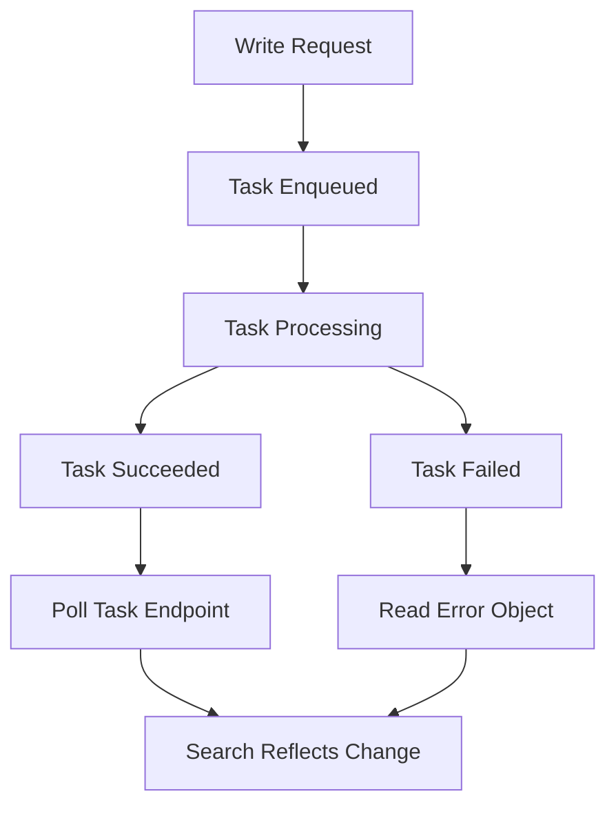

# The Task Queue as the Source of Truth for Writes

## English

When you send a document to Meilisearch, the HTTP response does not mean the document is searchable. It means the engine accepted a task. Every write, every settings change, every index creation is enqueued as a task with an identifier and a status such as enqueued, processing, succeeded, or failed. This design is deliberate: indexing is expensive and asynchronous, so the API stays fast and predictable while the heavy work happens in the background. Understanding the task queue is the difference between a search feature that feels reliable and one that mysteriously shows stale results.

A task moves through states. First it is enqueued, meaning it is waiting its turn. Then it becomes processing while the indexer works on it. Finally it becomes succeeded or failed, and a failed task carries an error object explaining what went wrong, for example a document missing the primary key or a filter referencing a non-filterable attribute. Tasks are processed roughly in the order they were received, but batching means several tasks can be combined into one indexing pass, which is why throughput is much higher when you submit many documents at once rather than one at a time. If you send a thousand single-document tasks, the engine may still batch them, but sending one task with a thousand documents is clearer and usually faster.

The practical consequence is that your application must handle eventual consistency. After a write, a search may not yet reflect it. There are two common patterns. The first is to poll the task endpoint until the task reaches a terminal state, then proceed. This is simple and correct but adds latency. The second is to design the UI so that brief staleness is acceptable, for example showing the user's own newly created item optimistically from local state while the index catches up. Both are valid; what is not valid is assuming the write is instantly visible. A common bug is a test that writes a document and immediately searches for it, which passes locally when the machine is idle and fails in CI when the queue is busy.

Task history is also an operational tool. You can list tasks and filter by status, index, or type, which lets you answer questions like: did last night's import fail, and on which document? Was the settings change applied before or after the reindex? Because tasks are persisted, this history survives restarts, so it doubles as a lightweight audit log. When something looks wrong in production, checking recent failed tasks is often faster than reading application logs, because the engine records the exact error at the point of failure.

Two subtleties are worth remembering. First, task identifiers are monotonically increasing, so you can use them as a watermark: record the highest task ID you have seen and wait until that ID has completed before considering a batch durable. Second, cancellation and deletion of tasks exist but should be used carefully; cancelling a task that is already processing may not take effect immediately, and deleting task history removes your audit trail. Treat the queue as a first-class part of your architecture, not an implementation detail you can ignore.

## 中文

當你把一份文件送到 Meilisearch，HTTP 回應並不代表文件已可被搜尋。它代表引擎接受了一個任務。每一次寫入、每一次設定變更、每一次建立索引，都會以任務形式排入佇列，附有識別碼和狀態，例如 enqueued、processing、succeeded 或 failed。這個設計是刻意的：索引建立成本高且非同步，所以 API 保持快速和可預測，而繁重的工作在背景進行。理解任務佇列，就是「搜尋功能感覺可靠」與「搜尋功能神秘地顯示過時結果」之間的差別。

任務會經歷多個狀態。首先它是 enqueued，表示正在排隊等候。然後在索引器處理它時變成 processing。最後變成 succeeded 或 failed，而失敗的任務會帶有一個錯誤物件解釋出了什麼問題，例如文件缺少主鍵，或過濾器引用了不可過濾的屬性。任務大致按接收順序處理，但批次處理意味著多個任務可以合併成一次索引處理，這就是為何一次提交大量文件比逐份提交吞吐量高得多。如果你送出一千個單文件任務，引擎仍可能把它們批次處理，但送出一個包含一千份文件的任務更清晰，通常也更快。

實際後果是你的應用程式必須處理最終一致性。寫入之後，搜尋可能尚未反映它。有兩種常見模式。第一種是輪詢任務端點，直到任務達到終止狀態，然後繼續。這簡單且正確，但增加延遲。第二種是設計介面，令短暫的過時可以接受，例如從本地狀態樂觀地顯示用戶剛建立的項目，同時索引在追趕。兩者都可行；不可行的是假設寫入即時可見。一個常見的錯誤是測試先寫入文件然後立即搜尋，這在機器閒置時本地通過，但在佇列繁忙的 CI 中失敗。

任務歷史也是一種營運工具。你可以列出任務並按狀態、索引或類型過濾，這讓你回答這類問題：昨晚的匯入是否失敗，在哪份文件上失敗？設定變更是在重建索引之前還是之後套用？由於任務會被持久化，這段歷史在重啟後仍然存在，所以它同時是一份輕量的審計日誌。當生產環境看起來出問題時，檢查最近失敗的任務往往比閱讀應用程式日誌更快，因為引擎在失敗點記錄了確切的錯誤。

有兩個微妙之處值得記住。第一，任務識別碼單調遞增，所以你可以把它當作水位標記：記錄你見過的最高任務 ID，並等待該 ID 完成後才認為一批寫入已持久化。第二，任務的取消和刪除確實存在，但應謹慎使用；取消一個已在處理中的任務可能不會即時生效，而刪除任務歷史會移除你的審計軌跡。把佇列視為架構中一等公民的一部分，而不是可以忽略的實作細節。

## Key Takeaway

Every write returns a task, not a guarantee, so poll or design for eventual consistency and treat task history as an audit log.

## Related Concepts
- Eventual consistency in search
- Asynchronous indexing pipelines

## Diagram

