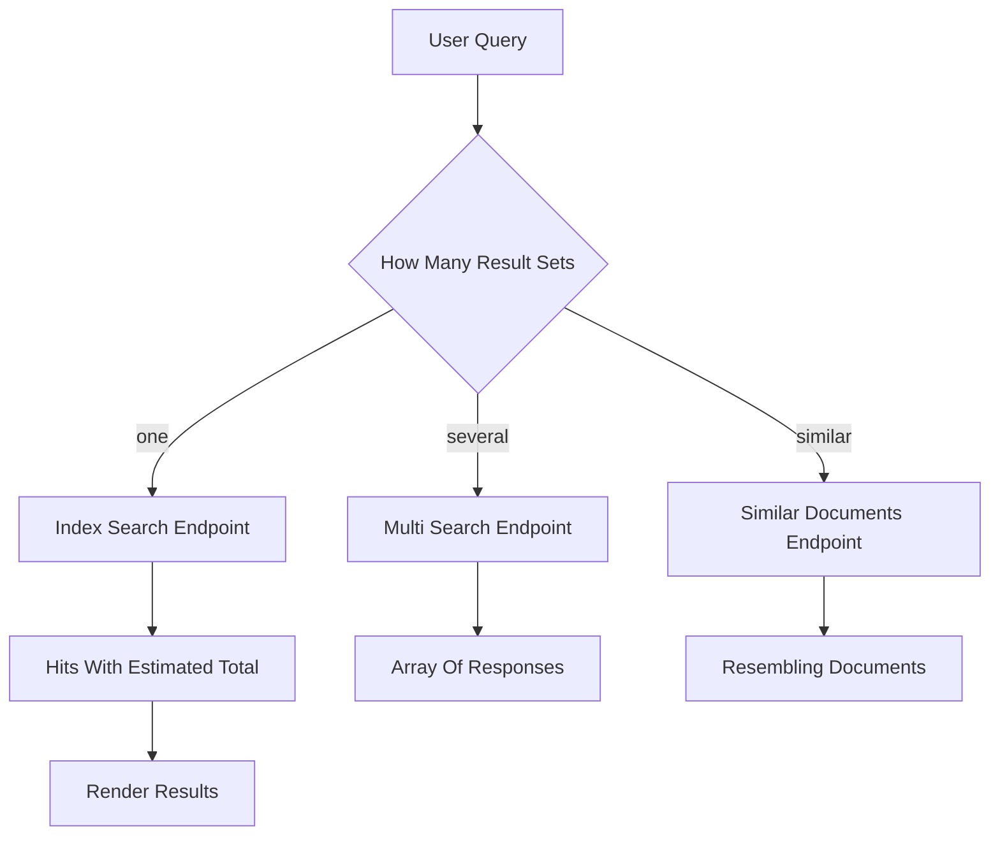

# Choosing Between Search Endpoints and What Each One Returns

## English

Meilisearch exposes several ways to ask for results, and they are not interchangeable. The main one is the search endpoint on an index, which takes a query string and returns ranked hits with metadata. There is also a multi-search endpoint that runs several queries in one HTTP round trip, and a similar-documents endpoint that finds documents resembling a given one. Knowing which to reach for saves latency and simplifies your client code. The distinction matters most in user interfaces that show several result lists at once, for example a global search box that previews products, articles, and people side by side.

The single-index search endpoint is the workhorse. You provide a query, and optionally parameters such as limit, offset, filter, sort, attributes to retrieve, and attributes to highlight. The response includes the hits array, plus useful extras like the estimated total number of matches and processing time. A subtle point is that the total is an estimate, not an exact count, because computing an exact count over a huge candidate set would be expensive; the engine stops counting once it is confident enough. If you need precise counts for pagination UI, be aware of this and design your pagination to tolerate approximation, or restrict the query enough that the estimate is reliable.

Multi-search exists because HTTP round trips dominate latency when you need several result sets. Instead of three requests to three indices, you send one request containing an array of queries, each naming its index and its own parameters, and receive an array of responses in the same order. The queries still run against the same server and share the same underlying engine, so this is not parallelism magic; it is the elimination of network overhead and connection setup. For a search-as-you-type interface that shows a handful of categories, this can cut perceived latency noticeably. The trade-off is that a single slow query delays the whole batch, so keep each query cheap.

The similar-documents endpoint is a different beast. It takes an identifier of an existing document and returns other documents that are close to it according to the vector or textual representation the engine has stored. This is useful for recommendation-style features: show products like this one. It is not a replacement for search, because there is no query string and no user intent expressed in words. If you find yourself wanting to combine a text query with similarity, that is a sign you want hybrid search with embedders rather than either endpoint alone.

A final practical note concerns payload size. Returning full documents with every hit is convenient but wasteful when documents are large. Use the attributes-to-retrieve parameter to return only the fields the UI needs, and fetch the rest lazily when the user opens a result. Similarly, highlighting is computed server-side and adds work; request it only for fields you actually display with emphasis. These small choices compound: a search box that returns three fields instead of thirty feels instant, while the same engine returning everything can feel sluggish purely because of serialization and network transfer.

## 中文

Meilisearch 提供幾種請求結果的方式，它們不能互換。主要的一種是索引上的搜尋端點，它接受查詢字串並回傳附有中繼資料的排名結果。另外還有多重搜尋端點，可在一次 HTTP 往返中執行多個查詢，以及相似文件端點，找出與給定文件相似的文檔。知道該用哪一個，可節省延遲並簡化客戶端程式碼。這個區別在同時顯示多個結果列表的介面中最為重要，例如一個同時預覽產品、文章和人物的全域搜尋框。

單一索引搜尋端點是主力。你提供查詢，並可選地提供 limit、offset、filter、sort、要擷取的屬性，以及要突顯的屬性等參數。回應包含 hits 陣列，以及一些有用的額外資訊，例如估計的匹配總數和處理時間。一個微妙之處是總數是估計值而非精確計數，因為在龐大的候選集上計算精確計數會很昂貴；引擎在足夠確信後就停止計數。如果你需要為分頁介面提供精確計數，要注意這一點，並設計分頁以容忍近似值，或把查詢限制得足夠窄，令估計可靠。

多重搜尋之所以存在，是因為當你需要多個結果集時，HTTP 往返主導了延遲。與其向三個索引發出三個請求，你送出一個包含查詢陣列的請求，每個查詢指定其索引和自己的參數，然後按相同順序收到回應陣列。這些查詢仍在同一伺服器上執行，共享同一個底層引擎，所以這不是平行處理的魔法；它是消除了網絡開銷和連線建立。對於顯示少量分類的即時搜尋介面，這可明顯降低感知延遲。代價是單一緩慢查詢會拖慢整批，所以要保持每個查詢便宜。

相似文件端點是另一回事。它接受現有文件的識別碼，並根據引擎儲存的向量或文字表示，回傳其他與它接近的文件。這對推薦式功能很有用：顯示與這件產品相似的產品。它不是搜尋的替代品，因為沒有查詢字串，也沒有用文字表達的用戶意圖。如果你發現自己想結合文字查詢與相似度，這表示你想要的是配合嵌入器的混合搜尋，而不是單用任何一個端點。

最後一個實用要點關於回應負載大小。每次命中都回傳完整文件很方便，但當文件很大時很浪費。使用要擷取的屬性參數，只回傳介面需要的欄位，並在用戶開啟結果時才延遲取得其餘部分。同樣，突顯是伺服器端計算的，會增加工作量；只對你真正以強調方式顯示的欄位請求它。這些小選擇會累積：一個回傳三個欄位而非三十個欄位的搜尋框感覺即時，而同一個引擎回傳所有東西可能純粹因為序列化和網絡傳輸而感覺遲緩。

## Key Takeaway

Use single-index search for one result set, multi-search to collapse several queries into one round trip, and similar-documents for recommendations rather than text search.

## Related Concepts
- HTTP latency and request batching
- Payload shaping with attributes to retrieve

## Diagram

