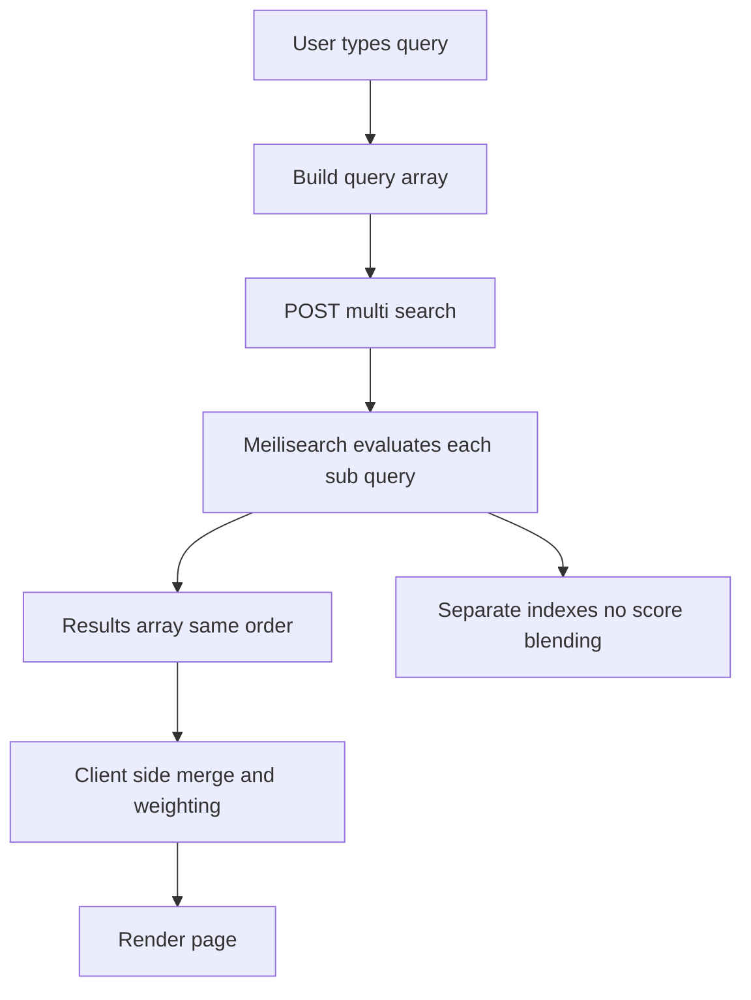

# Multi-Search and Federated Queries: Asking Many Questions in One Round Trip

## English

A typical product page does not make one search request; it makes several. You might need the top three matching products, the top two matching categories, a count of matching reviews, and a suggestion list — all for the same typed query. If each of those is a separate HTTP call, you pay the network round trip and the per-request overhead again and again, and the browser renders in a staggered, flickering way. Meilisearch's multi-search endpoint (POST /multi-search) exists to collapse that fan-out into a single request: you send an array of queries, each with its own indexUid, query text, filter, limit, and other parameters, and you get back an array of results in the same order. Each sub-query is still evaluated independently against its own index, so you are not merging relevance scores across indexes — you are simply batching the transport.

The distinction matters. True federated search would take results from several indexes, normalise their scores onto a comparable scale, and produce one blended ranked list. Multi-search does not do that for you; it returns separate result sets and leaves the blending decision to your application. That is usually the right call, because blending relevance across heterogeneous indexes (products versus help articles versus user profiles) is a product decision, not an engine decision. A common pattern is to give each sub-query a small limit, then merge client-side with your own weighting — for example, boosting exact product-name matches over support articles.

There is a real performance argument here beyond convenience. Each HTTP request carries connection setup, header parsing, authentication, and JSON serialisation costs. Batching five queries into one request amortises all of that, and on a high-traffic search bar the difference in perceived latency is measurable. It also simplifies consistency: the sub-queries in a single multi-search request are processed against the index state at roughly the same moment, so you are less likely to render a page where the product list reflects a newer index than the category counts.

Practical caveats: multi-search is a read-only convenience, so it does not change how writes or task queuing work — if a document was just added and its task has not been processed, none of your sub-queries will see it. Keep the number of sub-queries modest; each one still consumes search-time CPU and memory, so a request with twenty heavy queries is not free just because it is one round trip. And remember that per-query parameters like filter and sort are evaluated per sub-query, so a filterable attribute must be configured on each index that uses it.

The mental model: multi-search is a bundling layer over the ordinary search endpoint. It buys you latency and simplicity at the transport level, not cross-index relevance merging. Design your UI around several small, purposeful sub-queries rather than one giant query, and do the blending yourself where you can reason about it.

## 中文

一個典型的產品頁面並不是只發出一個搜尋請求，而是好幾個。你可能需要最匹配的三件產品、最匹配的兩個分類、符合條件的評論數量，以及一份建議清單——全部針對同一段輸入文字。如果每一個都是獨立的 HTTP 呼叫，你就要一次又一次付出網絡往返與每個請求的固定開銷，瀏覽器也會斷斷續續地渲染、閃爍。Meilisearch 的 multi-search 端點（POST /multi-search）就是為了把這種扇出（fan-out）壓縮成單一請求：你送出一個查詢陣列，每個查詢各自帶 indexUid、查詢文字、filter、limit 等參數，回傳的結果陣列則依相同順序排列。每個子查詢仍然是獨立地對自己的索引求值，所以它並不是把不同索引的相關性分數合併起來——它只是把傳輸批次化。

這個區別很重要。真正的聯邦搜尋（federated search）會把多個索引的結果收集起來，把它們的分數正規化到可比較的尺度，再產生一份混合排序清單。multi-search 不會替你這樣做；它回傳各自獨立的結果集，把混合的決定留給你的應用程式。這通常才是對的，因為在異質索引之間（產品、說明文章、使用者檔案）混合相關性是產品決策，不是引擎決策。常見做法是給每個子查詢一個很小的 limit，然後在客戶端用你自己的權重合併——例如讓產品名稱完全相符的結果優先於支援文章。

這裡除了方便之外，還有實質的效能理由。每個 HTTP 請求都帶著連線建立、標頭解析、身分驗證與 JSON 序列化的成本。把五個查詢批次成一個請求，就能攤提所有這些成本，而在高流量的搜尋列上，感知延遲的差異是可以量測的。它也簡化了資料一致性：同一個 multi-search 請求裡的子查詢，大約是在同一個時間點對索引狀態求值，所以你比較不會渲染出「產品清單反映較新的索引、分類計數卻反映較舊索引」的頁面。

實務上的注意事項：multi-search 只是唯讀的便利功能，它不會改變寫入或任務佇列（task queue）的運作方式——如果某份文件才剛加入、其任務尚未被處理，你的任何子查詢都看不到它。子查詢數量要克制；每一個仍然會消耗搜尋期的 CPU 與記憶體，所以一個包含二十個沉重查詢的請求，不會因為只算一次往返就變得免費。另外要記得，filter、sort 這類參數是逐子查詢求值的，因此每個用到某個可過濾屬性的索引，都必須各自設定好該屬性。

心智模型是這樣：multi-search 是疊在一般搜尋端點之上的批次封裝層。它買到的是傳輸層面的延遲與簡潔，而不是跨索引的相關性合併。把你的介面設計成幾個小而各有明確目的的子查詢，而不是一個巨無霸查詢，並且在你能夠推理的地方自己動手做混合。

## Key Takeaway

Multi-search batches several independent per-index queries into one HTTP round trip for latency and simplicity, but it does not blend relevance across indexes — that merging stays in your application.

## Related Concepts
- Federated search
- HTTP request batching

## Diagram

