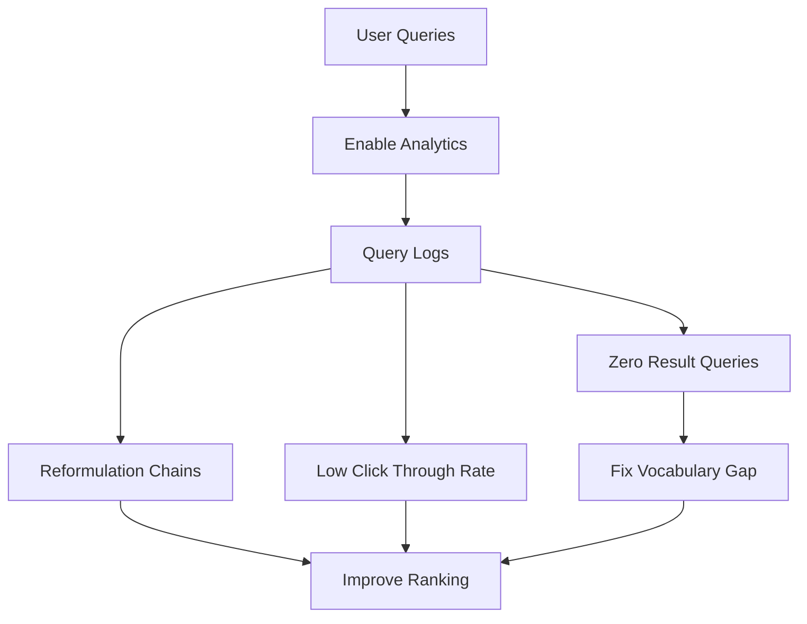

# Search Analytics: Turning Query Logs into a Relevance Feedback Loop

## English

A search engine that nobody measures is a search engine that quietly rots. Users rarely file a bug report when search fails; they just leave. The only reliable signal that something is wrong is the shape of the queries themselves — which ones return zero results, which ones get reformulated, which ones are followed by a click and which by an immediate bounce. Meilisearch exposes this through its search analytics endpoints: you can enable analytics so the engine records queries, and then retrieve aggregates such as the most frequent queries, the queries that returned no results, and the ones with the lowest click-through rate. The exact endpoint paths and parameter names have shifted across versions, so check the documentation for the version you deploy rather than copying a URL from memory.

The zero-result query is the single most actionable artefact. Suppose a bookseller sees that a meaningful share of searches for a particular author return nothing. That is almost never a bug in the matching algorithm; it is a vocabulary gap. The author's name might be stored only in a field that is not marked searchable, or it might be spelled with a diacritic that a document does not carry, or the catalogue simply lacks the book. Each of those has a different fix: change searchableAttributes, add a synonym, or buy the book. Analytics tells you which conversation to have; it does not tell you the answer.

The second artefact is the reformulation chain. If many users type a term, get results, and then immediately retype a slightly different term, the first result set was probably not good enough. You cannot see this from a single query log row — you need to group by session or user and look at sequences. That is why analytics in a search product is usually paired with click tracking: a query followed by a click on a low-ranked result is a strong hint that your ranking rules are misordered, while a query followed by a click on the top result is a quiet success you can use as a baseline.

There is an important privacy and design dimension. Query logs are user-generated content and often contain personal information — names, addresses, account numbers typed into the wrong box. Decide up front how long you retain them, whether you hash or truncate them, and who can read the analytics endpoints. The analytics feature is a diagnostic tool, not a data warehouse; exporting raw query strings into a long-lived analytics pipeline is a decision with real consequences. And because analytics recording is a setting, you can turn it on for a staging environment to study behaviour without touching production data at all.

The loop you want is: observe zero-result and low-CTR queries, form a hypothesis (missing synonym, wrong searchable field, bad ranking rule), change a setting, and measure again. That is the same offline-evaluation discipline used for relevance judgement, but fed by live traffic instead of a curated test set. The two complement each other: a hand-built judgement set tells you whether a change helps on known queries, while analytics tells you which unknown queries you should have been testing all along.

## 中文

一個沒有人量測的搜尋引擎，就是一個會悄悄腐壞的搜尋引擎。使用者很少在搜尋失敗時回報錯誤；他們只是離開。唯一可靠的異常訊號，就是查詢本身的形狀——哪些查詢回傳零筆結果、哪些被重新改寫、哪些後面跟著點選、哪些後面跟著立刻跳出。Meilisearch 透過搜尋分析（search analytics）端點把這些暴露出來：你可以啟用分析，讓引擎記錄查詢，然後取回聚合資料，例如最頻繁的查詢、回傳零結果的查詢，以及點選率最低的查詢。具體的端點路徑與引數名稱在不同版本之間有變動，所以請查閱你部署版本的官方檔案，不要憑記憶複製網址。

零結果查詢是最可行動的線索。假設某間書店發現，搜尋某位作者的有相當比例回傳空結果。這幾乎從來不是匹配演演算法的錯誤，而是詞彙落差（vocabulary gap）。作者的名字可能只存在於某個未被標記為可搜尋的欄位，或者拼寫帶有變音符號而檔案沒有，或者目錄裡根本沒有那本書。這三種情況各有不同的修法：調整 searchableAttributes、加入同義詞，或者去買那本書。分析只告訴你該進行哪一場對話，不會給你答案。

第二個線索是改寫鏈（reformulation chain）。如果許多使用者輸入一個詞、拿到結果，然後立刻改打一個略有不同的詞，那第一組結果大概不夠好。你無法從單一筆查詢日誌看出這件事——你需要按工作階段或使用者分組，觀察序列。這就是為什麼搜尋產品中的分析通常會搭配點選追蹤：一個查詢後面跟著點選排名很低的結果，強烈暗示你的排名規則順序有問題；而一個查詢後面跟著點選第一名結果，則是一個安靜的成功，可以拿來當基準線。

這裡還有一個重要的隱私與設計面向。查詢日誌是使用者產生的內容，經常含有個人資料——姓名、地址、誤打進搜尋框的帳號號碼。要事先決定保留多久、是否雜湊或截斷、誰可以讀取分析端點。分析功能是診斷工具，不是資料倉儲；把原始查詢字串匯出到長期儲存的分析管線，是一個有真實後果的決定。而且因為分析記錄本身是一個設定，你可以在預備環境開啟它來研究行為，完全不碰正式環境的資料。

你要的迴圈是：觀察零結果與低點選率的查詢，形成假設（缺同義詞、可搜尋欄位設錯、排名規則不當），改一個設定，再量測一次。這和相關性判斷所用的離線評估紀律是同一套，只是資料來源從精選測試集換成即時流量。兩者互補：手工建立的判斷集告訴你某個改動對已知查詢有沒有幫助，而分析則告訴你哪些未知查詢是你從頭到尾都該拿來測試的。

## Key Takeaway

Search analytics turns query logs into a feedback loop: zero-result and low-click queries are hypotheses about missing synonyms, wrong searchable fields, or misordered ranking rules, and each hypothesis is verified by changing one setting and measuring again.

## Related Concepts
- Relevance evaluation
- Click-through rate

## Diagram

