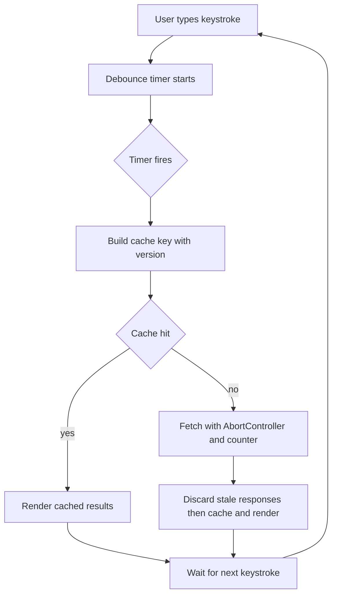

# Client-Side Caching and Debouncing: Making Instant Search Feel Effortless

## English

Meilisearch is fast, but your search box is not the only thing on the page. If every keystroke fires an HTTP request, a fast typist on a slow connection can generate a dozen in-flight requests, and the responses may arrive out of order — the results for “meil” landing after the results for “meili” and overwriting them. The user sees the list flicker backwards. This is a client-side problem with client-side solutions, and getting them right is what makes instant search feel instant rather than twitchy.

The first tool is debouncing: wait a short interval after the last keystroke before sending the request, and cancel the pending one if another keystroke arrives. A typical value is somewhere around a hundred to a few hundred milliseconds — long enough to skip the middle of a word, short enough that the user does not perceive a pause. The second tool is request cancellation or sequencing: attach a monotonically increasing counter to each request and discard any response whose counter is older than the latest one you have already rendered. The browser's AbortController API lets you actually cancel the in-flight fetch rather than merely ignoring its result, which also frees the connection.

Caching is the third and most underrated tool. Queries are highly repetitive: a user types “meil”, “meili”, “meilis”, then backspaces to “meili” again. If you keep a small map from query-plus-filter-plus-sort key to result set, the backspace is free. Because Meilisearch's results for a given index state and query are deterministic, caching is safe as long as you invalidate on writes. A simple approach is to clear the cache whenever your application knows it has submitted a document change, or to include an index-version token in the cache key that you bump after a successful task completes.

There is a subtlety around prefix search. Because Meilisearch matches on word prefixes, the result for “meili” is usually a superset of the result for “meilis”. You can exploit this: render the broader result set immediately and then refine. Some client libraries and UI patterns do exactly this, showing the previous results greyed out while the narrower query is in flight, which eliminates the empty-state flash that makes search feel broken. The same idea applies to filters — if the user adds a filter, the new result set is a subset of the old one, so you can filter the already-fetched page client-side as an optimistic preview.

Finally, think about what you cache and for how long. Caching the first page of popular queries is cheap and high-value; caching deep pages is expensive and rarely reused. And never cache across users if results depend on per-user filters — a tenant filter baked into a cached response is a data leak. The general principle: treat the search box as a UI with its own state machine (idle, typing, loading, showing results), and make every transition explicit rather than letting network timing decide what the user sees.

## 中文

Meilisearch 很快，但你的搜尋框並不是頁面上唯一的東西。如果每次按鍵都發出一個 HTTP 請求，在慢速連線上打字快的人可以產生十幾個進行中的請求，而回應可能亂序抵達——「meil」的結果比「meili」的結果晚到，然後把它覆蓋掉。使用者就看到清單往回閃。這是客戶端問題，要用客戶端方法解決，而把它做對，正是讓即時搜尋感覺順暢而不是抽搐的關鍵。

第一個工具是防抖（debouncing）：在最後一次按鍵之後等一小段時間才送出請求，若期間又有按鍵就取消待送的那個。典型值大約是一百到幾百毫秒——長到足以跳過一個詞的中間，短到使用者感覺不到停頓。第二個工具是請求取消或序號化：為每個請求附加一個單調遞增的計數器，並丟棄任何計數器比已渲染的最新結果更舊的回應。瀏覽器的 AbortController API 讓你真正取消進行中的 fetch，而不只是忽略它的結果，這也順帶釋放連線。

快取是第三個、也最被低估的工具。查詢高度重複：使用者打「meil」、「meili」、「meilis」，然後退格回「meili」。如果你保留一個從小型的「查詢＋filter＋sort」鍵到結果集的映射，那次退格就是免費的。因為在給定的索引狀態與查詢下，Meilisearch 的結果是確定性的，所以只要在寫入時失效，快取就是安全的。簡單做法是：當應用程式知道自己送出了文件變更時就清空快取，或者在快取鍵裡放一個索引版本權杖，並在某個任務成功完成後把它遞增。

前綴搜尋有一個微妙之處。因為 Meilisearch 是按詞前綴匹配，「meili」的結果通常是「meilis」結果的超集。你可以利用這點：立刻渲染較廣的結果集，然後再收窄。有些客戶端程式庫與介面模式正是這樣做，在較窄查詢進行中時把先前的結果以灰階顯示，這就消除了讓搜尋看起來像壞掉的空白閃爍。同樣的想法適用於過濾——如果使用者加上一個過濾條件，新的結果集是舊結果集的子集，你可以先在客戶端對已抓取的這一頁做過濾，當作樂觀預覽。

最後，想想你快取什麼、快取多久。快取熱門查詢的第一頁成本低、價值高；快取深層分頁成本高、鮮少重用。而且如果結果取決於逐使用者的過濾條件，絕不要跨使用者快取——把租戶過濾條件烤進快取回應裡就是資料外洩。通則如下：把搜尋框當成一個有自己狀態機（閒置、輸入中、載入中、顯示結果）的介面，讓每一次轉換都是明確的，而不是讓網絡時序決定使用者看到什麼。

## Key Takeaway

Debouncing, response sequencing, and careful cache invalidation turn a fast engine into a smooth interface, and the prefix-superset property of Meilisearch lets you preview results optimistically instead of flashing empty states.

## Related Concepts
- Debouncing
- Cache invalidation

## Diagram

