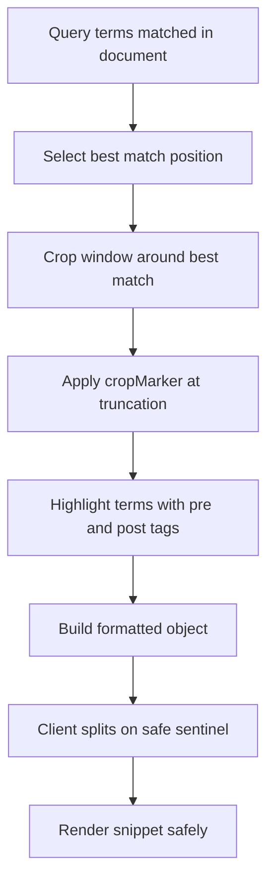

# Highlighting and Cropping: Turning Ranked Hits into Readable Snippets

## English

A search engine that returns a ranked list of document IDs is technically useful but practically useless to a human. Meilisearch solves this with two coupled features: formatting (highlighting) and cropping. Formatting wraps the matched query terms inside a field with marker tags so the front end can render them in bold or a colour. Cropping, by contrast, decides which slice of a long field to return at all, because sending a whole 10,000-word article body for every hit would waste bandwidth and screen space. The two work together: the engine finds the query terms, picks a window of text around them, and marks the terms inside that window. This is why the response for a hit contains a `_formatted` object alongside the raw fields — the raw value is what you stored, the formatted value is what you should display.

Cropping is controlled per query with a `cropLength` parameter (measured in words) and per attribute with `cropMarker`, the string inserted where text was truncated, conventionally an ellipsis. Highlighting is controlled with `highlightPreTag` and `highlightPostTag`, which default to `<em>` and `</em>` but should almost always be overridden — if you render those tags into a React component or an HTML template without escaping the surrounding text, you have given an attacker a cross-site scripting vector, because a document containing literal `<script>` text will pass through. The safe pattern is to set custom markers like a rare sentinel string and split on them in the client rather than injecting the result as raw HTML.

The cropping window is not naive — it is centred on the best match, not on the start of the field. If the query matches a word deep in paragraph nine, the snippet you get back begins near that word rather than at character zero. This matters enormously for relevance perception: a user scanning results sees the matched context immediately instead of a useless opening sentence. The trade-off is that cropping is computed at query time for each hit, so very large `cropLength` values across many hits cost more work and more bytes on the wire.

Formatting applies to every field listed in the `attributesToHighlight` and `attributesToCrop` arrays, and these are separate from `attributesToRetrieve`. You can therefore return a slim set of fields while still highlighting text from fields you do not otherwise send — useful when you highlight a title you already have but crop a body you do not want to store twice. Note that highlighting only marks terms that actually matched after tokenisation and normalisation, so a match that came from a synonym or a prefix may be marked at the position of the matched token, not the word the user typed.

A practical recipe: keep `attributesToRetrieve` minimal, add one or two fields to `attributesToCrop` with a `cropLength` of roughly 20 to 40 words, highlight the same fields, and set custom markers. Then in the client, split the string on your markers and build DOM nodes — never use an inner-HTML assignment. That single habit keeps the convenience of server-side snippets without inheriting its security cost.

## 中文

一個搜尋引擎如果只回傳一串排好序的文件 ID，技術上雖然有用，但對真人來說幾乎毫無價值。Meilisearch 用兩個互相配合的功能解決這個問題：格式化（formatting，即高亮 highlighting）與裁剪（cropping）。格式化會把命中的查詢詞用標記標籤包起來，讓前端可以粗體或上色顯示。裁剪則決定長欄位要回傳哪一段，因為若每一筆結果都回傳整篇一萬字的文章，既浪費頻寬又浪費螢幕空間。兩者協同運作：引擎先找出查詢詞，再在詞語附近選一個文字視窗，然後在該視窗內標記詞語。這就是為何每筆結果除了原始欄位外，還有一個 `_formatted` 物件——原始值是你存進去的內容，格式化值是你要顯示的內容。

裁剪由查詢參數 `cropLength`（以詞為單位）與每個屬性的 `cropMarker` 控制，後者是文字被截斷時插入的字串，慣例上是省略號。高亮則由 `highlightPreTag` 與 `highlightPostTag` 控制，預設是 `<em>` 與 `</em>`，但幾乎總應該覆寫——如果你把這些標籤直接塞進 React 元件或 HTML 模板而沒有轉義周邊文字，你就給了攻擊者一個跨站腳本（XSS）的入口，因為一份含有字面 `<script>` 文字的文件會原樣穿過。安全的做法是設定像罕見哨兵字串的自訂標記，在客戶端用分割處理，而不是把結果當原始 HTML 注入。

裁剪視窗不是天真地從欄位開頭算起，而是以最佳匹配為中心。如果查詢命中的是第九段深處的某個詞，你拿到的摘要會從那個詞附近開始，而不是從第零個字元開始。這對使用者感受的相關性影響極大：掃視結果的使用者馬上看到命中的上下文，而不是一句毫無用的開場白。代價是裁剪在查詢時對每筆結果即時計算，因此 `cropLength` 設得很大、命中又很多時，運算量與傳輸位元組都會增加。

格式化會套用到 `attributesToHighlight` 與 `attributesToCrop` 陣列中列出的每個欄位，而這兩個陣列與 `attributesToRetrieve` 是分開的。因此你可以只回傳精簡的欄位，同時仍高亮那些你根本不回傳的欄位文字——例如你已經有標題可高亮，但只想裁剪一段不想重複儲存的內文。要注意，高亮只標記在分詞與正規化之後真正命中的詞，所以若命中來自同義詞或前綴，標記的位置可能是實際命中的 token，而不是使用者打的那個字。

實用配方：把 `attributesToRetrieve` 保持精簡，挑一兩個欄位放進 `attributesToCrop`，`cropLength` 設大約二十到四十個詞，同一批欄位也做高亮，並設定自訂標記。然後在客戶端按標記分割字串、建立 DOM 節點——永遠不要用 inner-HTML 賦值。這一個習慣讓你享有伺服器端摘要的便利，又不必承擔它的安全代價。

## Key Takeaway

Use cropping and highlighting together to return readable, matched-context snippets, but always render them through custom markers and DOM construction rather than raw HTML injection.

## Related Concepts
- Cross-site scripting in search result rendering
- Tokenisation and match positions

## Diagram

