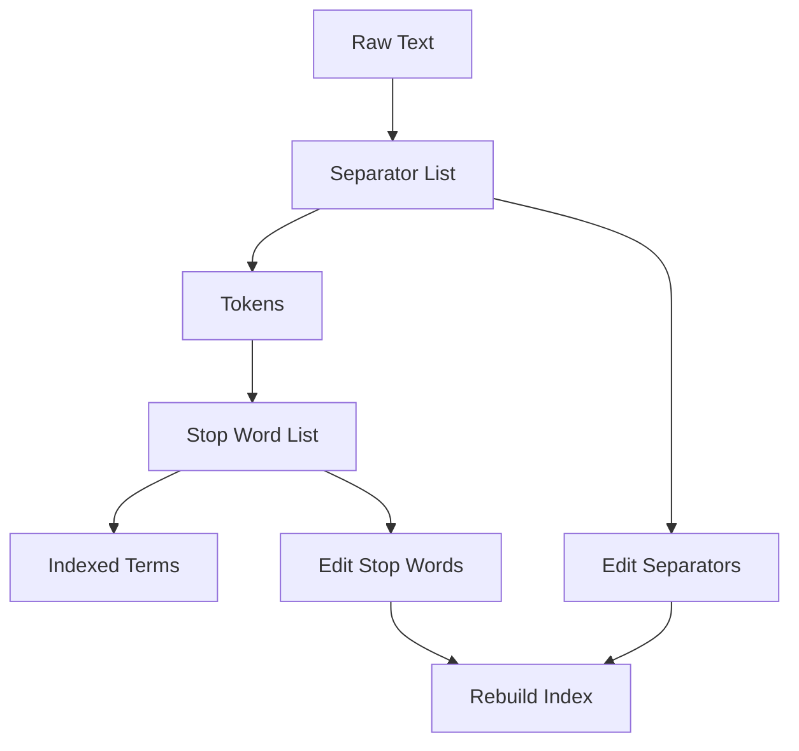

# Stop Words and Separators: The Tokenisation Knobs You Rarely Touch

## English

Every search engine must decide what counts as a word. Meilisearch does this with a tokeniser that splits text on a configurable set of separator characters and then optionally discards a list of stop words — extremely common terms like articles and prepositions that carry little meaning. Both lists live in index settings and both are editable. Understanding them explains a class of confusing behaviour: queries that return nothing, or results that seem to ignore part of what you typed.

Separators are the characters the tokeniser treats as boundaries. The default set covers whitespace and common punctuation, but it is language- and domain-sensitive. Consider product codes like `AB-1234` or version strings like `v2.1.0`. With a hyphen and a period as separators, `AB-1234` becomes two tokens, `ab` and `1234`, and searching for the full string may still work through phrase matching but behaves differently from searching for either half. If you add or remove a character from the separator list, the tokenisation of every document changes, which means the index must be rebuilt — this is not a cheap settings tweak. That is the key operational fact: stop words and separators are among the settings that force reindexing, unlike ranking rules which can change on a live index.

Stop words are subtler. Removing `the`, `a`, `of`, and `and` from the index saves space and speeds up matching, but it also changes semantics. A phrase query for `the who` could collapse if `the` is a stop word, leaving only `who`, and now you match every document containing `who`. For natural-language prose this rarely bites; for titles, names, and catalogue codes it bites hard. A common mistake is to apply a generic English stop-word list to an index of product names or song titles, where words like `the` are genuinely distinguishing. Note that Meilisearch ships no stop words by default — the default `stopWords` setting is an empty array, so nothing is dropped until you configure it — but plenty of guides and starter templates assume an English list and apply one anyway. The fix is either to leave the stop-word list empty for such an index or to curate it carefully.

There is an interaction with typo tolerance worth knowing. Typo tolerance operates on tokens, so if a word is dropped as a stop word before matching, no amount of typo tolerance will bring it back. Conversely, a very short token — one or two characters — is often not eligible for typo correction, because allowing one edit on a two-letter word would match almost everything. This is why searching for a two-letter brand fragment can feel less forgiving than searching for a longer word.

A practical approach is to treat these settings as domain configuration rather than defaults to accept. Ask: what are the atomic units a user would search for in this corpus? If the answer is whole identifiers, keep the characters that appear inside them out of the separator list. If the answer is natural-language phrases, the defaults are usually fine. Then write a handful of representative queries and check them after any change, because tokenisation changes are global and silent — nothing errors, results just quietly shift.

## 中文

每個搜尋引擎都必須決定什麼算是一個「詞」。Meilisearch 用分詞器（tokeniser）來做：它依一組可設定的分隔字元切開文字，然後可選擇丟棄一份停用詞（stop words）清單——那些極常見、意義不大的冠詞與介系詞。兩份清單都放在索引設定裡，也都可以編輯。了解它們，就能解釋一整類令人困惑的行為：查詢什麼都找不到，或結果似乎忽略了使用者打的某部分。

分隔字元是分詞器視為邊界的字元。預設集合涵蓋空白與常見標點，但它對語言與領域很敏感。想想像 `AB-1234` 這種產品編號，或 `v2.1.0` 這種版本字串。若連字號與句點都是分隔字元，`AB-1234` 就變成兩個 token：`ab` 與 `1234`，搜尋完整字串也許仍能靠片語比對成功，但行為與搜尋其中一半不同。若你在分隔清單中增減一個字元，每一份文件的分詞都會改變，這意味著索引必須重建——這不是便宜的設定微調。這是關鍵的運維事實：停用詞與分隔字元屬於會強制重建索引的設定，不像排名規則可以在線上索引即時更改。

停用詞更微妙。把 `the`、`a`、`of`、`and` 從索引移除可省空間、加快比對，但也改變語意。片語查詢 `the who` 若 `the` 是停用詞，可能塌縮成只剩 `who`，於是你就命中所有含 `who` 的文件。對自然語言散文這很少出問題；對標題、人名、目錄編號則很容易出事。常見錯誤是在產品名稱或歌名索引裡套用一份通用的英文停用詞清單，而這些語料裡的 `the` 恰恰是區辨關鍵。要留意 Meilisearch 預設並冇任何停用詞——`stopWords` 設定的預設值係空陣列，即係你唔設定就乜都唔會被丟棄——但好多教學與範本都預設有份英文清單而直接套用落去。解法係把這類索引的停用詞清單留空，或仔細策劃。

還有一個與錯字容忍的互動值得知道。錯字容忍作用在 token 上，所以若某詞在比對前已被當停用詞丟掉，再多的錯字容忍也救不回來。反過來說，極短的 token——一或兩個字元——通常不符合錯字修正資格，因為允許兩個字母的詞改一個字母幾乎會命中一切。這就是為何搜尋兩字母的品牌片段，感覺比搜尋長字更不通融。

實務做法是把這些設定當成領域配置，而不是照單全收的預設值。問自己：這個語料裡使用者會拿來搜尋的原子單位是什麼？若答案是完整識別碼，就把出現在識別碼內部的字元排除在分隔清單外。若答案是自然語言片語，預設通常夠用。然後寫幾條代表性查詢，任何改動後都測一遍，因為分詞變更是全域且無聲的——不會報錯，結果只是悄悄改變。

## Key Takeaway

Stop words and separator characters are powerful but reindexing global settings; treat them as domain-specific configuration and validate with representative queries after every change.

## Related Concepts
- Tokenisation and normalisation
- Index settings that require reindexing

## Diagram

