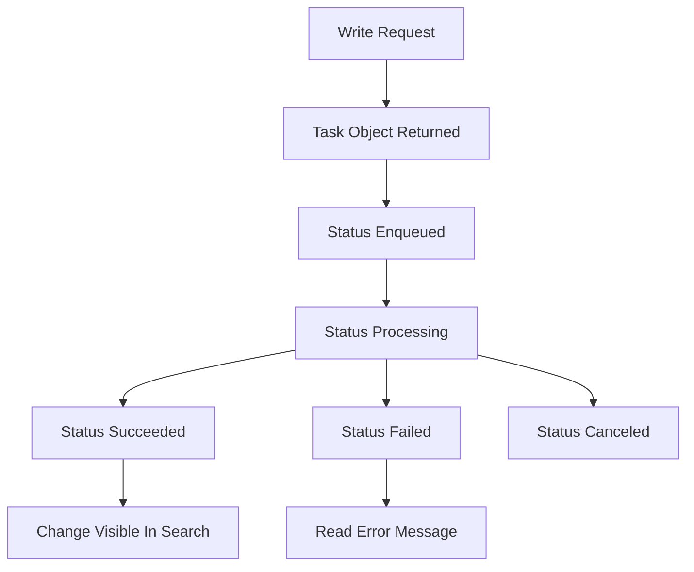

# Reading Task Responses: How to Know When a Write Actually Landed

## English

Meilisearch's write path is asynchronous: when you add documents or change settings, the HTTP response does not mean the change is visible. It returns a task object with an identifier and a status such as `enqueued` or `processing`. The search index only reflects the change once that task reaches `succeeded`. This is the single most common source of confusion for new integrators, and it is worth building a mental model of the task lifecycle rather than treating it as a nuisance.

The lifecycle is roughly: `enqueued` (accepted, waiting in the queue), `processing` (being applied), then one of `succeeded`, `failed`, or `canceled`. A task can also be batched with others that arrived around the same time, which is why a burst of small document additions often completes faster than the sum of their individual costs — the engine amortises the overhead of committing to disk. When a task fails, the task object carries an error code and message; reading that message is how you learn that, say, a document had a mismatched primary key type. Ignoring task status means you never see those errors at all.

In practice you have two patterns. The first is polling: after a write, poll the task endpoint until the status is terminal, with a small delay and a timeout. This is fine for tests and scripts but wasteful in a web request handler, where it would hold a connection open. The second is event-driven: let the write return the task ID, and let a background worker or a scheduled job drain completed tasks and act on failures. Meilisearch can also notify an external endpoint when tasks finish, which turns the poll into a push and is the natural fit for pipelines that must react — for example, invalidating a cache after a batch of documents is indexed.

A subtle point is that task history is itself stored and grows. Every write leaves a record, and in a busy system the task list becomes large. Meilisearch lets you delete finished tasks, and doing so periodically is part of routine housekeeping; otherwise the task store becomes a growing append-only log that you never read. Deleting tasks does not undo their effects — the documents stay — it only removes the record of what happened.

With that model, the sensible integration rule is: never assume a write is searchable until its task reports success. In automated tests, wait for the task; in user-facing flows, either show a pending state or design the UI so the write is not immediately queried. And log task failures somewhere you will actually look, because a silently failing settings change can leave an index subtly wrong for weeks.

## 中文

Meilisearch 的寫入路徑是非同步的：當你新增文件或更改設定，HTTP 回應並不代表變更已經可見。它回傳一個任務物件，內含識別碼與狀態，例如 `enqueued` 或 `processing`。搜尋索引要等到該任務變成 `succeeded` 才會反映變更。這是新手整合時最常見的困惑來源，值得建立一套任務生命週期的心智模型，而不是把它當成麻煩。

生命週期大致是：`enqueued`（已接受、在佇列中等待）、`processing`（正在套用），然後是 `succeeded`、`failed` 或 `canceled` 之一。任務也可能與差不多同時抵達的其他任務合批處理，這就是為何一連串小型文件新增的總完成時間，往往比各自成本相加還快——引擎攤銷了寫入磁碟的固定開銷。任務失敗時，任務物件會帶錯誤碼與訊息；讀那則訊息，你才會知道比如某份文件的主鍵型別不符。忽略任務狀態，等於你永遠看不到這些錯誤。

實務上有兩種模式。第一種是輪詢：寫入後反覆查詢任務端點直到狀態進入終態，中間加小延遲與逾時。這對測試與腳本沒問題，但在網頁請求處理常式中很浪費，因為它會把連線掛著。第二種是事件驅動：讓寫入回傳任務 ID，由背景工作者或排程工作消化已完成的任務並對失敗採取行動。Meilisearch 也能在任務完成時通知外部端點，把輪詢變成推送，這對必須即時反應的管線最自然——例如在一批文件索引完成後讓快取失效。

一個微妙的點是任務歷史本身會被儲存且不斷增長。每次寫入都留一筆紀錄，在繁忙系統中任務清單會變得很龐大。Meilisearch 允許刪除已完成的任務，定期清理是例行家務；否則任務儲存區會變成你不曾閱讀、只增不減的日誌。刪除任務不會撤銷其效果——文件仍在——只是移除發生過什麼的紀錄。

有了這個模型，合理的整合規則就是：在任務回報成功之前，永不假設寫入已可被搜尋。在自動化測試中等待任務；在使用者流程中，要嘛顯示待處理狀態，要嘛設計介面讓寫入不會被立刻查詢。並且把任務失敗記錄到你真的會看的地方，因為一個悄悄失敗的設定變更，可能讓索引微妙地錯了幾個星期。

## Key Takeaway

Treat every write as pending until its task reaches a terminal success state, and build polling or event-driven notification around the task lifecycle rather than assuming synchronous visibility.

## Related Concepts
- Asynchronous task queue
- Consistency guarantees in search indexes

## Diagram

