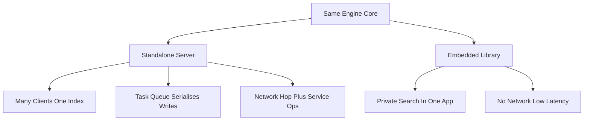

# The Embedded vs Standalone Trade-off: Running Meilisearch as a Library or a Server

## English

Meilisearch ships in two shapes that share the same engine core but differ in who owns the process. The standalone binary is a long-running HTTP server: you start it, it binds a port, it keeps the index in memory-mapped files, and every client talks to it over JSON. The embedded form packages the same engine inside your application process, so a Rust program can call it as a library and skip the network hop entirely. The engine underneath is the same, which is why the results and ranking behave identically — the difference is operational, not semantic.

The standalone server wins when many clients need the same index. A web front end, a mobile app, and a back-office admin tool can all query one process, and the server's task queue serialises writes so nobody sees a half-indexed document. You get one place to configure API keys, one place to take snapshots, and one memory budget to reason about. The cost is an extra network round trip per query, plus the burden of running and monitoring a service.

The embedded form wins when the search is a private detail of one application. A desktop app that indexes the user's own notes, or a CLI tool that searches a local documentation set, does not need a socket or a daemon. Queries become function calls, latency drops to microseconds, and there is no port to secure. The catch is that you now own the lifecycle: opening the database, handling concurrent access, and making sure two instances of your app do not fight over the same files.

A useful mental model is a database driver versus a database server. SQLite is embedded and delightful for a single-user tool; PostgreSQL is a server and delightful when many clients share state. Meilisearch's embedded mode plays the SQLite role, and the HTTP server plays the PostgreSQL role. Picking the wrong one is not a correctness bug — it is an architecture decision you will feel every day in deployment, backup, and debugging.

One practical consequence: features that depend on a shared queue or centralised key management only make sense in server mode. If you embed the engine, you are the queue and you are the key manager. That is fine for a single-tenant app and painful for a multi-tenant platform, which is exactly the kind of judgement call the choice forces you to make early.

## 中文

Meilisearch 有兩種形態，兩者共用同一個引擎核心，差別在於「誰擁有那個程序」。獨立執行檔是一個長時間執行的 HTTP 伺服器：你啟動它、它繫結一個埠、把索引放在記憶體對映的檔案裡，所有客戶端都用 JSON 跟它對話。嵌入形態則把同一個引擎包進你的應用程式程序裡，一個 Rust 程式可以把它當函式庫呼叫，完全省掉網路往返。底層引擎是同一個，所以結果與排名行為一模一樣——差別在運維，不在語意。

當很多客戶端需要共用同一份索引時，獨立伺服器勝出。網頁前端、手機 App、後臺管理工具都可以查詢同一個程序，而伺服器的任務佇列會把寫入序列化，沒有人會看到只索引了一半的檔案。你有一個地方設定 API 金鑰、一個地方做快照、一個記憶體預算要想。代價是每次查詢多一趟網路往返，加上要執行和監控一個服務的負擔。

當搜尋只是某個應用程式的私事時，嵌入形態勝出。一個索引使用者自己筆記的桌面程式，或一個搜尋本地檔案集的命令列工具，不需要 socket 也不需要常駐服務。查詢變成函式呼叫，延遲降到微秒級，也沒有埠要保護。問題是你現在要自己管生命週期：開啟資料庫、處理並行存取、確保應用程式的兩個例項不會搶同一批檔案。

一個好用的心智模型是「資料庫驅動程式 vs 資料庫伺服器」。SQLite 是嵌入式的，對單人工具非常愉快；PostgreSQL 是伺服器式的，當很多客戶端共用狀態時非常愉快。Meilisearch 的嵌入模式扮演 SQLite 的角色，HTTP 伺服器扮演 PostgreSQL 的角色。選錯不是正確性錯誤——而是一個你每天在部署、備份、除錯時都會感受到的架構決定。

一個實際後果：依賴共用佇列或集中金鑰管理的功能，只有在伺服器模式下才合理。如果你嵌入引擎，你就是佇列、你就是金鑰管理者。對單租戶應用這沒問題，對多租戶平臺則很痛苦——而這正是這個選擇逼你及早做出的判斷。

## Key Takeaway

Embedded and standalone Meilisearch share one engine but differ in who owns the process, the queue, and the keys — choose based on how many clients must share one index.

## Related Concepts
- Process architecture
- SQLite versus PostgreSQL

## Diagram

