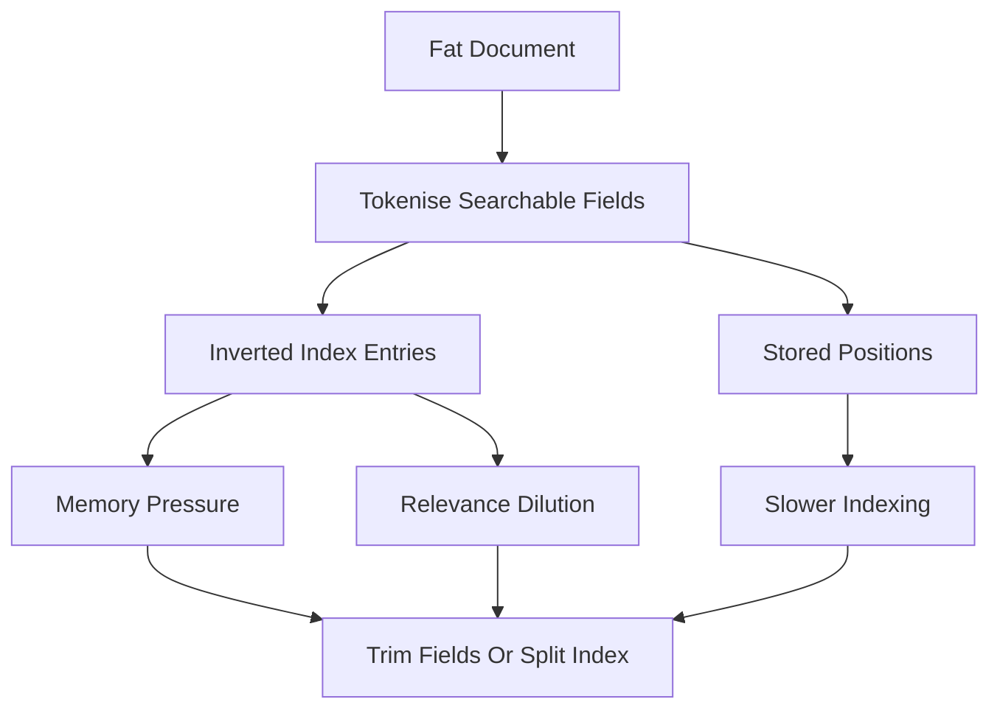

# Document Size and Field Explosion: Why Fat Documents Slow Everything Down

## English

Meilisearch indexes documents, and every field you mark as searchable becomes terms in the inverted index. That sounds free, but it is not: a document with a 20,000-word article body, a long HTML description, and a nested list of tags produces far more index entries than a document with a title and a short summary. The engine has to tokenise all of it, store positions, and keep the postings on disk. Fat documents raise memory pressure, slow down indexing, and can even hurt relevance because a huge field full of incidental words dilutes the signal from the fields that actually matter.

A concrete example: an e-commerce catalog where each product document carries the full marketing copy, the full spec sheet, and every customer review. Searching for 「waterproof」 now matches a product because a reviewer mentioned it once in paragraph nine. The result is technically correct and practically useless. Trimming the document to title, brand, category, and a short description usually produces better results and a smaller index at the same time.

There is also a field-count dimension. Meilisearch stores attributes per document, and a schema with hundreds of sparse fields (each document only filling a few) wastes space and complicates filtering. If your documents look like a bag of optional keys, consider whether some of them belong in a separate index or should be flattened into a small set of typed fields. The same data modelled as ten well-chosen attributes is easier to search and cheaper to store than as two hundred ad-hoc ones.

The searchable-attributes setting is your main lever. Fields you list there are indexed for full-text search; fields you omit are still stored and returned in results, but they do not contribute terms. That means you can keep a big blob field for display while excluding it from search, which is often exactly what you want for article bodies or raw HTML. Filterable and sortable attributes are separate lists with their own costs, so a field can be displayed, filterable, and not searchable all at once.

A good habit is to ask, for each field, 「would a user ever type a word that should match this field?」 If the answer is no, it probably should not be searchable. The second question is 「do I need it back in results?」 If no, drop it from the document entirely. Documents are not a database row you must preserve faithfully — they are a search projection, and a leaner projection usually ranks better.

## 中文

Meilisearch 索引的是文件，而每個你標記為可搜尋的欄位都會變成倒排索引裡的字詞。這聽起來免費，其實不然：一份帶著兩萬字文章正文、長篇 HTML 描述、還有一串嵌套標籤清單的文件，產生的索引條目遠多於只有標題和短摘要的文件。引擎必須把這些全部斷詞、儲存位置、把倒排清單留在磁碟上。肥胖的文件會拉高記憶體壓力、拖慢索引，甚至可能傷害相關性，因為一個塞滿雜訊字詞的巨大欄位會稀釋真正重要欄位的訊號。

一個具體例子：電商目錄中每份商品文件都帶著完整行銷文案、完整規格表、以及每一則客戶評論。現在搜尋「waterproof」會命中某個商品，只因為某位評論者在第九段提過一次。這結果技術上正確、實務上無用。把文件修剪成標題、品牌、分類、短描述，通常同時產生更好的結果和更小的索引。

還有欄位數量的維度。Meilisearch 為每份文件儲存屬性，而一個有數百個稀疏欄位（每份文件只填幾個）的 schema 會浪費空間並讓過濾變複雜。如果你的文件像一袋可選鍵，想一想其中一些是否該放進另一個索引，或該攤平成少量有型別的欄位。同一批資料建模成十個精選屬性，比建模成兩百個臨時屬性更好搜、更省儲存。

可搜尋屬性的設定是你主要的槓桿。你列在那裡的欄位會被索引以供全文搜尋；你省略的欄位仍會被儲存並在結果中回傳，但不貢獻字詞。這意味著你可以保留一個大 blob 欄位供顯示，同時把它排除在搜尋之外——對文章正文或原始 HTML 而言，這往往正是你要的。可過濾與可排序屬性是另外兩份清單，各有自己的成本，所以一個欄位可以同時是「可顯示、可過濾、不可搜尋」。

一個好習慣是對每個欄位問：「使用者有可能打出應該命中這個欄位的字嗎？」如果答案是否，它大概不該可搜尋。第二個問題是：「我需要它在結果裡回來嗎？」如果不需要，就把它從文件裡整個拿掉。文件不是你必須忠實保留的資料庫列——它是搜尋投影，而更精簡的投影通常排名更好。

## Key Takeaway

Documents are a search projection, not a faithful database row — index only the fields a user would actually type into, and keep big blobs out of the searchable list.

## Related Concepts
- Searchable attributes
- Index size and memory

## Diagram

