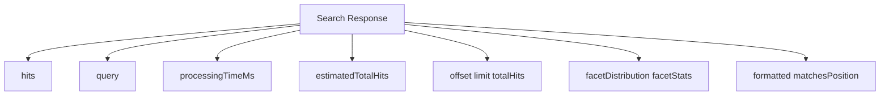

# Reading the Search Response: What Each Field Tells You About the Engine's Work

## English

A Meilisearch search response is small but dense, and each top-level field is a window into what the engine did. The hits array holds the matched documents, already shaped by any attributes-to-retrieve restriction. The query field echoes the parsed query, which is useful when you send something the engine normalises. The processingTimeMs tells you how long the engine spent, and estimatedTotalHits tells you roughly how many documents matched — the word 「estimated」 matters, because the engine may stop counting early rather than scan the whole candidate set.

The offset, limit, and totalHits fields describe pagination as the engine sees it, and they are your sanity check when a UI shows the wrong page count. If you asked for offset 40 with limit 20 and got fewer hits than expected, the engine is telling you the candidate pool was smaller than your arithmetic assumed. This is also why deep pagination is expensive: the engine still has to walk past the earlier pages.

Facet distribution and facet stats are where faceted search becomes concrete. When you request facets, the response includes counts per facet value computed over the current result set, so a UI can show 「Brand: Acme (12)」 and disable zero-count values. Facet stats give numeric summaries like min, max, and average for numeric facets, which is how range sliders get sensible bounds without a second query.

Matched and ranked positions live inside each hit when you ask for them. The _formatted object holds the highlighted and cropped versions of your fields, with match markers around the terms that hit. The _matchesPosition object reports where in each field the match occurred, by offset and length — the raw material for custom highlighting if the built-in formatting is not what your design needs. These are opt-in extras: ask for them and you pay a little more processing, skip them and the response stays lean.

Finally, the response is a snapshot, not a promise about the future. Because writes go through an asynchronous task queue, a document you just added may not appear until its task reports success. Reading the response correctly means knowing which numbers are exact, which are estimates, and which reflect the index as of the moment your query was processed — a discipline that saves a lot of confused debugging.

## 中文

Meilisearch 的搜尋回應很小但資訊密集，每個頂層欄位都是窺探引擎做了什麼的一扇窗。hits 陣列裝著命中的文件，已依任何「要取回的屬性」限制裁剪過。query 欄位回顯解析後的查詢，當你送出會被引擎正規化的東西時很有用。processingTimeMs 告訴你引擎花了多久，estimatedTotalHits 則告訴你大約有多少文件命中——「estimated」這個字很重要，因為引擎可能提早停止計數，而不是掃完整個候選集合。

offset、limit、totalHits 描述引擎眼中的分頁，當 UI 顯示錯誤頁數時，它們就是你的 sanity check。如果你要求 offset 40、limit 20，卻拿到比預期少的命中，引擎是在告訴你候選池比你算的小。這也是深分頁昂貴的原因：引擎仍得走過前面那些頁。

facet distribution 與 facet stats 是分面搜尋具體化的地方。當你要求 facets，回應會包含在目前結果集上算出的每個 facet 值計數，於是 UI 可以顯示「品牌：Acme（12）」並把計數為零的值停用。facet stats 給出數值 facet 的摘要，例如最小值、最大值、平均值，這就是範圍滑桿不必第二次查詢就能取得合理邊界的方式。

當你要求時，命中位置與排名位置會出現在每筆 hit 裡。_formatted 物件裝著你欄位的高亮與裁剪版本，命中字詞周圍有標記。_matchesPosition 物件回報匹配在每個欄位中發生的位置，以位移和長度表示——這是內建格式化不符合你的設計時，自訂高亮的原料。這些是選配：要求它們就多付一點處理成本，跳過它們回應就保持精簡。

最後，回應是一個快照，不是對未來的承諾。因為寫入走非同步任務佇列，你剛加的文件可能要到它的任務回報成功才出現。正確讀懂回應，意味著知道哪些數字是精確的、哪些是估計的、哪些反映的是你的查詢被處理那一刻的索引——這個紀律能省下大量困惑的除錯。

## Key Takeaway

Treat the search response as a snapshot with mixed exact and estimated numbers, and request _formatted and _matchesPosition only when your UI actually needs them.

## Related Concepts
- Search response fields
- Asynchronous task queue

## Diagram

