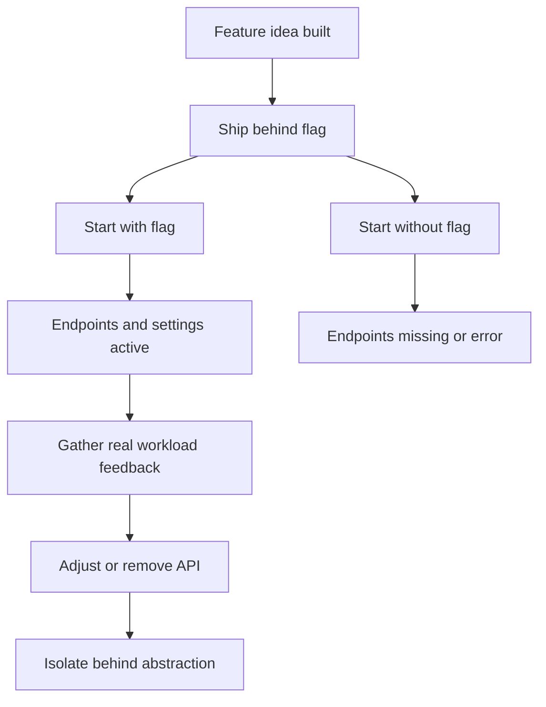

# The Experimental Feature Flag: How Meilisearch Ships Unfinished Ideas Safely

## English

Meilisearch does not release every capability as a stable, always-on feature. Some features — vector and hybrid search being the clearest example — arrive behind an experimental feature flag that you must explicitly enable at startup by passing the relevant flag to the binary (for instance, an --experimental-enable-* style argument) or by setting the corresponding environment variable. Until you flip that switch, the endpoints and settings associated with the feature either do not exist or return an error. This is a deliberate engineering choice: it lets the team ship code that is useful but not yet frozen in its API shape, gather feedback from real workloads, and still change or remove it without breaking a promise of backward compatibility.

Think of it like a building with a locked wing. The wing is fully constructed and the lights work, but the architect has not yet signed off on the floor plan. You can get the key, walk around, and tell the architect what you think — but you should not build your business inside it, because the walls may move. Experimental features in Meilisearch carry exactly that social contract: they are supported enough to try in development and even staging, but their request and response formats, their setting names, and their behaviour may change between minor releases, sometimes without a deprecation period.

The practical consequence is that you should treat the feature flag as a boundary in your architecture. If an experimental feature is load-bearing for your product, isolate it behind your own thin abstraction layer — a module in your backend that wraps the calls — so that when the upstream API shifts, you change one file instead of hunting through your codebase. Pin your Meilisearch version in production, read the release notes before upgrading, and run your integration tests against the new version in a staging environment before you promote it.

It also helps to understand why the flag exists at the process level rather than per-index or per-request. Enabling an experimental feature typically changes what the engine is willing to do globally: which routes are mounted, which setting keys are accepted, sometimes how memory is allocated for extra data structures. Making that a startup decision keeps the code paths simple and makes the blast radius obvious — if the process started without the flag, nothing experimental can happen at all. That is a much easier thing to reason about than a feature that could be toggled at any moment by any client.

Finally, remember that a flag is not a licence to skip the boring parts. An experimental vector search still needs the same care as any other index: sensible primary keys, a plan for reindexing when the embedding model changes, and monitoring for the extra memory and disk the vectors consume. The flag only tells you that the interface may move; it says nothing about whether the feature is a good fit for your problem. Evaluate it on relevance and cost like any other tool, and keep a fallback path — even a simple keyword-only search — so that an upstream change never takes your product down with it.

## 中文

Meilisearch 並非把每項功能都當成穩定、永遠開啟的能力來釋出。有些功能——最明顯的例子是向量與混合搜尋——會以實驗性功能旗標（experimental feature flag）的形式登場，你必須在啟動時明確開啟，例如向執行檔傳入相應的 --experimental-enable-* 之類的引數，或設定對應的環境變數。在你撥動那個開關之前，與該功能相關的端點與設定要麼不存在，要麼會回傳錯誤。這是刻意的工程取捨：讓團隊可以釋出有用但 API 形態尚未定型的程式碼，從真實工作負載收集意見，同時仍能修改甚至移除它，而不必背負向後相容的承諾。

可以把它想像成一棟大樓裡上鎖的側翼。側翼已經蓋好、燈也會亮，但建築師還未在平面圖上簽字。你可以拿到鑰匙、進去走走、告訴建築師你的想法——但你不應該把自己的生意搬進去，因為牆可能會移動。Meilisearch 的實驗性功能背負的正是這種社會契約：它們足夠支援你在開發甚至預備環境試用，但請求與回應格式、設定名稱與行為，可能在次要版本之間改變，有時甚至不給棄用期。

實際後果是：你應該把功能旗標視為架構上的一道邊界。如果某項實驗性功能是你產品的承重牆，就把它隔離在你自己的薄抽象層後面——在後端寫一個模組包住那些呼叫——這樣上游 API 一變，你只改一個檔案，而不是在整個程式庫裡東翻西找。在生產環境鎖定 Meilisearch 版本，升級前先讀發行說明，並在預備環境對新版本跑整合測試，透過後才推上正式環境。

理解旗標為何存在於行程層級、而非每個索引或每個請求層級，也很有幫助。啟用實驗性功能通常會改變引擎整體願意做什麼：掛載哪些路由、接受哪些設定鍵，有時還包括為額外資料結構分配多少記憶體。把這件事變成啟動時的決定，能讓程式碼路徑保持簡單，也讓影響範圍一目瞭然——如果行程啟動時沒有帶旗標，就完全不可能發生任何實驗性的事。這比一個任何客戶端隨時都能切換的功能，容易推理得多。

最後，請記住旗標不是跳過基本功的許可證。實驗性的向量搜尋仍然需要和其他索引一樣的照料：合理的主鍵、當嵌入模型改變時的重建索引計畫，以及對向量所額外消耗的記憶體與磁碟的監控。旗標只告訴你介面可能會移動，完全沒說這項功能是否適合你的問題。請像對待任何工具一樣，用相關性與成本去評估它，並保留一條退路——哪怕只是簡單的純關鍵字搜尋——好讓上游的變動永遠不會把你的產品一起拖下水。

## Key Takeaway

Experimental feature flags let Meilisearch ship unfinished APIs without promising stability, so isolate any experimental feature behind your own abstraction layer, pin versions, and always keep a fallback path.

## Related Concepts
- Semantic and Hybrid Search with Embedders
- Running Meilisearch in Production: Persistence, Snapshots, and Upgrades

## Diagram

