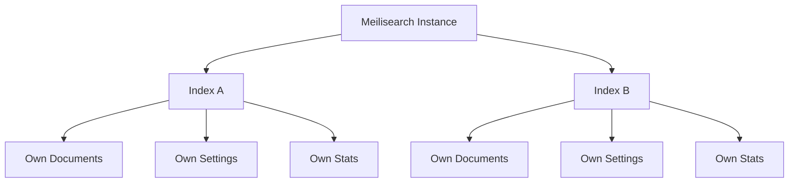

# Indexes as Independent Universes: Settings, Stats, and the Admin Surface

## English

Every Meilisearch instance is really a container for many indexes, and each index is a nearly self-contained universe. An index owns its own documents, its own primary key, its own complete set of settings (searchable attributes, ranking rules, stop words, synonyms, filterable attributes, and so on), and its own statistics. Two indexes in the same process can behave completely differently: one can be tuned for a product catalogue with heavy faceting and custom ranking, another for a documentation site with a different tokenizer configuration. Nothing leaks between them. Understanding this isolation is the key to designing a clean multi-index layout instead of one giant index with a type field.

The admin surface reflects this structure. There are routes to list all indexes, to create one, to fetch its settings, and to read its stats — the stats endpoint tells you roughly how many documents an index holds and whether it is still being indexed. There are also routes to swap two indexes atomically and to delete an index outright. These are not just conveniences; they are the vocabulary of index lifecycle management. When you run a blue-green reindex, you build the new index under a temporary UID, wait for its tasks to finish, then swap it into place so that queries never see a half-built index. The swap is a single operation, which is what makes the cutover safe.

A subtle but important point is that settings are per-index and mostly independent of documents. Changing a searchable-attributes order or adding a synonym does not require you to re-upload your documents, though it may trigger background reindexing work that shows up as tasks. This is why you can iterate on relevance on a live index: you are editing the index's configuration, not its contents. The engine then rebuilds whatever internal structures depend on those settings. Treat settings as first-class artefacts — keep them in version control as JSON, apply them programmatically, and avoid hand-editing them in production, because a settings change is a real change with real consequences.

Index UIDs are also worth thinking about carefully, because they are effectively part of your public API. They appear in URLs, in SDK calls, and in logs. Choosing names that encode meaning — products, articles, support_tickets — makes the system legible. Choosing names that encode implementation details — products_v2_temp — makes every future migration confusing. Since UIDs must follow a restricted character set and cannot be changed in place, a rename is really a create-new, copy-or-reindex, swap, and delete-old dance. Good naming up front saves you from that dance.

Finally, remember that isolation is logical, not physical in the way you might assume. All those indexes share the same process, the same memory budget, and the same disk. One runaway index with enormous documents or an expensive faceting configuration can still degrade the whole instance. So design for logical separation — one index per distinct search experience — but monitor at the instance level. The stats and health endpoints, plus the task queue, are how you see which index is doing the work and which one is quietly eating your RAM.

## 中文

每一個 Meilisearch 例項，本質上都是許多索引的容器，而每個索引幾乎是一個自成一體的宇宙。一個索引擁有自己的檔案、自己的主鍵、自己完整的一套設定（可搜尋屬性、排名規則、停用詞、同義詞、可過濾屬性等等），以及自己的統計資料。同一個行程裡的兩個索引可以有完全不同的行為：一個可以為產品目錄調校，大量使用分面與自訂排名；另一個可以為檔案網站調校，採用不同的分詞設定。兩者之間什麼都不會滲漏。理解這種隔離，是設計乾淨的多索引佈局、而非用一個巨大索引加一個 type 欄位的關鍵。

管理介面正好反映了這個結構。有路由可以列出所有索引、建立索引、取得某個索引的設定，以及讀取它的統計資料——統計端點會粗略告訴你索引裡有多少檔案、是否仍在建立索引中。另外還有路由可以原子性地交換兩個索引，以及直接刪除一個索引。這些不只是方便的小工具，而是索引生命週期管理的詞彙。當你做藍綠重建索引時，你會用一個臨時 UID 建立新索引，等它的任務全部完成，再把它交換到位，這樣查詢就永遠不會看到一個蓋到一半的索引。交換是單一操作，這正是切換之所以安全的原因。

一個細微但重要的論點是：設定是每個索引各自的，而且大致與檔案無關。改變可搜尋屬性的順序或新增一個同義詞，並不需要你重新上傳檔案，雖然它可能觸發背景重建索引的工作，並以任務的形式出現。這就是為什麼你可以在一個上線中的索引上反覆調整相關性：你改的是索引的設定，不是它的內容。引擎之後會重建所有依賴那些設定的內部結構。請把設定當成第一級產物——以 JSON 形式納入版本控制、用程式化方式套用，避免在生產環境手動編輯，因為設定變更是真實的變更，會帶來真實的後果。

索引 UID 也值得仔細思考，因為它們實際上是你公開 API 的一部分。它們會出現在網址、SDK 呼叫與日誌裡。選擇能編碼意義的名字——products、articles、support_tickets——會讓整個系統易讀。選擇編碼實作細節的名字——products_v2_temp——會讓每一次未來的遷移都令人困惑。由於 UID 必須遵守受限的字元集，而且不能就地改名，所謂改名其實是一連串「建立新的、複製或重建、交換、刪除舊的」的動作。一開始就取好名字，能讓你免於這套舞步。

最後，請記住隔離是邏輯上的，而不是你可能以為的物理隔離。所有這些索引共用同一個行程、同一份記憶體預算、同一塊磁碟。一個失控的索引——檔案龐大或分面設定昂貴——仍然可以拖慢整個例項。所以，為邏輯分離而設計——每個不同的搜尋體驗一個索引——但在例項層級監控。統計與健康端點，加上任務佇列，就是你看出哪個索引正在做事、哪個索引正悄悄吃掉你的記憶體的方法。

## Key Takeaway

Each index is a self-contained universe with its own settings, stats, and lifecycle, so design one index per distinct search experience, keep settings in version control, and monitor resource use at the instance level.

## Related Concepts
- Index UID Naming, Swaps, and Blue-Green Reindexing
- Multi-Tenancy and Index Design: One Index, Many Indexes, or Filtered Views

## Diagram

