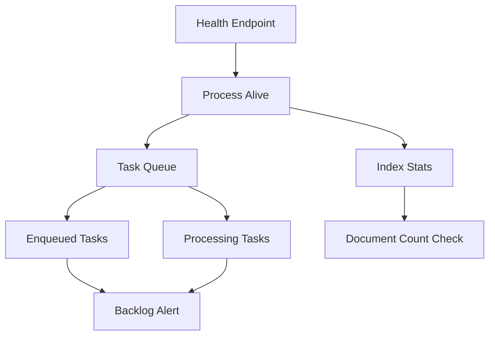

# The Health Endpoint and Runtime Signals: Knowing Your Instance Is Alive

## English

A search engine that returns results is not automatically a healthy search engine. Meilisearch exposes a small set of runtime signals that you should wire into your monitoring before you need them. The most basic is the health endpoint, which returns a simple status when the process is up and able to serve. It is deliberately cheap: it does not touch the index, it does not run a query, and it does not tell you whether search is fast. That is the point. A health check should answer one narrow question — is the process alive and accepting connections? — so that your orchestrator can restart a dead container without being confused by a slow but living one.

Beyond liveness, you want to know whether the engine is making progress. The task queue is your window into that. If tasks are piling up and never reaching a succeeded state, the instance is technically alive but functionally stuck — perhaps it is out of disk, perhaps a huge indexing job is monopolising resources, perhaps something is wrong with a document batch. Watching the count of enqueued and processing tasks over time, and alerting when it grows without bound, catches a class of failure that a simple ping never will. Likewise, the per-index stats endpoint tells you document counts, which is a useful sanity check after a bulk import: if you expected a million documents and the stats say twelve, you have a problem long before a user complains.

Latency deserves its own signal, measured from the outside. Because Meilisearch is fast by design, the interesting question is not usually absolute speed but the shape of the distribution: the median, the tail, and how they move when you change settings or grow the corpus. Instrument your own application to record search request durations and error rates, and separate the time spent waiting on Meilisearch from the time spent in your own code. When a page feels slow, this split tells you immediately whether to look at the engine or at yourself. It is also the baseline you need before you can honestly claim a change made things faster.

Resource signals matter just as much, because Meilisearch leans heavily on memory-mapped files and RAM. Disk space is a hard limit — an instance that fills its disk cannot index and may fail in unpleasant ways — so alert on free disk well before it reaches zero. Memory pressure shows up as the operating system evicting pages and the engine slowing down, which looks like a mysterious latency regression rather than an obvious crash. If you run in containers, set memory limits thoughtfully and watch for the process being killed by the orchestrator, because an out-of-memory kill looks exactly like a random restart from the outside.

Put together, these signals form a layered picture: liveness tells you the process exists, task progress tells you it is doing work, latency tells you it is doing work usefully, and resource metrics tell you it can keep doing so. No single one is sufficient, and a dashboard that shows only a green health check is a false comfort. The habit worth building is to define, in advance, what 'healthy' means for your instance — a task queue that drains, a document count that matches expectations, a latency distribution that stays within budget, and disk and memory with headroom — and then to alert on departures from that definition rather than on the absence of a crash.

## 中文

一個能回傳結果的搜尋引擎，並不自動等於健康的搜尋引擎。Meilisearch 提供了一小組執行期訊號，你應該在你需要它們之前就接進監控系統。最基本的是健康端點，當行程仍在運作並能提供服務時，它會回傳一個簡單的狀態。它刻意保持廉價：不碰索引、不執行查詢，也不會告訴你搜尋快不快。這正是重點。健康檢查應該只回答一個狹窄的問題——行程是否活著並接受連線？——這樣你的編排器就能重啟一個死掉的容器，而不會被一個緩慢但活著的容器搞混。

除了存活之外，你還想知道引擎是否在推進。任務佇列就是你的窗口。如果任務不斷堆積、永遠到不了成功狀態，這個實例在技術上活著，但功能上卡住了——也許是磁碟滿了，也許是一個龐大的索引工作獨佔了資源，也許是某批文件出了問題。持續觀察排隊中與處理中的任務數量，並在它無上限增長時告警，能抓到一種單純 ping 永遠抓不到的故障。同樣地，每個索引的統計端點會告訴你文件數量，這在大量匯入之後是很有用的合理性檢查：如果你預期一百萬份文件，統計卻說十二份，你在使用者抱怨之前很久就知道出事了。

延遲值得擁有自己的訊號，而且要從外部量測。因為 Meilisearch 在設計上就很快，有趣的問題通常不是絕對速度，而是分佈的形狀：中位數、尾端，以及當你改變設定或語料變大時它們如何移動。在你自己的應用程式裡加入量測，記錄搜尋請求的耗時與錯誤率，並把等待 Meilisearch 的時間與花在自己程式碼裡的時間分開。當一個頁面感覺慢時，這個拆分立刻告訴你該看引擎還是看自己。它也是你在能誠實宣稱某項改動讓事情變快之前，必須先有的基準。

資源訊號同樣重要，因為 Meilisearch 大量倚賴記憶體映射檔案與 RAM。磁碟空間是硬性限制——一個把磁碟塞滿的實例無法建立索引，而且可能以令人不悅的方式失敗——所以要在磁碟歸零之前就早早告警。記憶體壓力會表現為作業系統不斷逐出頁面、引擎變慢，看起來像莫名其妙的延遲退化，而不是明顯的當機。如果你跑在容器裡，請審慎設定記憶體上限，並留意行程被編排器殺掉的情況，因為從外面看，記憶體不足被殺掉和隨機重啟長得一模一樣。

把這些訊號放在一起，會形成一幅分層的圖像：存活告訴你行程存在，任務進度告訴你它在做事，延遲告訴你它做的事有用，資源指標則告訴你它能不能繼續做下去。沒有任何單一訊號是足夠的，而只顯示一個綠色健康檢查的儀表板，是一種虛假的安心。值得養成的習慣是：事先定義對你的實例而言「健康」是什麼意思——一個會排空的任務佇列、一個符合預期的文件數量、一個維持在預算內的延遲分佈，以及有餘裕的磁碟與記憶體——然後針對偏離這個定義的情況告警，而不是針對「沒有當機」告警。

## Key Takeaway

A green health check only proves the process is alive; real operational health comes from layering task-queue progress, latency distributions, and disk and memory headroom into a definition you alert on.

## Related Concepts
- Memory Budgeting: How Meilisearch Uses RAM and Why It Matters
- The Task Queue as the Source of Truth for Writes

## Diagram

