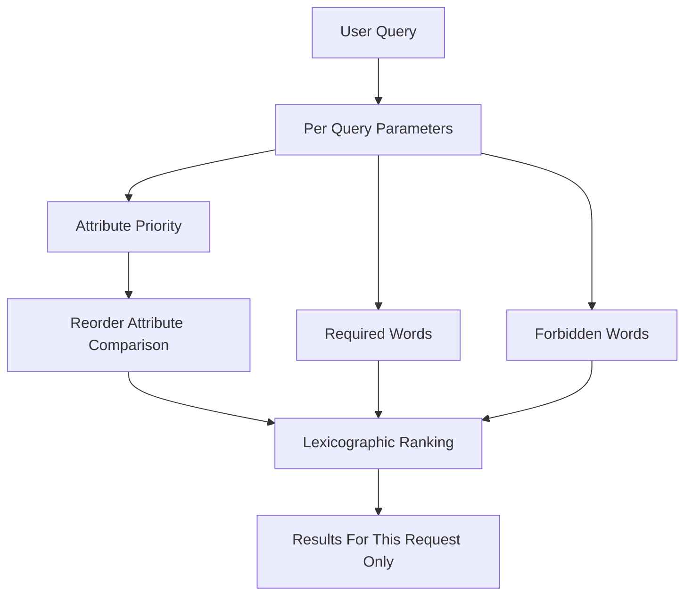

# Query-Time Boosting: The Per-Query Levers You Can Pull Without Touching Settings

## English

Most relevance tuning happens at index level — you change searchable attributes, ranking rules, or synonyms and the whole index shifts. But Meilisearch also exposes a set of per-query parameters that only affect the single request you are making right now. The most useful of these is attribute-based ranking: in a search call you can pass a list of attributes that should be treated as more important for this particular query, letting the same index serve very different intents. Imagine an e-commerce catalogue where a user typing "red" on the homepage wants colour matches surfaced, but a user typing "red" inside the brand-filter page wants brand names containing "red" first. You cannot satisfy both with one static searchable-attributes order without hurting one of them.

The mechanism works because ranking is a lexicographic sort over a sequence of rules, and one of those rules compares which attribute a match came from. When you supply a per-query attribute priority, you are effectively reordering that comparison for this request only. It is a lightweight override, not a reindex — the inverted index itself is untouched, so the cost is negligible. This is the same reason per-query parameters are safe to use aggressively in a UI: they do not mutate shared state, so two concurrent users with different priorities never interfere with each other.

There is a second family of per-query levers worth knowing. You can request that certain words be treated as mandatory (so results must contain them) or as forbidden, which is how you build a simple "must include" search box on top of fuzzy matching. You can also cap the number of hits returned and control how much of each document comes back, which matters when documents are large. And you can request specific facets and their distribution in the same round trip, so the UI can render filter counts without a second call.

A practical pattern is to treat per-query parameters as the "session layer" of relevance and index settings as the "corpus layer". The corpus layer encodes what is true about your data — which fields matter, which are filterable, which synonyms exist. The session layer encodes what this user is doing right now — which field they are focused on, which words they insist on, how many results the layout can show. Keeping the two mentally separate makes debugging much easier: if results look wrong for everyone, the problem is in settings; if they look wrong for one screen, the problem is in the query.

One caution: per-query overrides are easy to overuse. If every screen passes a different attribute priority, you end up with a relevance model nobody can reason about, and offline evaluation becomes meaningless because you are not measuring one system but dozens. The healthy habit is to start with a good default, add an override only when a concrete user task demands it, and write down why each override exists so a future maintainer does not delete it as noise.

## 中文

大部分相關性調校都發生在索引層——你改動可搜尋屬性、排名規則或同義詞，整個索引就跟著改變。但 Meilisearch 亦提供一組「每次查詢」引數，隻影響你當下發出的那一個請求。最有用的是以屬性為基礎的加權：在搜尋呼叫中，你可以傳入一個屬性清單，表示「就這一次查詢而言」這些屬性應被視為更重要，讓同一個索引服務非常不同的意圖。想像一個電商目錄：使用者在首頁打「red」，希望顏色相符的結果優先浮現；但同一個使用者在品牌篩選頁打「red」，卻希望品牌名稱含「red」的排在前面。單靠一個靜態的可搜尋屬性排序，無法同時滿足兩者而不犧牲其中一方。

這個機制之所以可行，是因為排名本質上是對一連串規則做字典序排序，而其中一條規則正是比較「命中來自哪個屬性」。當你提供每次查詢的屬性優先次序，你其實只是在這次請求中重新排列該比較，屬於輕量級覆寫，並非重建索引——倒排索引本身完全不動，所以成本微不足道。這也正是每次查詢引數可以放心在 UI 中大量使用的原因：它們不會改動共享狀態，所以兩個優先次序不同的並發使用者永遠不會互相干擾。

還有另一組值得認識的每次查詢槓桿。你可以要求某些字詞必須出現（結果必須包含它們），或必須排除，這就是在模糊比對之上建立簡單「必須包含」搜尋框的方法。你也可以限制回傳的命中數量，並控制每份檔案回傳多少內容，這在檔案很大時很重要。你還可以在同一趟往返中要求特定分面及其分佈，讓 UI 毋須第二次呼叫就能渲染篩選計數。

一個實用模式，是把每次查詢引數視為相關性的「工作階段層」，而索引設定視為「語料層」。語料層編碼的是關於你資料的事實——哪些欄位重要、哪些可篩選、有哪些同義詞。工作階段層編碼的是使用者當下在做什麼——他們聚焦哪個欄位、堅持要哪些字、版面能顯示多少結果。在腦中把兩層分開，除錯會容易得多：如果結果對所有人都錯，問題在設定；如果只對某個畫面錯，問題在查詢。

一個告誡：每次查詢覆寫很容易被濫用。如果每個畫面都傳不同的屬性優先次序，你最終會得到一個沒有人能理解的相關性模型，離線評估也變得毫無意義，因為你測量的不是一個系統，而是幾十個。健康的習慣是：先有一個好預設，只在具體使用者任務要求時才加覆寫，並寫下每個覆寫存在的原因，以免將來的維護者把它當噪音刪掉。

## Key Takeaway

Per-query parameters let you reshape relevance for one request without touching shared index state, so treat them as a session layer on top of a stable corpus layer.

## Related Concepts
- Ranking rules as lexicographic sort
- Searchable attributes order as a relevance signal

## Diagram

