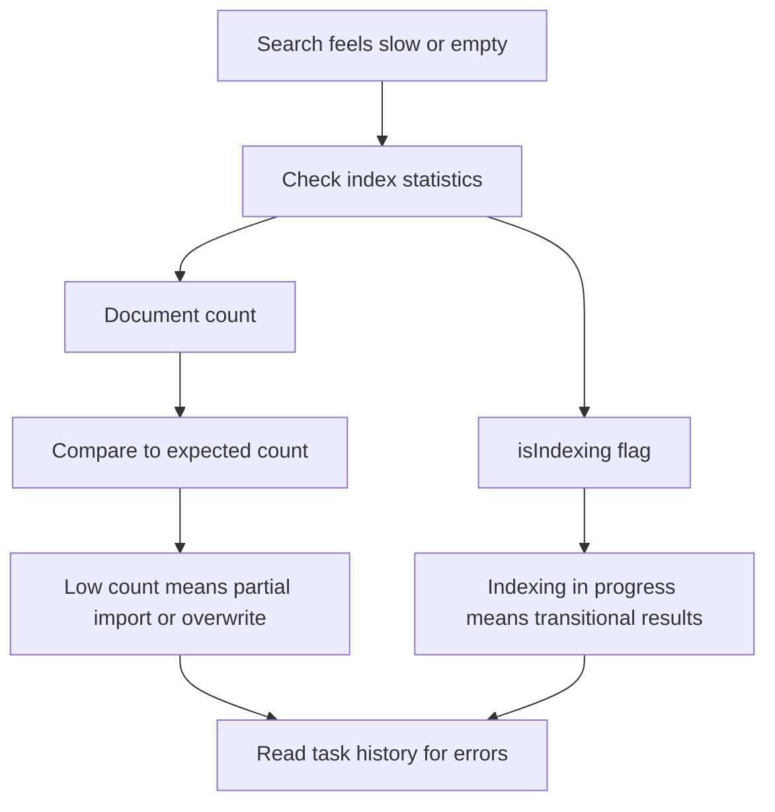

# Index Statistics and the Admin Surface: Reading the Engine's Vital Signs

## English

Every Meilisearch index exposes a statistics endpoint that reports how many documents it holds, whether it is still being indexed, and how many fields are present. These numbers look mundane but they are the cheapest diagnostic you have. If a search feels slow or returns nothing, the first question is almost always "does the index actually contain what I think it contains?" A document count that is lower than expected usually means a batch import partially failed, a primary key was misconfigured so documents overwrote each other, or a task is still queued. Checking the count takes a millisecond and rules out a whole class of bugs before you start reading logs.

The `isIndexing` flag is the second vital sign. Because writes are asynchronous — you submit a task and it is processed by a queue — there is a window where an index is being rebuilt or updated and queries may see an older or transitional state. Knowing whether indexing is currently in progress explains otherwise baffling behaviour: results that change between two identical requests, or a newly added document that does not appear yet. Rather than guessing, you read the flag, and if it is true you know to either wait or to accept that you are querying a snapshot in motion.

Beyond counts, the admin surface includes endpoints for listing indexes, inspecting settings, and reading the task history. The task history is the closest thing Meilisearch has to an audit log: every write, settings change, dump, or snapshot is a task with an identifier, a status, and a timestamp. When something goes wrong, the task list tells you what was attempted and in what order. A failed task carries an error payload explaining why — an invalid filter, a malformed document, an unknown attribute. Learning to read that list fluently is the single biggest productivity gain for anyone operating an instance.

It helps to think of the admin surface as three concentric rings. The innermost ring is per-index statistics: how big, how busy, how many fields. The middle ring is the task queue: what happened recently and did it succeed. The outer ring is instance-level health and version information: is the process alive, what version is running, are experimental features enabled. When debugging, work from the inside out — check the index first, then the tasks that shaped it, then the instance that hosts it. Most problems are solved in the first two rings.

A subtle but important point is that these endpoints are cheap and safe to poll, which makes them suitable for dashboards and alerts. A monitoring loop that samples document counts and task failure rates will catch a broken import pipeline long before a user complains. The cost of not watching is that failures are silent: an import script that writes zero documents because of a schema mismatch exits successfully, and nobody notices until search results are empty. Treat the statistics endpoint as a smoke test you run after every deployment, and treat task failures as an alert-worthy signal rather than something to inspect only when things break.

## 中文

每個 Meilisearch 索引都有一個統計端點，回報它容納多少文件、是否仍在索引中，以及存在多少欄位。這些數字看似平凡，卻是你手上最便宜的診斷工具。如果搜尋感覺慢或傳回空結果，第一個問題幾乎總是「索引是否真的包含我以為它包含的東西？」文件數低於預期，通常意味著批次匯入部分失敗、主鍵設定錯誤導致文件互相覆寫，或某個任務仍在排隊。檢查數量只需一毫秒，卻能在你開始讀日誌之前排除一整類錯誤。

`isIndexing` 旗標是第二個生命徵象。由於寫入是非同步的——你提交任務，由佇列處理——所以存在一個窗口，索引正在重建或更新，查詢可能看到較舊或過渡狀態。知道索引目前是否正在進行，能解釋許多原本令人費解的行為：兩個相同請求之間結果改變，或新加入的文件尚未出現。與其猜測，你讀這個旗標；若為真，你就知道要麼等待，要麼接受你正在查詢一個變動中的快照。

除了計數，管理介面還包括列出索引、檢視設定、讀取任務歷史的端點。任務歷史是 Meilisearch 最接近稽核日誌的東西：每次寫入、設定變更、傾印或快照都是一個任務，帶有識別碼、狀態與時間戳。出錯時，任務清單告訴你嘗試了什麼、順序如何。失敗的任務附帶錯誤酬載，解釋原因——無效的篩選、格式錯誤的文件、未知的屬性。學會流暢閱讀那份清單，是任何操作實例的人最大的生產力提升。

把管理介面想成三個同心圓會有幫助。最內圈是每個索引的統計：多大、多忙、多少欄位。中圈是任務佇列：最近發生了什麼、成功了沒有。外圈是實例層級的健康與版本資訊：行程是否存活、執行哪個版本、是否啟用實驗性功能。除錯時由內而外——先查索引，再查塑造它的任務，最後查承載它的實例。大多數問題在前兩圈就解決了。

一個細微但重要的點：這些端點便宜且可安全輪詢，因此適合儀表板與告警。一個定期取樣文件數與任務失敗率的監控迴圈，會遠在用戶抱怨之前就抓到中斷的匯入管線。不監控的代價是失敗是靜默的：一個因結構描述不符而寫入零文件的匯入腳本會成功結束，直到搜尋結果空白才有人發現。把統計端點當作每次部署後執行的煙霧測試，並把任務失敗視為值得告警的訊號，而不是只有出事時才去檢視的東西。

## Key Takeaway

Index statistics and the task history are cheap, always-available diagnostics that catch silent pipeline failures before users ever notice.

## Related Concepts
- The task queue as the source of truth for writes
- The health endpoint and runtime signals

## Diagram

