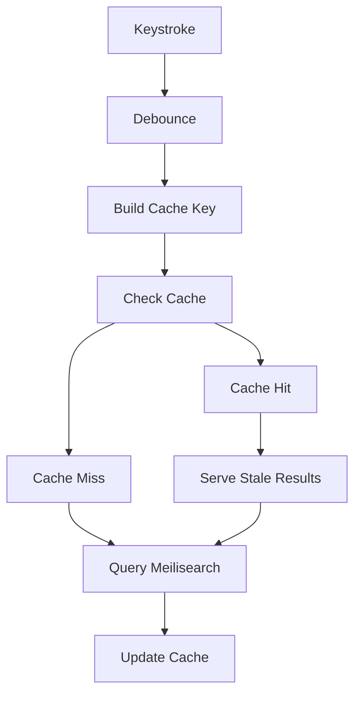

# Search Result Caching Strategy: What to Cache, What to Skip, and Why Invalidation Is the Hard Part

## English

Instant search produces a lot of queries. A user typing "wireless headphones" at human speed may fire eight or ten requests as each keystroke lands, and on a busy site that multiplies into a serious load. Caching is the obvious answer, but search caching is trickier than caching a static page because the same URL can return different results depending on filters, sort order, and per-query parameters. The first design decision is the cache key: it must include everything that can change the response — the query string, the filter expression, the sort, the pagination offset and limit, and any per-query overrides. Miss one of these and you will serve a filtered result to a user who expected the unfiltered one, which is worse than being slow.

The second decision is what to cache at all. Prefix queries are the most valuable to cache because they are the most frequent: every intermediate state of a typed word is a request, and the first two or three characters are shared across enormous numbers of users. A short-lived cache — measured in seconds, not hours — for prefix queries absorbs the burst of typing without risking staleness. Full-word queries are less frequent and more likely to be personalised, so they benefit less. Long-tail queries that appear once are pure overhead to cache; the eviction cost exceeds the hit rate.

Client-side caching deserves equal attention. Because the browser already has the results for "wire", when the user types "wired" you could show the previous results instantly while the new request is in flight, then swap in the fresh data. This is the "stale-while-revalidate" pattern and it is what makes instant search feel instantaneous even on a slow connection. Combined with debouncing — waiting a short interval after the last keystroke before firing the request — you cut the number of requests dramatically while keeping the UI responsive. Debounce and cache solve different halves of the problem: debounce reduces how many requests you send, cache reduces how many you have to actually compute.

The genuinely hard part is invalidation. Search results are derived from the index, and the index changes whenever a document is written. A cache entry that was correct a minute ago may be wrong now. There is no magic signal from Meilisearch that says "this cached query is stale"; you have to reason about it. The pragmatic approach is to keep cache lifetimes short enough that staleness is bounded and acceptable, and to flush aggressively around known write events — after a bulk import task completes, after a settings change, after a document update. If your application knows it just changed the corpus, it should say so.

Finally, be honest about when caching is not worth it. A small catalogue with a handful of queries per second does not need a cache at all; adding one introduces a whole new failure mode (stale results) in exchange for latency savings nobody will notice. Caching pays off when query volume is high, when the same queries repeat, and when the corpus is relatively stable. Measure first: log query frequency and hit rates, and let the data tell you whether a cache is buying you anything or just adding a moving part that can break.

## 中文

即時搜尋會產生大量查詢。使用者以人類速度打「wireless headphones」，每個按鍵落下時可能發出八到十個請求，在繁忙網站上這會放大成嚴重負載。快取是顯而易見的答案，但搜尋快取比快取靜態頁面棘手，因為同一個 URL 可能因篩選、排序與每次查詢引數而回傳不同結果。第一個設計決定是快取鍵：它必須包含所有能改變回應的東西——查詢字串、篩選表示式、排序、分頁位移與上限，以及任何每次查詢覆寫。漏掉其中一項，你就會把篩選後的結果送給期待未篩選結果的使用者，那比慢更糟。

第二個決定是什麼值得快取。字首查詢最值得快取，因為它們最頻繁：一個被打字的每個中間狀態都是一個請求，而頭兩三個字元被大量使用者共享。對字首查詢使用短生命週期快取——以秒計，而非小時——能吸收打字的爆量而不冒過時風險。完整字詞查詢較不頻繁，也更可能個人化，所以受益較少。只出現一次的長尾查詢純屬快取開銷；淘汰成本超過命中率。

客戶端快取同樣值得注意。因為瀏覽器已有「wire」的結果，當使用者打「wired」時，你可以在新請求在途時先即時顯示舊結果，然後換上新資料。這就是「stale-while-revalidate」模式，也是讓即時搜尋在慢連線下仍感覺瞬時的原因。配合去抖動——在最後一次按鍵後等待一小段時間才發出請求——你能大幅削減請求數，同時保持 UI 靈敏。去抖動與快取解決問題的兩半：去抖動減少你送出的請求數，快取減少你真正需要計算的次數。

真正困難的部分是失效。搜尋結果衍生自索引，而索引在每次寫入檔案時改變。一分鐘前正確的快取專案現在可能錯了。Meilisearch 不會神奇地發出「這個快取查詢已過時」的訊號；你必須自己推理。務實做法是把快取生命週期保持得夠短，使過時有界且可接受，並在已知寫入事件前後積極清除——批次匯入任務完成後、設定變更後、檔案更新後。如果你的應用程式知道自己剛改變了語料，它就應該說出來。

最後，誠實面對何時不值得快取。一個每秒只有少量查詢的小目錄根本不需要快取；加一個只會引入全新的失敗模式（過時結果），換取沒有人會注意到的延遲節省。快取在查詢量大、相同查詢重複、語料相對穩定時才划算。先量測：記錄查詢頻率與命中率，讓資料告訴你快取是在幫你，還是隻是多了一個會壞的活動零件。

## Key Takeaway

Cache prefix queries behind a complete cache key with short lifetimes, and treat invalidation around write events as the real design problem.

## Related Concepts
- Client-side caching and debouncing
- Consistency guarantees: why a write is not visible immediately

## Diagram

