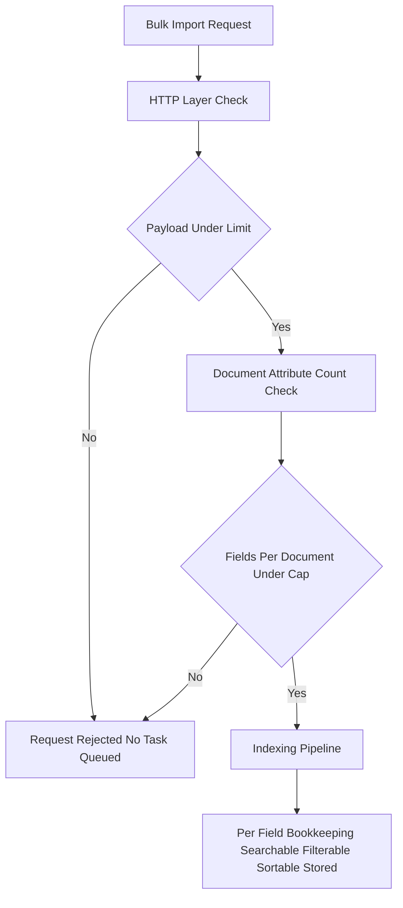

# The Engine's Limits: Document Size, Attribute Count, and Payload Ceilings

## English

Meilisearch is fast partly because it makes assumptions about how big a document can be, and those assumptions show up as hard limits you can hit without warning. The HTTP layer accepts request bodies up to a configurable maximum (the `MEILI_HTTP_PAYLOAD_SIZE_LIMIT` environment variable, defaulting to 100 MB in recent versions), and the engine also caps the number of attributes a single document can carry — historically 65,535 fields per document. These numbers sound enormous until you remember that a single bulk import can contain thousands of documents, so the practical ceiling is usually the payload limit, not the per-document one. If you push a 120 MB batch, the request fails at the HTTP layer before any indexing work begins, and the task never reaches the queue.

The deeper issue is that these limits are not just about bytes; they are about the shape of the work. Every field in a document becomes a candidate for indexing, and the engine builds internal structures per attribute. A document with 500 fields where 490 are unused metadata is not merely wasteful — it multiplies the amount of bookkeeping the indexing pipeline performs for every single record. The engine has to decide whether each field is searchable, filterable, sortable, or merely stored, and that decision tree runs per field per document. A million documents with 500 fields each is half a billion field decisions, versus a million documents with 10 fields each being ten million decisions. The difference between those two workloads is the difference between an import that finishes in seconds and one that crawls.

There is also a subtler ceiling: individual field values. Very long text fields (say, a full book chapter stored in one attribute) are tokenised into thousands of words, each of which must be added to the inverted index. A single 200 KB string field can generate more indexing work than a hundred small documents. The engine does not chunk this for you; it treats the field as one unit. If you genuinely need to search long-form content, the usual pattern is to split it into paragraph-level documents with a parent reference, so that each indexed unit stays small and relevance scoring stays meaningful. A giant blob field also degrades relevance, because term frequency within that field dominates the ranking signal.

Attribute count interacts with the admin surface in a way that surprises people. The index settings list attributes explicitly — searchable attributes, filterable attributes, sortable attributes — and each list must be maintained as documents evolve. If your documents gain a new field, the field is stored but not searchable until you add it to `searchableAttributes`. If you have hundreds of fields, that settings document becomes a maintenance burden in itself, and every change to it triggers a settings task that may require reindexing. Keeping the document schema lean is therefore not just a performance optimisation but a way to keep the settings surface small enough that humans can reason about it.

Practical guidance: measure the actual byte size of your largest realistic batch before importing, not the average; keep documents under a few kilobytes where possible; avoid storing large binary blobs or HTML dumps in indexed fields (pre-process them into plain text first); and treat the field count as a design budget. If a document needs more than a few dozen fields, ask whether it should be split into a parent record plus child records, or whether some fields belong in a separate index that you join at query time. The engine will not stop you from building a fat schema, but it will make you pay for it in indexing throughput, memory, and relevance quality.

## 中文

Meilisearch 之所以快，部分原因是它對「一份文件可以有多大」做了假設，而這些假設會以硬性上限的形式出現，你有可能在毫無預警的情況下撞上。HTTP 層接受請求本體的大小有可設定的上限（環境變數 `MEILI_HTTP_PAYLOAD_SIZE_LIMIT`，近版本預設約 100 MB），而引擎本身亦限制單一文件可攜帶的屬性數量——歷來是每份文件 65,535 個欄位。這些數字聽起來大得荒謬，但你要記得一次批量匯入可以包含數千份文件，所以實際的天花板通常是請求本體上限，而不是每份文件的上限。如果你送出 120 MB 的一批，請求會在 HTTP 層就被拒絕，任何索引工作都未開始，任務也從未進入佇列。

更深的問題是：這些上限不只是位元組數的問題，而是工作形狀的問題。文件裡每一個欄位都會成為索引的候選，引擎會為每個屬性建立內部結構。一份有 500 個欄位、其中 490 個是無用中繼資料的文件，不只是浪費——它會令索引管線對每一筆記錄所做的簿記工作倍增。引擎要判斷每個欄位是可供搜尋、可過濾、可排序，還是僅僅儲存，而這個決策樹是逐欄位、逐文件地跑的。一百萬份各 500 欄位的文件，就是五億次欄位決策；一百萬份各 10 欄位的文件，則是一千萬次。這兩種工作量的差別，就是「幾秒完成匯入」與「龜速爬行」的差別。

還有一個更隱蔽的上限：個別欄位的值。極長文字欄位（例如把整章書存成一個屬性）會被切詞成數千個詞，每個詞都要加進倒排索引。單一個 200 KB 的字串欄位，可以產生比一百份小文件更多的索引工作。引擎不會替你分塊，它把該欄位當作一個單位處理。如果你真的需要搜尋長篇內容，慣常做法是把它切成段落級的文件，並附上父記錄參照，令每個被索引的單位保持細小、相關性評分保持有意義。一個巨型的 blob 欄位亦會拖低相關性，因為該欄位內的詞頻會主導排名訊號。

屬性數量與管理介面的互動方式亦常令人意外。索引設定會明確列出屬性——可搜尋屬性、可過濾屬性、可排序屬性——而每個清單都要隨文件演變而維護。如果文件新增了欄位，該欄位會被儲存，但在你把它加入 `searchableAttributes` 之前並不可搜尋。如果你有數百個欄位，那份設定文件本身就變成維護負擔，而每次改動都會觸發一個設定任務，可能需要重新索引。因此保持文件結構精簡不只是效能優化，也是讓設定面小到人類可以推理的程度。

實務建議：匯入前量度你最真實的最大批次位元組大小，而不是平均值；盡量讓文件保持在數 KB 以內；避免在索引欄位中存放大型二進位 blob 或 HTML 原文（先預處理成純文字）；並把欄位數量視為設計預算。如果一份文件需要超過幾十個欄位，問問自己是否應拆成父記錄加子記錄，或者某些欄位是否應放在另一個索引、在查詢時才連接。引擎不會阻止你建立肥大的結構，但它會要你在索引吞吐量、記憶體與相關性質素上付出代價。

## Key Takeaway

Meilisearch's payload and attribute ceilings are not arbitrary limits but signals of work shape: keep documents small and schemas lean, because every field and every token costs indexing throughput, memory, and relevance.

## Related Concepts
- Document Size and Field Explosion
- Batch Import Strategies

## Diagram

