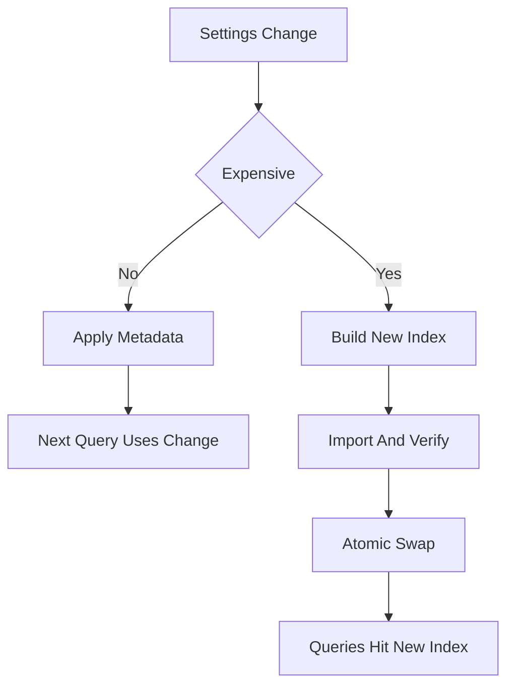

# Rebuilding Relevance Safely: Reindexing, Swaps, and the Cost of Changing Your Mind

## English

Every search engine has a category of change that cannot be applied in place: a change to how documents are tokenised, to the primary key, or to the fundamental structure of the index. In Meilisearch, most settings changes are cheap (they update metadata and take effect on the next query), but some are expensive because they require rebuilding the underlying index structures for every document. Knowing which is which is the difference between a two-second settings update and a two-hour maintenance window. The general rule: changes that affect how text is broken into terms — tokenisation, separators, stop words, and the searchable attributes list when it changes which fields are indexed — are the expensive ones. Changes to ranking rules, synonyms, and typo tolerance settings are typically cheap, because they are applied at query time against existing structures.

The safe pattern for expensive changes is blue-green reindexing, and Meilisearch gives you a specific primitive for it: the index swap. You create a new index (say, `products_v2`) with the desired settings, import all documents into it, wait for the import task to reach `succeeded`, verify it with test queries, and then issue a swap operation that atomically exchanges the contents and settings of `products_v2` and `products` — in a single task, with no window where queries see a half-built index. The swap is atomic from the client's perspective: before the task succeeds, queries hit the old data; after, they hit the new. There is no moment where the index is empty or partially populated.

The subtlety is that the swap exchanges the two indexes' identities, so after the swap, the index named `products` contains what was in `products_v2`, and `products_v2` contains the old data. If you then want to prepare the next rebuild, you either reuse `products_v2` (after clearing it) or create a third index. This means your application code should always query the stable name (`products`), never the versioned one. Any code that hard-codes `products_v2` will silently start serving stale data after the swap. Treat the versioned index as an implementation detail of your deployment process.

A second, simpler pattern is the dump-and-restore path: export the instance with a dump, spin up a fresh instance, import the dump, and point traffic at it. This is heavier than a swap but works across versions and gives you a clean slate for upgrades. The trade-off is downtime or dual-running cost. For most teams, the swap is preferable for routine schema changes, and the dump is the right tool for version upgrades or disaster recovery. The two are complementary: swap for routine, dump for exceptional.

One more consideration: verification. Before swapping, run a fixed set of representative queries against the new index and compare the results to the old index's results. If you have relevance judgements (a set of queries with expected documents), this is where they pay off. Without them, at minimum check that document counts match, that a handful of known queries return the expected top hit, and that filters and facets still work. The swap is atomic, but it is not reversible in the sense of restoring the old state — after the swap, the old data is in the versioned index, and you can swap back, but only if you have not overwritten it. Plan the rollback before you need it.

## 中文

每個搜尋引擎都有一類無法就地套用的改動：改變文件如何被切詞、改變主鍵，或改變索引的根本結構。在 Meilisearch 中，大部分設定改動都很便宜（它們只更新中繼資料，下一次查詢就生效），但有些改動很昂貴，因為它們要為每份文件重建底層索引結構。分清楚哪些是哪種，就是「兩秒的設定更新」與「兩小時的維護窗口」之間的差別。通則：影響文字如何被切成詞的改動——切詞、分隔符、停用詞，以及當可搜尋屬性清單改變了哪些欄位被索引時——就是昂貴的那些。排名規則、同義詞、錯字容忍設定的改動通常很便宜，因為它們是在查詢時套用到既有結構上。

昂貴改動的安全模式是藍綠重新索引，而 Meilisearch 給你一個特定原語：索引交換（index swap）。你建立一個新索引（例如 `products_v2`），套用所需設定，把所有文件匯入其中，等待匯入任務到達 `succeeded`，用測試查詢驗證，然後發出交換操作，在單一任務中原子地交換 `products_v2` 與 `products` 的內容與設定——沒有任何時刻查詢會看到半建成的索引。交換從客戶端角度是原子的：任務成功之前，查詢命中舊資料；之後，命中新資料。不存在索引為空或部分填充的時刻。

微妙之處在於交換會交換兩個索引的身分，所以交換之後，名為 `products` 的索引含有原本在 `products_v2` 的東西，而 `products_v2` 則含有舊資料。如果你之後想準備下一次重建，你要麼重用 `products_v2`（先清空它），要麼建立第三個索引。這意味著你的應用程式碼應永遠查詢穩定名稱（`products`），絕不查詢帶版本的名稱。任何硬編碼 `products_v2` 的程式碼會在交換後靜默地開始提供過時資料。把帶版本的索引視為你部署流程的實作細節。

第二個較簡單的模式是 dump 與還原路徑：用 dump 匯出實例，啟動一個新實例，匯入該 dump，再把流量指向它。這比交換重，但可跨版本運作，並為升級提供乾淨的起點。代價是停機或雙跑的費用。對大多數團隊而言，例行結構改動用交換較好，版本升級或災難復原則用 dump 是正確工具。兩者互補：例行用交換，例外用 dump。

還有一點要考慮：驗證。交換之前，對新索引跑一組固定的代表性查詢，並與舊索引的結果比較。如果你有相關性判斷（一組查詢加上期望文件），這就是它們發揮作用的時候。沒有它們的話，至少檢查文件數量相符、少數已知查詢回傳預期的首位命中，以及過濾與分面仍然運作。交換是原子的，但它不是「可還原到舊狀態」意義上的可逆——交換之後舊資料在帶版本的索引裡，你可以交換回去，但前提是你沒有覆蓋它。在你需要之前就計劃好回滾。

## Key Takeaway

Separate cheap settings changes from expensive reindexing ones, and use atomic index swaps with pre-swap verification so that even a full rebuild never exposes users to an empty or half-built index.

## Related Concepts
- Index UID Naming, Swaps, and Blue-Green Reindexing
- The Dump and Snapshot Distinction

## Diagram

