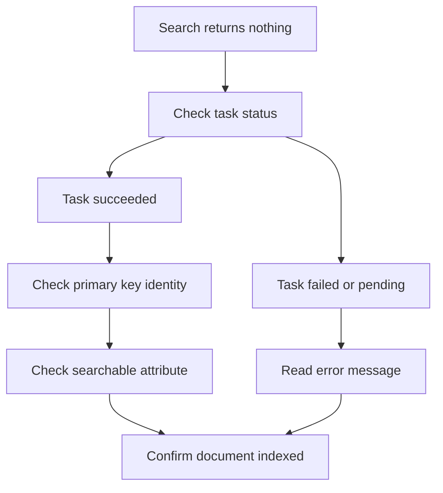

# Debugging a Search That Returns Nothing: A Diagnostic Order of Operations

## English

The most common support question in any search deployment is some variant of "this document exists, why doesn't it show up?" The answer is almost never a bug in the engine; it is a mismatch between what you think is indexed and what actually is. The productive approach is a fixed diagnostic order, from the most likely and cheapest-to-check causes to the least likely. Following the order saves you from randomly toggling settings and hoping something changes.

First, check the task, not the document. Every write in Meilisearch is a task with a status, and a task can be `enqueued`, `processing`, `succeeded`, `failed`, or `canceled`. If your import task is still processing, the document is not yet searchable — this is the consistency gap in action. If the task `failed`, the response contains an error message explaining why (a malformed document, a primary key conflict, a payload too large). Reading the task response is always step one, because it distinguishes "the write never happened" from "the write happened but search can't find it." A surprisingly large fraction of "missing document" reports are actually failed or still-pending tasks.

Second, check the primary key and document identity. If a document was added with a primary key value that collides with an existing document, it replaces it rather than adding a second one — so your "new" document may have silently overwritten an old one, or been overwritten by a later batch. Also confirm the primary key field is actually present in the document; if the engine inferred a primary key from a field you did not intend (or failed to infer one), documents may land under unexpected identifiers. Query the document by its ID directly to confirm it exists and has the field values you expect.

Third, check the searchable attributes. A field that is stored is not necessarily searchable. If `searchableAttributes` is set explicitly, only those fields are searched; a query for a term that appears only in an unlisted field returns nothing. This is the single most common cause of "the text is right there but search ignores it." The fix is a settings update, which is usually cheap, but it does not retroactively apply to documents that were never indexed for that field — check whether the settings change triggered a reindex task and whether it succeeded.

Fourth, check the query itself. Meilisearch applies typo tolerance and prefix matching, but it also applies stop words and separators, and a query consisting entirely of stop words can behave unexpectedly. Filters are another trap: a filter on a field that is not in `filterableAttributes` returns an error, but a filter on a field that is filterable but missing from the document excludes that document silently. Finally, check pagination and ranking: the document may be present but ranked below the page you are looking at. Increasing `limit` or checking the `estimatedTotalHits` field tells you whether the document is in the result set at all or merely ranked low. Working through these five checks in order — task status, document identity, searchable attributes, query and filter construction, then ranking and pagination — resolves the overwhelming majority of "missing result" cases without guesswork.

## 中文

任何搜尋部署最常見的支援問題，都是「這份文件明明存在，為何不出現？」的變體。答案幾乎從來不是引擎的 bug，而是你以為已索引的東西與實際已索引的東西之間的落差。有效的方法是固定的診斷次序，由最可能、最便宜檢查的原因，排到最不可能的原因。依序檢查可以避免你隨機切換設定、祈求有東西改變。

第一，檢查任務，而不是文件。Meilisearch 中每次寫入都是一個任務，有狀態，可以是 `enqueued`、`processing`、`succeeded`、`failed` 或 `canceled`。如果你的匯入任務仍在處理中，文件就尚未可搜尋——這就是一致性落差在起作用。如果任務 `failed`，回應會含有錯誤訊息解釋原因（文件格式錯誤、主鍵衝突、請求本體過大）。閱讀任務回應永遠是第一步，因為它區分「寫入從未發生」與「寫入發生了但搜尋找不到」。出乎意料大比例的「文件不見了」報告，其實是失敗或仍在待處理的任務。

第二，檢查主鍵與文件身分。如果一份文件以與既有文件相撞的主鍵值加入，它會取代該文件而不是新增第二份——所以你的「新」文件可能已靜默覆蓋了舊文件，或被之後的批次覆蓋。同時確認主鍵欄位確實存在於文件中；如果引擎從你無意的欄位推斷出主鍵（或推斷失敗），文件可能落在意外的識別碼之下。直接用其 ID 查詢該文件，確認它存在且欄位值如你所料。

第三，檢查可搜尋屬性。被儲存的欄位不一定可搜尋。如果 `searchableAttributes` 被明確設定，就只有那些欄位會被搜尋；查詢一個只出現在未列出欄位中的詞，會回傳空結果。這是「文字明明就在那裡但搜尋忽略它」最常見的單一原因。修法是更新設定，通常很便宜，但它不會追溯套用到從未為該欄位建立索引的文件——檢查設定改動有否觸發重新索引任務，以及該任務是否成功。

第四，檢查查詢本身。Meilisearch 會套用錯字容忍與前綴比對，但它也會套用停用詞與分隔符，而一個完全由停用詞組成的查詢可能行為異常。過濾器是另一個陷阱：對不在 `filterableAttributes` 中的欄位過濾會回傳錯誤，但對可過濾卻在文件中缺失的欄位過濾，會靜默地排除該文件。最後，檢查分頁與排名：文件可能存在，但排名低於你正在看的那一頁。增加 `limit` 或檢查 `estimatedTotalHits` 欄位，可告訴你文件究竟是否在結果集內，還是只是排名低。依序走完這五項檢查——任務狀態、文件身分、可搜尋屬性、查詢與過濾器建構，然後排名與分頁——可在無需猜測的情況下解決絕大多數「結果不見了」的個案。

## Key Takeaway

Debug missing search results in a fixed order — task status, document identity, searchable attributes, query and filter construction, then ranking and pagination — because the engine is almost never wrong, your mental model of what is indexed is.

## Related Concepts
- Reading Task Responses
- Searchable Attributes Order Is a Relevance Signal

## Diagram

