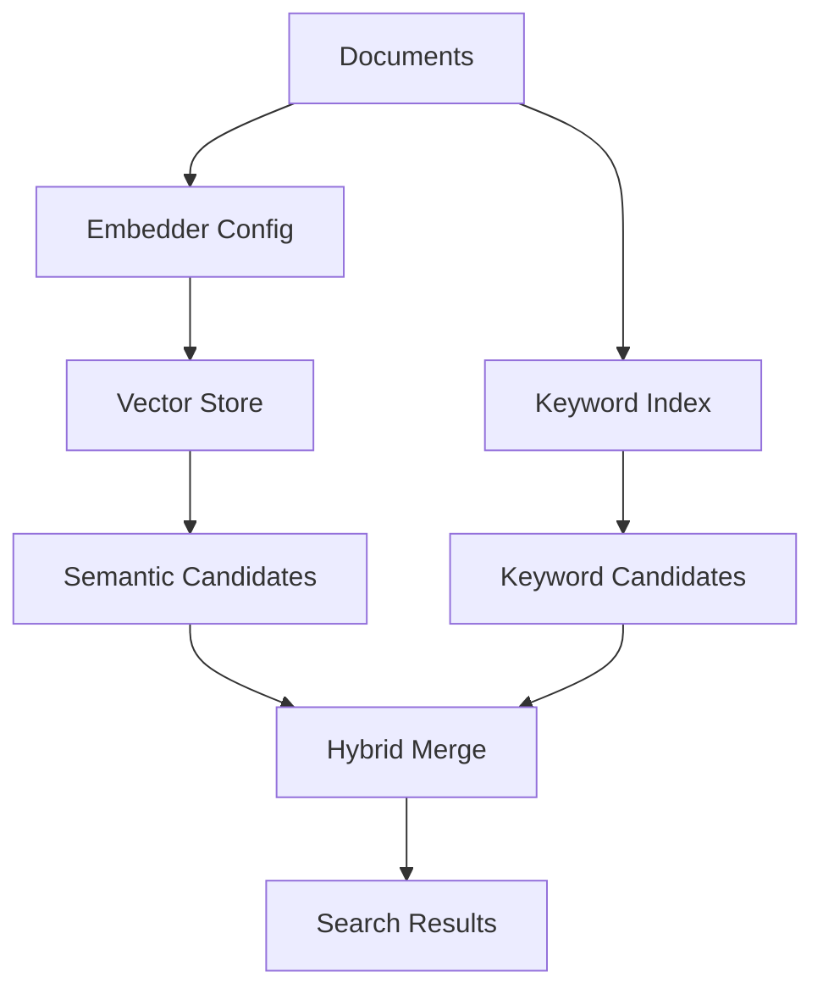

# The Vector Store Inside Meilisearch: How Embeddings Live Beside Your Documents

## English

When you enable an embedder in Meilisearch, the engine does not throw away its inverted index and become a pure vector database. Instead it keeps both structures side by side: the classic keyword index built from your documents, and a separate vector store holding one or more embeddings per document. Each embedder you configure gets its own name, its own model configuration, and its own slice of the vector store, so a single index can carry several independent semantic views of the same document set. This is why the `hybrid` search parameter exists: it is a dial that tells the engine how much weight to give the keyword side versus the semantic side when merging the two candidate lists.

The embeddings themselves are produced in one of two ways. Either you supply them yourself, by writing a reserved field (by convention `_vectors`) into each document with the arrays you computed elsewhere, or you let Meilisearch call an external embedding provider such as an OpenAI-compatible HTTP endpoint or a local model served separately. In the second case the engine batches documents, sends them out, and waits for vectors to come back before the document is considered fully indexed, which means indexing throughput is now bounded by network latency and the provider's rate limits rather than by disk speed. That is a fundamentally different performance profile from plain keyword indexing and it is the single biggest operational surprise when teams first turn on semantic search.

The vector store is not a general-purpose similarity database you can query directly. You cannot ask it for nearest neighbours of an arbitrary vector through a public route; the only way in is a search request that carries a query, which the engine then embeds (using the same embedder) and compares against stored vectors. This design keeps the API small but means that any change to the embedding model invalidates every stored vector: the numbers are only comparable if they came from the same model. Swapping models therefore requires re-embedding the whole index, which is exactly the kind of expensive, asynchronous job the task queue is built to absorb.

A practical consequence is that the cost of semantic search is paid twice. First at write time, when every document must be embedded, and again at query time, when the incoming query string must be embedded before the vector comparison can begin. That second cost is why hybrid search usually feels slower than pure keyword search even on a warm instance: there is an extra round trip to the provider on the critical path of every request. Caching query embeddings, or choosing a locally hosted model, are the two standard mitigations.

Finally, remember that the two rankings are merged, not simply concatenated. The engine takes the keyword results and the semantic results, normalises their scores, and blends them according to your hybrid ratio before applying the usual ranking rules. That means a document that ranks poorly on keywords but is semantically close can still surface, and a document that matches a keyword exactly can still be pushed down if its vector is far from the query. Tuning that blend is a relevance question, not a database question, and it deserves the same evaluation discipline as any other ranking change.

## 中文

當你在 Meilisearch 啟用 embedder（嵌入模型）時，引擎並不會丟掉倒排索引、變成純向量資料庫。它會把兩套結構並排保留：一套是由文件建立的傳統關鍵字索引，另一套是獨立的向量儲存區，為每份文件存放一或多個嵌入向量。你設定的每個 embedder 都有自己的名稱、自己的模型設定，以及向量儲存區裡自己的一塊空間，所以同一個索引可以對同一批文件同時持有幾種獨立的語意視角。這正是 `hybrid` 搜尋參數存在的原因：它是一個旋鈕，告訴引擎在合併兩份候選清單時，關鍵字那邊與語意那邊各佔多少比重。

嵌入向量本身的產生方式有兩種。其一是你自己提供：在每份文件寫入一個保留欄位（慣例上是 `_vectors`），放入你在別處算好的陣列。其二是讓 Meilisearch 呼叫外部嵌入服務，例如相容於 OpenAI 的 HTTP 端點，或另外架設的本機模型。第二種情況下，引擎會把文件分批送出、等待向量回傳，之後該文件才算完成索引，這意味著索引吞吐量現在受制於網路延遲與服務商的速率限制，而不是磁碟速度。這與純關鍵字索引的效能特性截然不同，也是團隊第一次開啟語意搜尋時最大的營運意外。

向量儲存區並不是你能直接查詢的通用相似度資料庫。你不能透過公開路由拿一個任意向量去問最近鄰；唯一的入口是帶有查詢字串的搜尋請求，引擎會用同一個 embedder 把查詢也嵌入，再與已儲存的向量比對。這個設計讓 API 保持精簡，但也意味著只要更換嵌入模型，所有已儲存的向量就全部失效：數字只有在來自同一個模型時才可比較。因此換模型等於要把整個索引重新嵌入，而這正是任務佇列擅長吸收的那種昂貴、非同步的工作。

實際後果是語意搜尋的成本要付兩次。第一次在寫入時，每份文件都必須被嵌入；第二次在查詢時，進來的查詢字串也必須先被嵌入，向量比對才能開始。第二項成本正是混合搜尋即使實例已預熱、通常仍比純關鍵字搜尋慢的原因：每個請求的關鍵路徑上都多了一趟往返服務商的行程。快取查詢的嵌入向量，或改用本機託管的模型，是兩種標準的緩解方法。

最後要記住，兩邊的排名是混合而非單純串接。引擎會取得關鍵字結果與語意結果，把分數正規化，再依你的混合比例調和，之後才套用平常的排名規則。也就是說，關鍵字排名很差但語意上很接近的文件仍可能浮上來；而關鍵字完全命中的文件，若向量與查詢相距很遠，也可能被壓下去。調整這個混合比例是相關性問題，不是資料庫問題，值得用與其他排名改動同等的評估紀律來對待。

## Key Takeaway

Enabling an embedder adds a second, separately-maintained vector store alongside the keyword index, and its cost is paid both when documents are written and on every query.

## Related Concepts
- Embedding model compatibility and re-embedding
- Hybrid search score blending

## Diagram

