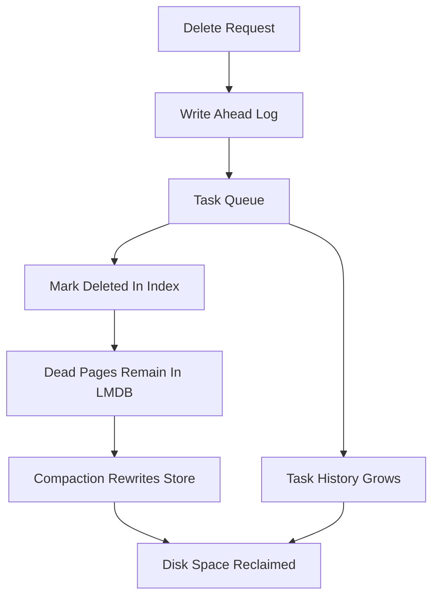

# Soft Deletion, Compaction, and Why Your Disk Does Not Shrink After a Delete

## English

Deleting a document in Meilisearch feels instantaneous, but almost nothing physical happens at the moment you send the request. The engine appends a record to its write-ahead log, hands the work to the task queue, and when the task is processed it marks the document as deleted in the index structures rather than rewriting them in place. The underlying storage engine, LMDB, is a copy-on-write B-tree: pages are never modified in place, new pages are written and the old ones are simply no longer referenced. That is what makes readers and writers able to proceed without blocking each other, and it is also why a delete is cheap to perform but does not immediately return space to the operating system.

Instead, the space is reclaimed by compaction. Over time the database accumulates pages that are no longer reachable from any live root: old versions of documents, superseded index entries, vectors from a replaced embedder. The engine periodically rewrites and compacts the store, copying live data forward and dropping dead pages, which is when the file on disk actually shrinks. This is why an instance that has absorbed millions of updates and deletes can occupy far more disk than the size of its current document set suggests, and why that number can drop noticeably after the engine has had time to tidy up.

A second layer of the same effect lives in the task queue itself. Every write, every settings change, every deletion becomes a task with a status, timestamps, and often the original payload, all retained for a configurable period so you can inspect what happened. If you are importing in many small batches, the task history can dwarf the index. The engine exposes a way to trim or delete finished tasks, and doing so regularly is one of the simplest ways to keep an instance lean. Ignoring it is a common cause of mysterious disk growth on otherwise quiet deployments.

There is a related trap with the document count and index statistics. Because deletion is logical first and physical later, the reported number of documents and the reported disk usage can disagree with your intuition for a while. When you need to be certain that space has been released, the honest test is to look at the file size after compaction has run, not immediately after the delete task reports success. Treating those two moments as the same thing leads to false alarms and unnecessary reindexing.

The practical lesson is to plan disk capacity for churn, not just for the steady-state corpus. A workload that rewrites every document daily needs headroom for the dead pages that accumulate between compactions, on top of the live data. If disk is tight, the levers are: batch your writes so fewer task records are created, prune finished tasks, avoid gratuitous settings changes that trigger reindexing, and give the engine room to compact rather than restarting it constantly, since a restart does not by itself reclaim anything.

## 中文

在 Meilisearch 刪除一份檔案感覺是瞬間完成的，但你送出請求的那一刻，幾乎沒有發生任何實體動作。引擎先把一筆記錄附加到它的預寫日誌（write-ahead log），把工作交給任務佇列，等到任務被處理時，它是在索引結構中把檔案標記為已刪除，而不是就地改寫那些結構。底層儲存引擎 LMDB 是一棵寫時複製（copy-on-write）的 B 樹：頁面從不就地修改，而是寫入新頁面、舊頁面從此不再被引用。這正是讀者與寫者能夠互不阻塞地推進的原因，也是刪除執行起來便宜、卻不會立刻把空間還給作業系統的原因。

這些空間是靠壓實（compaction）回收的。隨著時間過去，資料庫會累積一些從任何現存根節點都無法到達的頁面：檔案的舊版本、被取代的索引條目、被換掉的 embedder 留下的向量。引擎會定期重寫並壓實儲存區，把存活資料往前搬、丟掉死頁面，磁碟上的檔案才真正縮小。這就是為什麼一個經歷過數百萬次更新與刪除的例項，佔用的磁碟可能遠多於它目前檔案集的規模，也解釋了為什麼在引擎有時間整理之後，那個數字會明顯下降。

同樣效應還有第二層，就在任務佇列本身。每一次寫入、每一次設定變更、每一次刪除都會變成一筆任務，帶有狀態、時間戳，往往還有原始負載，全部保留一段可設定的時間，好讓你事後追查發生了什麼。如果你用許多小批次匯入，任務歷史可以比索引本身還龐大。引擎提供了修剪或刪除已完成任務的方法，定期這樣做是讓例項保持精瘦最簡單的手段之一。忽略它，是安靜的部署上莫名磁碟成長的常見原因。

還有一個相關的陷阱，關於檔案數與索引統計。因為刪除先邏輯、後實體，回報的檔案數與回報的磁碟用量，會有一段時間與你的直覺不一致。當你需要確定空間真的釋放了，誠實的測試是在壓實跑過之後看檔案大小，而不是在刪除任務回報成功之後立刻看。把這兩個時刻當成同一件事，會導致假警報與不必要的重建索引。

實務上的教訓是：規劃磁碟容量時要為翻攪（churn）留空間，而不只是為穩定狀態的語料留空間。每天重寫每份檔案的工作負載，除了存活資料之外，還需要為兩次壓實之間累積的死頁面預留餘裕。如果磁碟吃緊，可用的槓桿是：把寫入批次化以減少任務記錄、修剪已完成的任務、避免無謂的設定變更觸發重建索引，以及給引擎壓實的空間而不是不停地重啟它，因為重啟本身並不會回收任何東西。

## Key Takeaway

Deletes and updates are logical first and physical later, so disk usage only falls after compaction and task-history pruning, not when the delete task reports success.

## Related Concepts
- Copy-on-write storage and LMDB
- Task history retention and pruning

## Diagram

