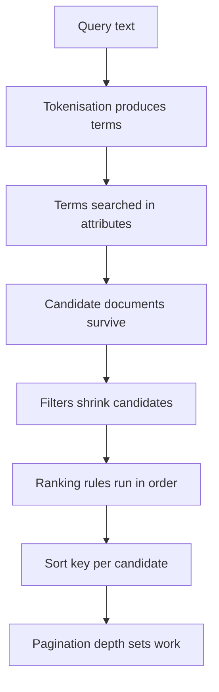

# Query-Time Cost Model: What Actually Makes a Search Request Expensive

## English

Two search requests can look identical in the URL bar and differ by an order of magnitude in cost. Building an intuition for where the time goes lets you make sensible trade-offs without profiling every change. The main cost centres are: how many terms the query produces after tokenisation, how many attributes those terms are searched in, how many candidates survive into ranking, and how much work each ranking rule must do over those candidates.

Start with the query itself. A one-word prefix query is cheap because the engine walks a narrow slice of the term dictionary. A long natural-language query expands into many terms, each of which must be looked up, and if you have not restricted `searchableAttributes` the engine searches every text field. Reducing the searchable set to the two or three fields that genuinely matter is often the single largest win available, and it costs nothing at write time. Similarly, a query that is mostly stop words or punctuation produces few useful terms and should be fast; if it is not, something else is dominating.

Next is candidate volume. Filters are applied early and cheaply, so a selective filter is your best friend: it shrinks the set of documents that ranking ever has to touch. A query with no filter over a large index can pull a huge candidate set into the ranking phase. This is also why deep pagination is expensive: asking for page fifty forces the engine to rank far more candidates than asking for page one, even though both return the same number of hits. If users rarely go past the first few pages, capping the reachable depth is a legitimate design decision.

Ranking rules then run in order over the surviving candidates, and each rule must compute a sort key for every candidate it considers. Rules that depend on textual proximity or attribute position are more expensive per document than a simple numeric comparison. A long list of custom rules, each requiring a per-document computation, multiplies that work. The engine is generally smart about not evaluating later rules when earlier ones already fully determine the order, but a query where the top rule leaves many ties will push work down the chain.

Finally, response shaping costs something too: highlighting and cropping require the engine to locate matched terms inside the original text and extract windows around them, which is real work per hit. Requesting a large number of hits with highlighting enabled is measurably heavier than the same request without it. The general principle is that every knob you turn on adds per-hit or per-candidate work, so the cheapest request is the one that asks for exactly what the interface will display, over exactly the fields that matter, with filters that narrow the candidate set before ranking begins.

## 中文

兩個搜尋請求在網址列上看起來一模一樣，成本卻可能相差一個數量級。建立「時間花在哪裡」的直覺，能讓你在不必為每次改動做效能剖析的情況下做出合理取捨。主要的成本中心有四個：查詢經過分詞後產生多少詞項、這些詞項要在多少個屬性裡搜尋、有多少候選文件能存活到排名階段，以及每條排名規則必須在這些候選上做多少工作。

先從查詢本身說起。單一詞的前綴查詢很便宜，因為引擎只走詞典中很窄的一片。冗長的自然語言查詢會展開成許多詞項，每個都要查一次；而如果你沒有收窄 `searchableAttributes`，引擎會搜尋每一個文字欄位。把可搜尋欄位縮到真正重要的兩三個，往往是現成最大的一筆節省，而且它在寫入時毫無成本。同樣地，一個幾乎全是停用詞或標點符號的查詢，產生不了幾個有用詞項，本應很快；如果並不快，那就是別的東西在主宰成本。

接著是候選量。過濾條件會很早、很便宜地套用，所以選擇性高的過濾條件是你最好的朋友：它縮小排名階段必須觸碰的文件集合。在大索引上一個沒有過濾條件的查詢，可能把龐大的候選集拉進排名階段。這也是深分頁昂貴的原因：要求第五十頁，會迫使引擎排名遠多於要求第一頁時的候選，即使兩者回傳的命中數相同。如果使用者很少翻過前幾頁，把可達深度封頂是合理的設計決定。

然後排名規則依序在存活的候選上執行，每條規則都必須為它考慮的每份候選計算一個排序鍵。依賴文字鄰近度或屬性位置的規則，每份文件的成本高於單純的數值比較。一長串各自需要逐文件計算的自訂規則，會把這份工作乘大。引擎通常很聰明，當前幾條規則已完全決定順序時就不評估後面的規則，但如果查詢讓第一條規則留下大量並列，工作就會往後面的鏈條推。

最後，回應的塑形本身也有成本：醒目標示（highlighting）與裁切（cropping）要求引擎在原始文字中定位命中的詞並截取周圍的視窗，這是每筆命中都要做的實質工作。要求大量命中又開啟醒目標示，會比同樣請求不開時明顯更重。通則就是：你打開的每個旋鈕都會增加逐命中或逐候選的工作量，所以最便宜的請求，是那個只要求介面真正要顯示的內容、只針對真正重要的欄位、並在排名開始前就用過濾條件收窄候選集的請求。

## Key Takeaway

Search cost is driven by query term count, searchable-attribute breadth, candidate volume after filtering, and per-hit shaping work, so narrowing those is the cheapest optimisation available.

## Related Concepts
- Searchable attribute scoping
- Deep pagination cost

## Diagram

